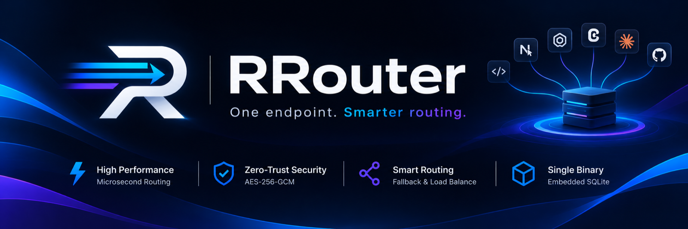

# RRouter

**One endpoint for every model, in one Rust binary.**

RRouter is a self-hosted AI gateway. Point Cursor, Cline, Codex CLI, Aider, or your own
backend at it, and it routes each request to whichever account you configured — translating
between the OpenAI Chat, OpenAI Responses, and Anthropic Messages protocols on the way in
and out.

No Node runtime, no Redis, no external database, no telemetry. SQLite, the encryption key
material, and the dashboard all live inside the binary and the data directory.

- **Single binary, embedded storage.** SQLite is compiled in; the dashboard is compiled in.
- **Protocol translation, not a proxy.** Anthropic clients can talk to a Codex account, and
  OpenAI clients get OpenAI-shaped streams back.
- **Account failover.** Rate-limited or broken accounts are skipped; a circuit breaker takes
  them out of rotation and half-opens to probe recovery.
- **Secrets stay secret.** Credentials are AES-256-GCM at rest; gateway keys are stored as
  SHA-256 hashes and printed once.
- **A real model registry.** Model lists, capabilities, and limits converge from the catalog,
  the provider's own `/models` endpoint, and [models.dev](https://models.dev).

---

## Install

One line, any Linux or macOS host — the script resolves the latest release for your
OS/architecture, verifies its SHA-256, and installs to `/usr/local/bin` (or
`~/.local/bin` when that is not writable):

```sh
curl -fsSL https://raw.githubusercontent.com/centopw/RRouter/main/install.sh | sh
```

```sh
# pin a version / choose a directory
RROUTER_VERSION=v0.1.0 RROUTER_INSTALL_DIR="$HOME/bin" \
  sh -c "$(curl -fsSL https://raw.githubusercontent.com/centopw/RRouter/main/install.sh)"

# see what it would do
RROUTER_DRY_RUN=1 curl -fsSL https://raw.githubusercontent.com/centopw/RRouter/main/install.sh | sh
```

## Quick start

From source:

```sh
git clone https://github.com/centopw/RRouter && cd RRouter
cargo build --release
./target/release/rrouter
# listening on http://127.0.0.1:20128
```

Open <http://127.0.0.1:20128> — it redirects to the dashboard at `/app`. Add a provider:
sign in with a Claude/ChatGPT/Copilot subscription, or paste an API key. Then create a
gateway key under **API Keys** and point a client at the gateway.

```sh
# Anthropic-shaped client
export ANTHROPIC_BASE_URL=http://127.0.0.1:20128
export ANTHROPIC_AUTH_TOKEN=sk-rr-...

# OpenAI-shaped client
curl -s localhost:20128/v1/chat/completions \
  -H "Authorization: Bearer sk-rr-..." \
  -H "Content-Type: application/json" \
  -d '{"model":"codex/gpt-5.6-luna","messages":[{"role":"user","content":"ping"}]}'
```

The same traffic can be sent as `/v1/messages` or `/v1/responses`; the model string decides
where it goes, not the protocol.

## Endpoints

| Path | Dialect |
| --- | --- |
| `POST /v1/chat/completions` | OpenAI Chat Completions |
| `POST /v1/responses` | OpenAI Responses (Codex-style) |
| `POST /v1/messages` | Anthropic Messages |
| `POST /v1/embeddings` | OpenAI Embeddings |
| `GET /v1/models` | catalog + upstream + custom models |
| `GET/POST /api/*` | admin: providers, keys, models, aliases, combos, usage |

`/v1/responses/compact` and `/v1/messages/count_tokens` are deliberately unimplemented and
answer `501` rather than pretending.

Usage reads are windowed and aggregated in SQL, so the dashboard never pages through events:

| Query | Answers |
| --- | --- |
| `GET /api/usage?hours=&limit=` | the request log: one row per request with id, endpoint, tokens, cache, latency, status |
| `GET /api/usage/series?hours=&bucket=5m\|hour\|day` | one row per time bucket (requests, errors, tokens, cache, avg latency) |
| `GET /api/usage/series?by=model` | the same buckets split per model, for the stacked traffic chart |
| `GET /api/usage/summary?hours=` | per-model totals for the window; omit `hours` for all time |

## Routing

- **`provider/model`** — `openai/gpt-4.1`, `claude/sonnet-4-5`, `codex/gpt-5.6-luna`.
- **Aliases** — give a model a stable internal name (`prod-default`) so clients never change.
- **Combos** — an ordered fallback chain; the next candidate is tried when a provider fails.

Candidates are ordered by account priority, skipping providers with no active connection and
accounts inside their circuit breaker. A 429 backs the account off exponentially, honouring
`Retry-After`; a 5xx opens the breaker, and a half-open probe brings it back.

## Providers

| Kind | Providers |
| --- | --- |
| Subscription sign-in (OAuth) | Claude, Codex (ChatGPT), GitHub Copilot |
| API key | OpenAI, Anthropic, Google Gemini, DeepSeek, Groq, OpenRouter, xAI, Mistral, Together, Cerebras |
| Local / custom | Ollama, or anything reachable through `base_url_override` |

OAuth tokens refresh ahead of expiry with a per-account lock, so concurrent requests never
race two refreshes and invalidate the session.

## Models

**Models** in the dashboard is the registry behind `/v1/models`, and it lists exactly one
thing: **what this gateway can call right now** — models belonging to providers you have
connected. Disconnect the last account and the list is empty.

- **Provider lists** — adding a provider fetches that provider's own `/models` endpoint in
  the background; the Fetch button re-runs it. Codex cannot enumerate, so its five verified
  ids come from the built-in catalog.
- **Sync from models.dev** — metadata only. One button (plus a daily refresh) fills in
  context window, output cap, capabilities (vision, pdf, audio, tools, reasoning), and price
  per million tokens. It never adds a model to the list.
- **Custom models** — define any id with limits, capabilities, and price for providers that
  do not publish a list; custom rows win over everything and survive syncs.
- **Test** — a real 16-token completion through the same planner, dispatcher, and
  reassembly path a client uses, so a green result means what it says.

Every place the dashboard asks for a model is a select grouped by provider — no free-text
model fields, so a typo cannot silently route to nothing.

## Prompt caching

Caching is what makes agentic coding affordable, and a gateway can silently destroy it in
two ways. RRouter avoids both:

- **Same-dialect requests are forwarded as the client wrote them.** Only routing fields are
  patched (the resolved model id, streaming, `store:false` for Codex, a bare-string
  `input`). Anthropic `cache_control` breakpoints and the OpenAI Responses fields
  (`prompt_cache_options`, `prompt_cache_key`, per-block `prompt_cache_breakpoint`) survive
  untouched. Cross-dialect requests still go through the canonical translator.
- **Accounts are pinned per conversation.** KV caches live on one upstream account, so
  equal-priority connections are ordered by a hash of the conversation (model, system,
  first turn, `prompt_cache_key`) instead of round-robin. Different conversations still
  spread across the pool; the same conversation never alternates accounts.

Cache reads and writes are recorded per request, and **Activity** shows the hit rate
(`cache_read / (input + cache_read + cache_write)`), so a regression is visible instead of
inferred from the bill.

## Security

- Credentials encrypted with AES-256-GCM, unique nonce per write; the key lives in
  `<data dir>/master.key` created `0600` (or comes from `RROUTER_MASTER_KEY`).
- Gateway keys are stored as SHA-256 hashes; the plaintext is shown once at creation.
- The admin API never returns token material, only `has_*` booleans.
- `RROUTER_ALLOW_REMOTE_ADMIN=false` by default: admin routes are loopback-only unless the
  operator says otherwise. `RROUTER_CORS_ORIGINS=*` is rejected at startup.
- Upstream payloads are never persisted; usage rows record tokens, latency, status, and the
  model — not prompts or completions.

## Dashboard

The dashboard is a Vite + React app served at `/app`, embedded in the binary at build time.
It needs Node only to build, never to run.

```sh
cd ui && npm install
npm run dev     # http://localhost:5173, proxies /api and /v1 to :20128
npm run build   # writes ui/dist; the next cargo build embeds it
```

**Activity** is the operator's answer to "is anything wrong right now?": four readouts
(requests, tokens, latency, error rate), a stacked traffic chart with an error lane, a models
table, and the request log with a detail panel — clicking a model filters the log, clicking a
request opens its tokens, latency, endpoint and error. Empty, sparse and failing states are
explicit; no number on the page is estimated client-side.

A checkout without `ui/dist` still builds: `/` then serves a smaller dependency-free shell
that composes itself from `GET /api/ui/panels` (and supports sandboxed extension panels).

Assets are content-hashed, so a rebuilt binary ships new filenames. A tab opened before an
upgrade reloads itself once when it asks for a chunk that no longer exists; if the reload
cannot fix it, the page shows a recoverable "this dashboard was updated" card while the
sidebar keeps working.

## Configuration

| Variable | Default | Purpose |
| --- | --- | --- |
| `RROUTER_HOST` | `127.0.0.1` | Bind address |
| `RROUTER_PORT` | `20128` | Listen port |
| `RROUTER_DATA_DIR` | `./data` | SQLite database, master key, `/ext` assets |
| `RROUTER_MASTER_KEY` | auto-generated | 64 hex chars; otherwise created on first run |
| `RROUTER_REQUIRE_API_KEY` | `false` | Require `sk-rr-…` on `/v1/*` |
| `RROUTER_ALLOW_REMOTE_ADMIN` | `false` | Serve admin routes beyond loopback |
| `RROUTER_CORS_ORIGINS` | unset | Comma-separated allowlist; `*` is rejected |
| `RROUTER_REQUEST_TIMEOUT_SECS` | `600` | Upstream request timeout |
| `RROUTER_CONNECT_TIMEOUT_SECS` | `15` | TCP/TLS connect timeout |
| `RROUTER_STATIC_DIR` | unset | Serve extra extension assets under `/ext` |
| `RUST_LOG` | `rrouter=info` | Log filter |

### Docker

The image is three stages — Node builds the dashboard, Rust embeds it and builds the binary,
distroless runs it — so the runtime layer has no shell, package manager, or Node.

```sh
docker run -p 20128:20128 -v rrouter-data:/data \
  ghcr.io/centopw/rrouter:latest

docker build -t rrouter .        # or build it yourself
```

Multi-arch images (`linux/amd64`, `linux/arm64`) are published to GHCR by
`.github/workflows/docker.yml` on every push to `main` and on `v*` tags. Tagged builds also
publish standalone binaries through `.github/workflows/release.yml`; `install.sh` consumes
those, which is why it needs no Rust toolchain.

## Architecture

Seven crates, each with one job:

```
client ──▶ gateway ──▶ translate ──▶ router ──▶ upstream
             │            │            │
             │            │            └── planner, breaker, dispatcher
             │            └── canonical request/response + SSE codecs
             └── axum routes, admin API, embedded dashboard

core        shared types (ChatRequest, StreamEvent, Usage, errors)
auth        provider registry, credential refresh, OAuth flows
store       SQLite, encryption, connections/keys/models/usage
translate   Chat ⇄ Responses ⇄ Anthropic, request and stream
router      model resolution, aliases, combos, circuit breaker
gateway     HTTP surface, proxying, admin routes
ui          the embedded Vite dashboard (build-time asset table)
```

The proxy parses the client body into one canonical request, picks candidates, builds the
provider's wire body, and decodes the upstream stream incrementally — a client frame is
emitted as soon as the chunk carrying it arrives. A stream-only upstream (Codex) serving a
non-streaming client is reassembled from the same decoder.

## Tests

```sh
cargo test --workspace                              # 182 tests
cargo clippy --workspace --all-targets -- -D warnings
./scripts/verify.sh                                 # build + every gate
python3 scripts/e2e_smoke.py                        # live binary + mock upstream
python3 scripts/oauth_smoke.py                      # OAuth flows against a mock IdP
```

Coverage includes: fallback on 401/429 without losing the client request, the first SSE frame
arriving before the upstream finishes, Anthropic clients receiving Anthropic shapes from an
OpenAI-speaking provider, tool calls and tool results crossing dialects, `strict` schemas and
provider-native tools surviving translation, credential material absent from the database
file, and the admin API never returning tokens.

## Releasing

```sh
git tag v0.2.0 && git push origin v0.2.0
```

That tag drives both workflows: the release job publishes
`rrouter-{linux,darwin}-{amd64,arm64}.tar.gz` with `.sha256` files, and the docker job pushes
`ghcr.io/centopw/rrouter:0.2.0`, `:0.2`, `:latest`, and a `:sha-…` tag. The installer verifies
the checksum before installing, so a corrupted download never lands in `$PATH`.

## License

MIT. Behavioural inspiration from 9router (also MIT); no code is copied. Wire formats were
re-derived from the providers' published APIs and observed behaviour.
