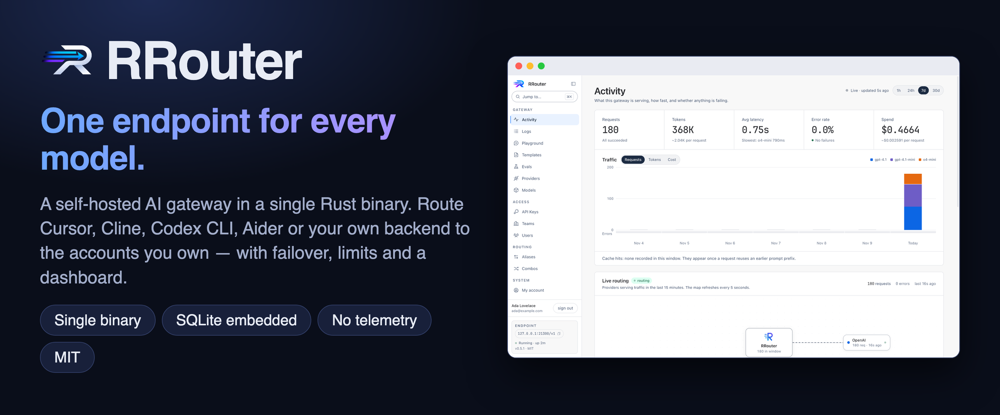
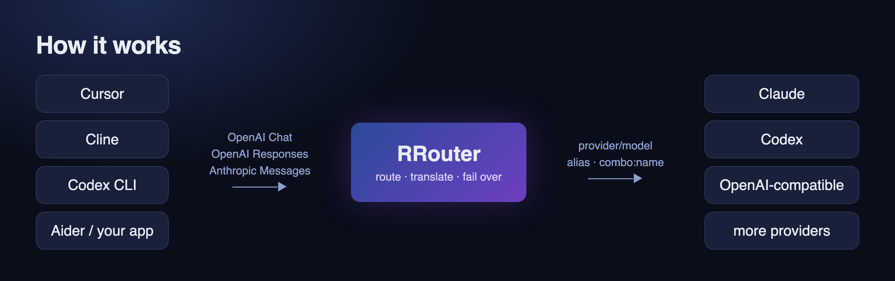
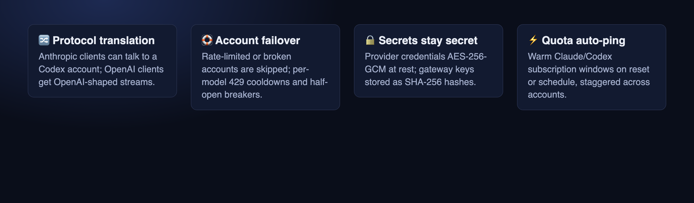
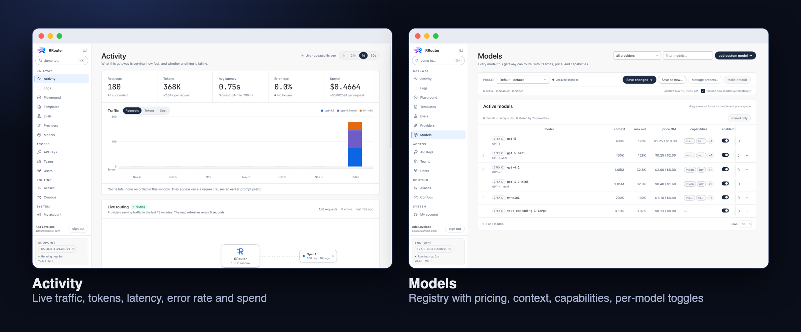
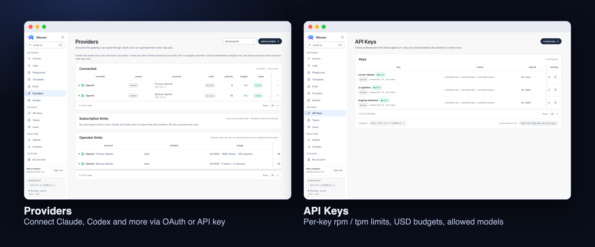
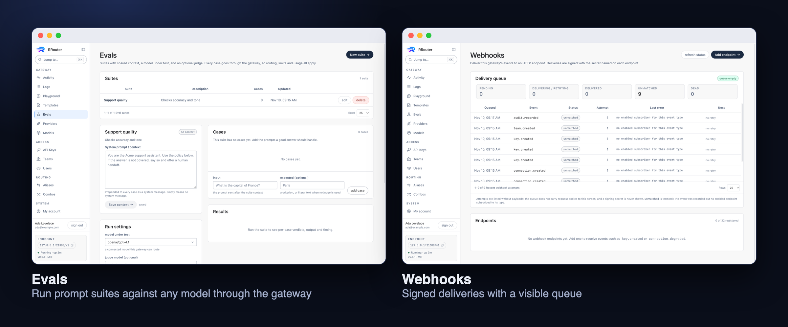
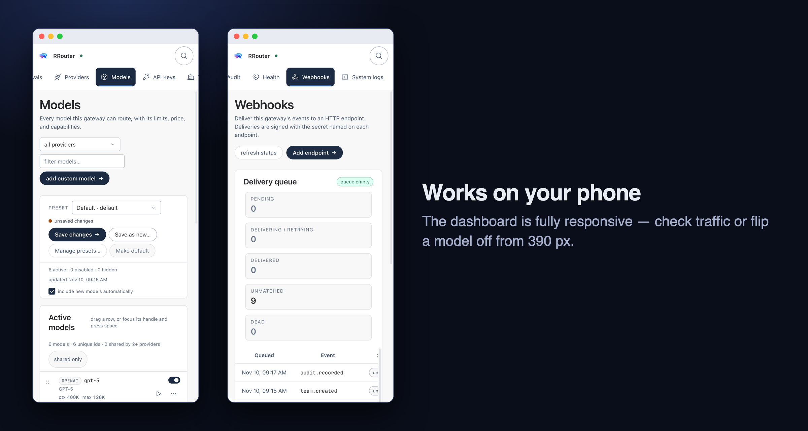
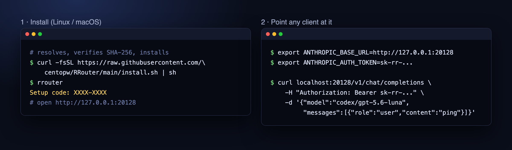

<p align="center"></p>

# RRouter

**One endpoint for every model, in one Rust binary.**

RRouter is a self-hosted AI gateway. Point Cursor, Cline, Codex CLI, Aider, or your own
backend at it, and it routes each request to whichever provider account you configured —
translating between OpenAI Chat, OpenAI Responses and Anthropic Messages on the way in and
out.

No Node runtime, no Redis, no external database, no telemetry by default. SQLite, the
encryption key material and the dashboard all live inside the binary and one data directory.

- **Single binary, embedded storage.** SQLite and the dashboard are compiled in.
- **Protocol translation, not a proxy.** Anthropic clients can talk to a Codex account, and
  OpenAI clients get OpenAI-shaped streams back.
- **Account failover.** Rate-limited or broken accounts are skipped; a per-account breaker
  half-opens to probe recovery. 429 cooldowns are scoped per model.
- **Secrets stay secret.** Provider credentials are AES-256-GCM at rest; gateway keys are
  SHA-256 hashes and printed once.
- **A real model registry.** Catalog, provider `/models`, models.dev metadata, custom rows,
  provider coverage, disabled models, preferred providers and grouped model boards.
- **Native web search.** Route Anthropic, OpenAI/Codex, xAI or Gemini through their own
  hosted search tools and return one cited answer from `/v1/search`.
- **Smart quota auto-ping.** Warm Claude/Codex subscription windows on reset, on a schedule,
  or with usage-aware staggered resets across accounts.

## See it

<p align="center"></p>

<p align="center"></p>

<p align="center"></p>
<p align="center"></p>
<p align="center"></p>
<p align="center"></p>

## Install

One line, Linux or macOS. The installer resolves the latest release for your
OS/architecture, verifies its SHA-256 and installs to `/usr/local/bin` (or `~/.local/bin`):

```sh
curl -fsSL https://raw.githubusercontent.com/centopw/RRouter/main/install.sh | sh
```

Pin a release or choose a directory:

```sh
RROUTER_VERSION=v0.14.0 RROUTER_INSTALL_DIR="$HOME/bin" \
  sh -c "$(curl -fsSL https://raw.githubusercontent.com/centopw/RRouter/main/install.sh)"
```

`install.sh` downloads a published release; `v0.14.0` is the newest. From source:

```sh
git clone https://github.com/centopw/RRouter && cd RRouter
cargo build --release
./target/release/rrouter
# http://127.0.0.1:20128
```

The first visit asks for the **setup code printed in the terminal** (`Setup code: XXXX-XXXX`),
then creates the owner account and shows ten recovery codes. Store them: they are the only
password-reset path besides the local CLI.

## Deploy

| Method | Start | Guide |
| --- | --- | --- |
| Docker | `docker compose up -d` | [Docker](docs/deploy/docker.md) |
| Kubernetes | `kubectl apply -f deploy/k8s.yaml` | [Kubernetes](docs/deploy/kubernetes.md) |
| Helm | `helm install rrouter deploy/helm/rrouter -n rrouter --create-namespace` | [Helm](docs/deploy/helm.md) |
| systemd | install `deploy/rrouter.service` | [systemd](docs/deploy/systemd.md) |
| Binary | run the release tarball | [Operations](docs/DEPLOY.md) |

All methods share one constraint: **one process per SQLite data directory**. Kubernetes and
Helm use one replica with `Recreate`. Back up the data directory, especially `master.key`.
Choose a method and read [Deployment overview](docs/deploy/README.md), then
[Operations](docs/DEPLOY.md) for exposure, TLS, backups, restore drills and upgrades.

## Quick start

<p align="center"></p>

```sh
export ANTHROPIC_BASE_URL=http://127.0.0.1:20128
export ANTHROPIC_AUTH_TOKEN=sk-rr-...

curl -s localhost:20128/v1/chat/completions \
  -H "Authorization: Bearer sk-rr-..." \
  -H "Content-Type: application/json" \
  -d '{"model":"codex/gpt-5.6-luna","messages":[{"role":"user","content":"ping"}]}'
```

The same traffic works on `/v1/messages` and `/v1/responses`; the model string decides
where it goes, not the protocol.

## Documentation

| Read | For |
| --- | --- |
| [Docs index](docs/README.md) | Everything below in one map |
| [API](docs/API.md) | Endpoints, dialects, usage queries |
| [Routing](docs/ROUTING.md) | Aliases, combos, strategies, breakers, preferred providers |
| [Models](docs/MODELS.md) | Registry, disabled models, provider coverage, preferred provider |
| [Keys and limits](docs/KEYS.md) | Limits, teams, guardrails, PII redaction |
| [Providers](docs/PROVIDERS.md) | OAuth/API-key support, endpoints, Antigravity |
| [Caching](docs/CACHING.md) | Exact/semantic cache and prompt-cache preservation |
| [Observability](docs/OBSERVABILITY.md) | Request IDs, metrics, traces, dashboard |
| [Security](docs/SECURITY.md) | Encryption, admin gate, accounts, audit |
| [Configuration](docs/CONFIG.md) | Every environment variable |
| [Updates](docs/UPDATES.md) | Update checks and deployment-specific upgrades |
| [Architecture](docs/ARCHITECTURE.md) | Crates and request flow |
| [Development](docs/DEVELOPMENT.md) | Build, dashboard dev server, tests |

## At a glance

- **Inference:** `/v1/chat/completions`, `/v1/responses`, `/v1/messages`, `/v1/embeddings`,
  `/v1/search`, token counting, images, audio, rerank, files and batches when the provider
  declares them.
- **Model strings:** `provider/model`, aliases, `combo:<name>`; bare ids expand across
  connected providers.
- **Strategies:** priority, weighted, least-latency and cheapest; canary and provider policy
  are request-scoped.
- **Limits:** rpm, tpm, token/USD budgets, allowed models, expiry, team budgets, guardrails
  and PII redaction.
- **Ops:** `/health`, `/ready`, Prometheus `/metrics`, request/attempt traces, audit and
  signed webhooks.
- **Dashboard:** Activity, Logs, Playground, Models, Providers, Evals, Keys, Teams, Users,
  Aliases, Combos, Webhooks, Settings.

## Tests

```sh
cargo test --workspace
cargo clippy --workspace --all-targets -- -D warnings
./scripts/verify.sh
python3 scripts/e2e_smoke.py
python3 scripts/oauth_smoke.py
```

See [Development](docs/DEVELOPMENT.md) for dashboard dev, load tests and the offline
acceptance harnesses.

## License

MIT. Wire formats were re-derived from the providers' published APIs and observed behaviour.
