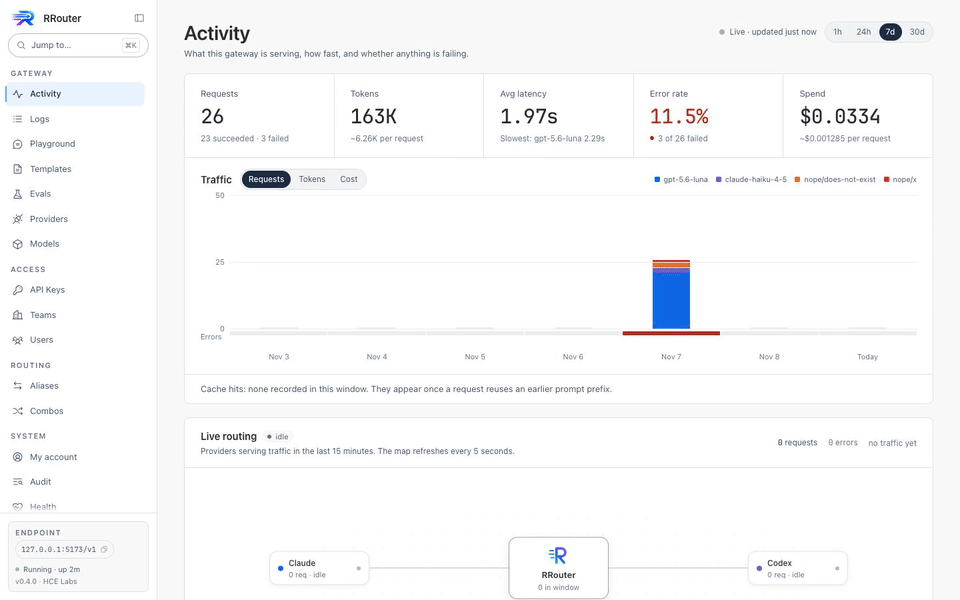
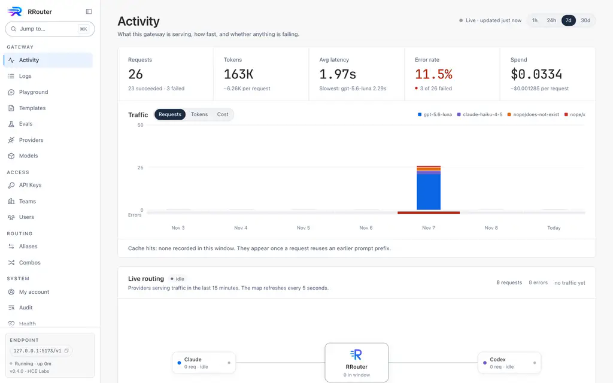
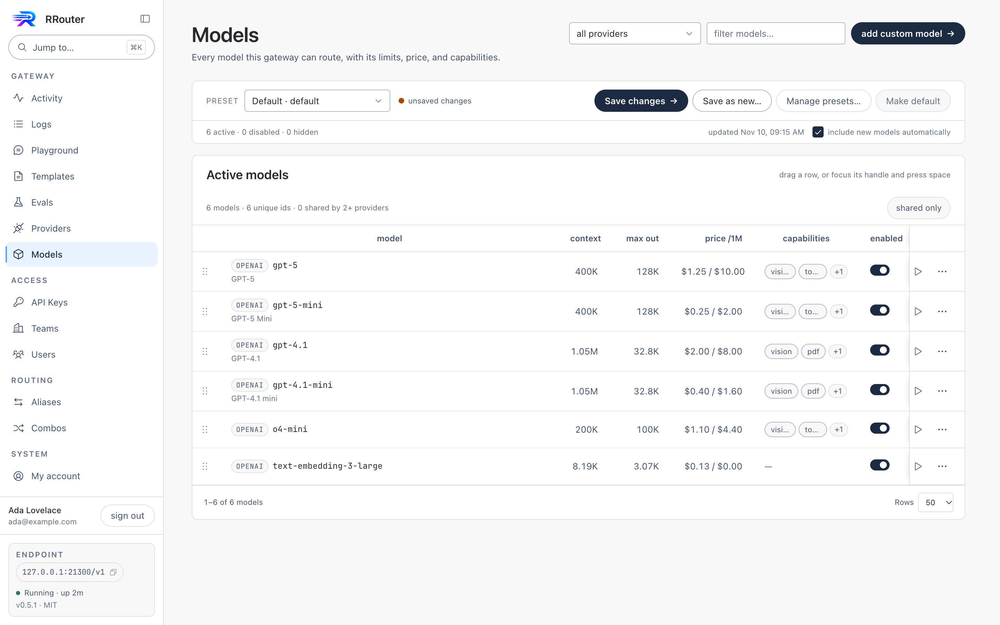
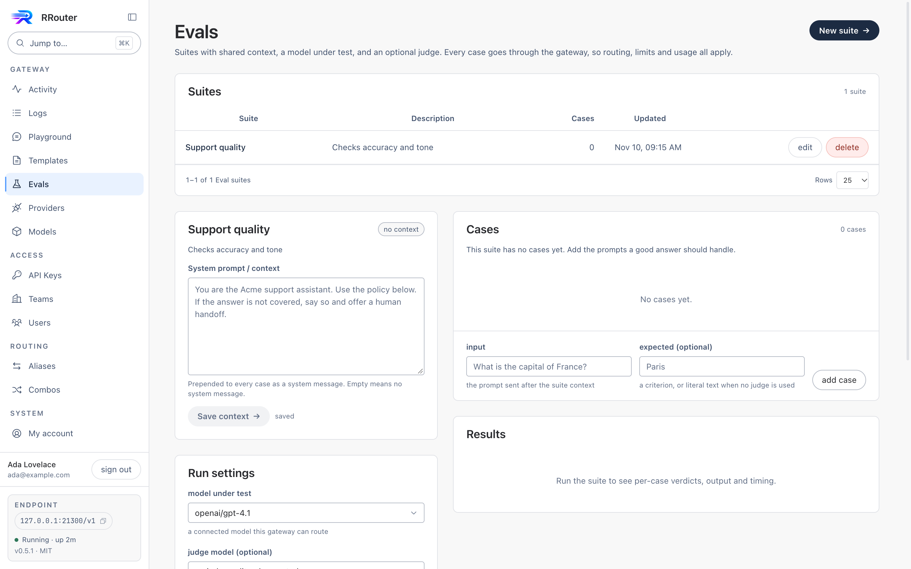
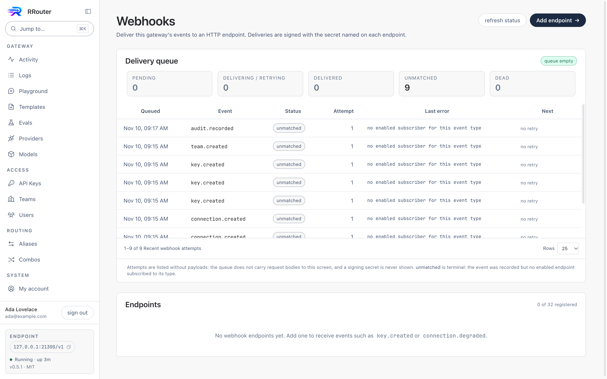
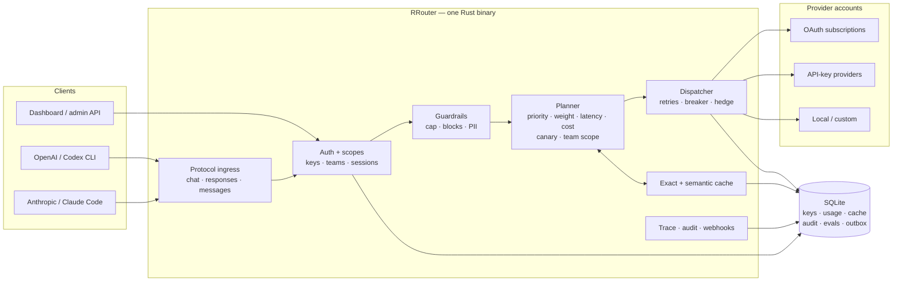

# RRouter

**One endpoint for every model, in one Rust binary.**

RRouter is a self-hosted AI gateway. Point Cursor, Cline, Codex CLI, Aider, or your own
backend at it, and it routes each request to whichever account you configured — translating
between the OpenAI Chat, OpenAI Responses, and Anthropic Messages protocols on the way in
and out.

No Node runtime, no Redis, no external database, no telemetry by default. SQLite, the
encryption key material, and the dashboard all live inside the binary and the data directory.

- **Single binary, embedded storage.** SQLite is compiled in; the dashboard is compiled in.
- **Protocol translation, not a proxy.** Anthropic clients can talk to a Codex account, and
  OpenAI clients get OpenAI-shaped streams back.
- **Account failover.** Rate-limited or broken accounts are skipped; a circuit breaker takes
  them out of rotation and half-opens to probe recovery.
- **Secrets stay secret.** Credentials are AES-256-GCM at rest; gateway keys are stored as
  SHA-256 hashes and printed once.
- **A real model registry.** Model lists, capabilities, and limits converge from the catalog,
  the provider's own `/models` endpoint, and [models.dev](https://models.dev).

## See it

[Watch the 10-second demo](docs/assets/rrouter-demo.mp4) · [Activity](docs/screenshots/activity.png) · [Models](docs/screenshots/models.png) · [Evals](docs/screenshots/evals.png) · [Webhooks](docs/screenshots/webhooks.png)

[](docs/assets/rrouter-demo.mp4)

<p align="center">
  
  
</p>
<p align="center">
  
  
</p>

Mobile layouts: [Models at 390px](docs/screenshots/models-mobile.png) · [Webhooks at 390px](docs/screenshots/webhooks-mobile.png)

---

## Install

One line, any Linux or macOS host — the script resolves the latest release for your
OS/architecture, verifies its SHA-256, and installs to `/usr/local/bin` (or
`~/.local/bin` when that is not writable):

```sh
curl -fsSL https://raw.githubusercontent.com/centopw/RRouter/main/install.sh | sh
```

```sh
# pin the newest published release (v0.4.6) / choose a directory
RROUTER_VERSION=v0.4.6 RROUTER_INSTALL_DIR="$HOME/bin" \
  sh -c "$(curl -fsSL https://raw.githubusercontent.com/centopw/RRouter/main/install.sh)"

# see what it would do
RROUTER_DRY_RUN=1 curl -fsSL https://raw.githubusercontent.com/centopw/RRouter/main/install.sh | sh
```

`install.sh` downloads a **published** release, so `RROUTER_VERSION` must name one: v0.4.6 is
the newest. The workspace is 0.4.6 — tag artifacts are published by the release workflow.

## Quick start

From source:

```sh
git clone https://github.com/centopw/RRouter && cd RRouter
cargo build --release
./target/release/rrouter
# listening on http://127.0.0.1:20128
```

Open <http://127.0.0.1:20128> — it redirects to the dashboard at `/app`. The first visit on a
fresh instance asks for the **setup code printed in the terminal** (`Setup code: XXXX-XXXX`),
then creates the owner account: that person administers the gateway. The ten recovery codes
shown next are the only password reset path besides the local CLI, so store them.

After that, **Setup** walks the three steps in order: connect an account (Claude browser
sign-in, Codex device code, or a pasted API key), create a gateway key, then send a request
while the page waits for it to arrive. The wizard can be reopened from **Health**.

```sh
# Anthropic-shaped client
export ANTHROPIC_BASE_URL=http://127.0.0.1:20128
export ANTHROPIC_AUTH_TOKEN=sk-rr-...

# OpenAI-shaped client
curl -s localhost:20128/v1/chat/completions \
  -H "Authorization: Bearer sk-rr-..." \
  -H "Content-Type: application/json" \
  -d '{"model":"codex/gpt-5.6-luna","messages":[{"role":"user","content":"ping"}]}'
```

The same traffic can be sent as `/v1/messages` or `/v1/responses`; the model string decides
where it goes, not the protocol.

## Endpoints

| Path | Dialect |
| --- | --- |
| `POST /v1/chat/completions` | OpenAI Chat Completions |
| `POST /v1/responses` | OpenAI Responses (Codex-style) |
| `POST /v1/messages` | Anthropic Messages |
| `POST /v1/embeddings` | OpenAI Embeddings |
| `POST /v1/messages/count_tokens` | Anthropic token counting (forwarded) |
| `POST /v1/responses/compact` | OpenAI/Codex compaction (forwarded) |
| `GET /v1/models` | catalog + upstream + custom models |
| `GET /v1/models/{id}` | one model object (or OpenAI-shaped 404) |
| `POST /v1/images/generations` | forwarded to providers with an images endpoint |
| `POST /v1/audio/speech` | forwarded; audio bytes relayed with the upstream content-type |
| `POST /v1/audio/transcriptions` | multipart forwarded verbatim (boundary preserved) |
| `GET /v1/audio/voices` | forwarded when the provider has one |
| `POST /v1/rerank` | canonical rerank, forwarded to providers with a rerank endpoint |
| `POST/GET /v1/files`, `GET /v1/files/{id}`, `GET /v1/files/{id}/content` | provider file API forwarded verbatim (multipart boundary preserved; content streamed); only the built-in OpenAI provider declares these today (`501` otherwise; a community manifest can declare them), uploads buffered under a 64 MiB cap |
| `POST/GET /v1/batches`, `GET /v1/batches/{id}`, `POST /v1/batches/{id}/cancel` | provider batch API forwarded byte-identically; execution stays with the provider; only the built-in OpenAI provider declares these today (`501` otherwise; a community manifest can declare them); pin one provider when a batch references an uploaded file |
| `GET/POST /api/*` | admin: providers, keys, models, model presets, teams, webhooks, evals, usage, settings |

`/v1/messages/count_tokens` and `/v1/responses/compact` are forwarded to the provider that
implements them (Anthropic and OpenAI/GitHub respectively), because both are provider-native
shapes the canonical request cannot represent. A provider without the endpoint answers `501`
with its dialect's error envelope rather than an invented estimate. Codex's subscription
backend does not serve `/responses/compact` today, so that one answers its own `404`; an
OpenAI API-key connection does.

Admin-side additions in this tree: signed webhooks (`/api/webhooks` — endpoint registry plus a
leased SQLite outbox with retries, dead-lettering and a terminal `unmatched` state, and a
delivery-status view), and an eval harness (`/api/evals/*` — suites/cases run in-process
through the real `/v1` path, with stored results and summaries).

Usage reads are windowed and aggregated in SQL, so the dashboard never pages through events:

| Query | Answers |
| --- | --- |
| `GET /api/usage?hours=&limit=` | the request log: one row per request with id, endpoint, tokens, cache, latency, status |
| `GET /api/usage/series?hours=&bucket=5m\|hour\|day` | one row per time bucket (requests, errors, tokens, cache, avg latency) |
| `GET /api/usage/series?by=model` | the same buckets split per model, for the stacked traffic chart |
| `GET /api/usage/summary?hours=` | per-model totals for the window; omit `hours` for all time |
| `GET /api/usage/export.csv?…` | the same filters as the log, streamed as a CSV download |

## Routing

- **`provider/model`** — `openai/gpt-4.1`, `claude/sonnet-4-5`, `codex/gpt-5.6-luna`.
- **Aliases** — give a model a stable internal name (`prod-default`) so clients never change.
- **Combos** — named model lists a client calls as `combo:<name>`. A combo's strategy decides how a request moves through the list: `fallback` (stored order on failure), `round_robin` (durable per-combo cursor), or `smart` (a decision model picks an entry via `{"choice": "provider/model"}`, falling back to the first on any error). See [`docs/COMBOS.md`](docs/COMBOS.md) for the strategy table, API shape and the offline acceptance harness.

Candidates are ordered by account priority, skipping providers with no active connection and
accounts inside their circuit breaker. A 429 backs the account off exponentially, honouring
`Retry-After`; a 5xx opens the breaker, and a half-open probe brings it back.

`RROUTER_STRATEGY` chooses how equal-priority accounts are ordered: `priority` (default),
`weighted` (smooth round-robin over each connection's weight), `least_latency` (EWMA of
successful attempts) or `cheapest` (lowest catalog price for the model first, unknown prices
last). Priority always wins across groups. A key can also map the model its
client sends to another ref (`default → claude/claude-haiku-4-5-20251001`), which is how a
team keeps a stable model name while the operator repoints it.

## Observability

- Every `/v1` response carries `x-request-id`; the same id is stored on the usage row and on
  each candidate attempt, so a fallback is visible instead of inferred. `GET /api/usage/{id}`
  returns the request plus its attempts (provider, status, latency, error).
- `GET /metrics` is Prometheus text behind the admin gate: build info, requests by
  provider/model/status, attempts by provider/status, a latency histogram, and breaker state
  per connection.
- W3C trace context is accepted, continued and logged (`x-trace-id` on every response, one
  child span per attempt); exporting spans over OTLP/HTTP is optional — build with
  `--features otel` and set `RROUTER_OTEL_ENDPOINT`. Default builds link no OpenTelemetry
  crates; the setting is environment-only and off until an endpoint is set.
- Activity's request detail shows the attempt timeline and splits streamed latency into
  time-to-first-output and generation.

## Caching

`RROUTER_CACHE=sqlite` turns on an opt-in, byte-exact response cache for **non-streaming**
chat, messages and responses. The key is a SHA-256 of the canonical request the gateway would
send, so two spellings that produce the same request share an entry. A hit returns the stored
body with `x-rrouter-cache: hit` and a fresh `x-request-id`, and records a usage row with zero
tokens and zero cost — it shows up in Activity without pretending the provider was called.
`x-rrouter-cache: bypass` forces a miss; streamed requests and errors are never cached.
`RROUTER_CACHE_TTL_SECS` and `RROUTER_CACHE_MAX_ENTRIES` bound lifetime and size; expired
rows are dropped lazily.

`RROUTER_SEMANTIC_CACHE=sqlite` adds an opt-in **semantic** layer on top: the canonical
prompt is embedded by `RROUTER_SEMANTIC_EMBEDDING_MODEL` (a `provider/model` ref) and a
stored response is served when cosine similarity reaches
`RROUTER_SEMANTIC_CACHE_THRESHOLD` (default 0.92), within the same scope — embedding model,
provider, model and team (not per gateway key) — and the `RROUTER_SEMANTIC_CACHE_TTL_SECS` /
`RROUTER_SEMANTIC_CACHE_MAX_ENTRIES` bounds. It is non-streaming chat/messages/responses
only, needs the embedding provider to answer before the lookup, and a semantic hit is marked
`x-rrouter-cache: semantic-hit`.

## Keys and limits

A gateway key is not just a password: each one carries the limits an operator needs.

| Limit | Effect |
| --- | --- |
| `rpm` | requests per minute, sliding window; over the limit `429 rate_limited` with `Retry-After` |
| `tpm` | tokens per minute from the last 60 s of recorded usage; `429 rate_limited` |
| `budget_tokens` | lifetime token budget; once spent, `429 budget_exhausted` until the operator raises it |
| `budget_micros` | the same in money: spend is computed per request from the model's catalog price, so `$1.00` means exactly that |
| `allowed_models` | exact refs or `provider/*` globs; anything else is `403 model_not_allowed` |
| `expires_at` | after that moment the key answers `403 api_key_expired` |

Spend is read from the usage table (not a counter that drifts), every usage row records which
key produced it, and the Keys page edits all of it.

**Teams add a second budget level.** A team carries the same token and USD budgets over a
lifetime or daily/weekly/monthly window (`/api/teams`). A key that belongs to a team spends the
team's allowance, and an exhausted team answers `429` `team_budget_exhausted` before dispatch.
Usage rows record the team, so `GET /api/usage`, `/api/usage/summary`, `/api/usage/series` and
`/api/usage/export.csv` attribute spend per team without a join. There is deliberately **no
prepaid credit balance**: budgets are the cap, and the gateway never holds a customer's money
([ADR 0001](docs/decisions/0001-no-prepaid-credits.md)).

A key can also carry **guardrails**: a prompt-size cap, case-insensitive blocked phrases, an
output-scan switch, and opt-in PII redaction (`guardrails.redact_pii`). Input checks run
before planning (system prompt plus message text); output checks inspect the response, and a
streamed hit is cut with one error frame. Blocks answer `403` with `prompt_too_long`,
`guardrail_blocked` or `output_blocked`, and are counted per stage in `/metrics`.

With redaction on, emails, phone numbers, cards and credential-shaped strings become
`[email]`/`[phone]`/`[card]`/`[secret]` in prompts, non-streaming responses **and streamed
text**. Streams hold at most 512 bytes so a value split across deltas is still caught; the
bounded cost is visible lag, and a value longer than the window can straddle an emission
cut. Tool-call arguments and opaque payloads are deliberately not rewritten (a redacted
argument would change what a tool does). Enforcement applies whenever a key is
presented; with `RROUTER_REQUIRE_API_KEY=false` a request with no key is still anonymous, and
an unknown placeholder key is ignored so local tools keep working. A *known* key that is
inactive or expired is always rejected.

## Providers

| Kind | Providers |
| --- | --- |
| Subscription sign-in (OAuth) | Claude, Codex (ChatGPT), GitHub Copilot, Google Antigravity (Cloud Code Assist; Google account, not a Gemini API key) |
| API key | OpenAI, Anthropic, Google Gemini, DeepSeek, Groq, OpenRouter, xAI, Mistral, Together, Cerebras |
| API key, provider-native surface | Azure OpenAI (`api-key` header, chat on the v1 surface, per-resource base URL, deployment name as the model id), Cohere (chat through the OpenAI-compatibility API plus `/v1/rerank`), Fireworks AI (chat, ids stored as `accounts/fireworks/models/<name>`), Jina AI (rerank only — no chat API) |
| Local / custom | Ollama, or anything reachable through `base_url_override` |

OAuth tokens refresh ahead of expiry with a per-account lock, so concurrent requests never
race two refreshes and invalidate the session. Google Antigravity signs in a Google account
(fixed OAuth callback on port 51121), discovers the Cloud project with `loadCodeAssist` /
`onboardUser`, and needs the exact Cloud Code Assist model ids added as custom rows (it has no
`GET /models`); it is chat/streaming only. Per-provider auth headers, native endpoints,
model-list behaviour and the community-manifest provenance are in
[`docs/PROVIDERS.md`](docs/PROVIDERS.md#google-antigravity-cloud-code-assist).

## Models

**Models** in the dashboard is the registry behind `/v1/models`, and it lists exactly one
thing: **what this gateway can call right now** — models belonging to providers you have
connected. Disconnect the last account and the list is empty.

- **Provider lists** — adding a provider fetches that provider's own `/models` endpoint in
  the background; the Fetch button re-runs it. Codex cannot enumerate, so its five verified
  ids come from the built-in catalog.
- **Sync from models.dev** — metadata only. One button (plus a daily refresh) fills in
  context window, output cap, capabilities (vision, pdf, audio, tools, reasoning), and price
  per million tokens. It never adds a model to the list.
- **Custom models** — define any id with limits, capabilities, and price for providers that
  do not publish a list; custom rows win over everything and survive syncs.
- **Test** — a real 16-token completion through the same planner, dispatcher, and
  reassembly path a client uses, so a green result means what it says.

Every place the dashboard asks for a model is a select grouped by provider — no free-text
model fields, so a typo cannot silently route to nothing.

### Model presets

Presets are named, ordered **layouts** of the Models page: reorder, hide and restore rows,
and switch between saved layouts. They are instance-wide admin configuration and never
change routing — hiding a row only removes it from that preset's active list, while routing
is controlled separately by `disabled_models`. Every layout save is a full-layout `PUT`
carrying the revision it read; a stale revision answers `409 preset_conflict` with the
current revision instead of overwriting another tab's work, and the default preset cannot be
deleted.

The workflow, JSON shape, endpoints, keyboard/drag accessibility and the manual browser
checklist are in [`docs/MODEL_PRESETS.md`](docs/MODEL_PRESETS.md). API acceptance:
`python3 scripts/model_presets_smoke.py` (it exits `3` with `BLOCKED-BY-API` only against a
build that does not serve the routes).

## Prompt caching

Caching is what makes agentic coding affordable, and a gateway can silently destroy it in
two ways. RRouter avoids both:

- **Same-dialect requests are forwarded as the client wrote them.** Only routing fields are
  patched (the resolved model id, streaming, `store:false` for Codex, a bare-string
  `input`). Anthropic `cache_control` breakpoints and the OpenAI Responses fields
  (`prompt_cache_options`, `prompt_cache_key`, per-block `prompt_cache_breakpoint`) survive
  untouched. Cross-dialect requests still go through the canonical translator.
- **Accounts are pinned per conversation.** KV caches live on one upstream account, so
  equal-priority connections are ordered by a hash of the conversation (model, system,
  first turn, `prompt_cache_key`) instead of round-robin. Different conversations still
  spread across the pool; the same conversation never alternates accounts.

Every request records what it cost (tokens × the model's per-million price, in micro-USD when
the catalog prices it), and the Keys page shows spend in dollars next to the budget.

Cache reads and writes are recorded per request, and **Activity** shows the hit rate
(`cache_read / (input + cache_read + cache_write)`), so a regression is visible instead of
inferred from the bill.

## Operations

```sh
rrouter admin show-setup-code            # while no user exists
rrouter admin reset-password <email>     # prints a new password; ends that user's sessions
rrouter admin backup ./rrouter-backup.db # consistent online SQLite backup (VACUUM INTO)
```

`GET /health` answers liveness; `GET /ready` additionally reads the store, so an
orchestrator can distinguish a running process from a usable one. Security events land in
the **Audit** page and are pruned with the usage retention window.

## Security

- Credentials encrypted with AES-256-GCM, unique nonce per write; the key lives in
  `<data dir>/master.key` created `0600` (or comes from `RROUTER_MASTER_KEY`).
- Gateway keys are stored as SHA-256 hashes; the plaintext is shown once at creation.
- The admin API never returns token material, only `has_*` booleans.
- `RROUTER_ALLOW_REMOTE_ADMIN=false` by default: admin routes are loopback-only unless the
  operator says otherwise. `RROUTER_CORS_ORIGINS=*` is rejected at startup.
- Dashboard accounts hash passwords with argon2id; session cookies, recovery codes and
  invitation tokens are stored only as hashes. The owner cannot be demoted, disabled or
  deleted. Cookie-authenticated writes require the `x-rrouter-csrf` header, sign-in is
  rate-limited, and the owner's setup code is printed once and consumed on use. Each session
  records the resolved client IP, raw User-Agent (bounded) and a derived device label for the
  account page; legacy sessions show none, and the forwarded IP is only as trustworthy as the
  proxy that sets it.
- Upstream payloads are never persisted; usage rows record tokens, latency, status, and the
  model — not prompts or completions.

## Dashboard

The dashboard is a Vite + React app served at `/app`, embedded in the binary at build time.
It needs Node only to build, never to run. The light design system lives in
`ui/src/index.css` (tokens only: near-black rail, off-white canvas, navy accent, pill
buttons, 4px inputs, 8px cards, 75/400/500ms ease-out motion). Sign-in, first-run setup,
invitation join and password recovery are pages outside the app shell; the design for them is
in `docs/redesign/AUTH.md`.

```sh
cd ui && npm install
npm run dev     # http://localhost:5173, proxies /api and /v1 to :20128
npm run build   # writes ui/dist; the next cargo build embeds it
```

**Logs** is the incident view: every request, newest first, filterable by range, status,
provider, model and key, with backward paging over the full history and the same attempts
detail as Activity.

**Playground** sends a real request through the gateway and shows the answer as it streams —
Chat and Messages dialects, time to first token, total latency, tokens, and the raw SSE when
you need it. **Settings** edits the deployment's brand (name, accent, logo, footer) and shows
the runtime facts; the shell reads the same settings, so white-labelling needs no rebuild.

**Activity** is the operator's answer to "is anything wrong right now?": four readouts
(requests, tokens, latency, error rate), a stacked traffic chart with an error lane, a models
table, and the request log with a detail panel — clicking a model filters the log, clicking a
request opens its tokens, latency (split into time-to-first-output and generation for
streams), endpoint and error. Empty, sparse and failing states are
explicit; no number on the page is estimated client-side.

A checkout without `ui/dist` still builds: `/` then serves a smaller dependency-free shell
that composes itself from `GET /api/ui/panels` (and supports sandboxed extension panels).

Assets are content-hashed, so a rebuilt binary ships new filenames. A tab opened before an
upgrade reloads itself once when it asks for a chunk that no longer exists; if the reload
cannot fix it, the page shows a recoverable "this dashboard was updated" card while the
sidebar keeps working.

## Configuration

The operational guide — exposure, TLS proxy, backups, upgrades, failure modes — lives in
[`docs/DEPLOY.md`](docs/DEPLOY.md).

| Variable | Default | Purpose |
| --- | --- | --- |
| `RROUTER_HOST` | `127.0.0.1` | Bind address |
| `RROUTER_PORT` | `20128` | Listen port |
| `RROUTER_DATA_DIR` | `./data` | SQLite database, master key, `/ext` assets |
| `RROUTER_MASTER_KEY` | auto-generated | 64 hex chars; otherwise created on first run |
| `RROUTER_REQUIRE_API_KEY` | `false` | Require `sk-rr-…` on `/v1/*` |
| `RROUTER_ALLOW_REMOTE_ADMIN` | `false` | Serve admin routes beyond loopback |
| `RROUTER_ADMIN_TOKEN` | unset | Require this token (`Authorization: Bearer` or `x-admin-token`) on every `/api/*` and `/metrics` request; loopback stops being a shortcut |
| `RROUTER_MAX_CONCURRENCY` | `0` | Cap concurrent `/v1` requests; over the cap answers `503 overloaded` instead of queueing |
| `RROUTER_MAX_ATTEMPTS` | `4` | Upstream sends per request before giving up (1–8) |
| `RROUTER_RETRY_ATTEMPTS` | `1` | Extra tries of the same candidate on a retryable error (0–5) |
| `RROUTER_RETRY_BASE_MS` | `200` | First backoff; doubles per retry, ±20% jitter |
| `RROUTER_RETRY_MAX_MS` | `5000` | Backoff ceiling, also caps an upstream `Retry-After` |
| `RROUTER_HEDGE_MS` | `0` | Non-streaming hedge delay: after N ms without an answer, the next same-priority candidate starts in parallel; `0` disables; restart-only |
| `RROUTER_CANARY` | unset | Operator A/B, `model=provider:percent` (e.g. `gpt-4.1=azure:10`); the canary provider is tried first for that share of request ids, inside its own priority tier |
| `RROUTER_SEMANTIC_CACHE` | `off` | `sqlite` enables the opt-in semantic cache (non-streaming chat/messages/responses) |
| `RROUTER_SEMANTIC_CACHE_THRESHOLD` | `0.92` | Minimum cosine similarity for a semantic hit (0–1) |
| `RROUTER_SEMANTIC_EMBEDDING_MODEL` | unset | `provider/model` used to embed prompts; required when the cache is on |
| `RROUTER_SEMANTIC_CACHE_TTL_SECS` | `3600` | Semantic entry lifetime |
| `RROUTER_SEMANTIC_CACHE_MAX_ENTRIES` | `1000` | Semantic rows kept, oldest evicted first |
| `RROUTER_OTEL_ENDPOINT` | unset | Full OTLP/HTTP traces URL; only read by builds with `--features otel`; unset disables export; environment-only |
| `RROUTER_OTEL_SERVICE_NAME` | `rrouter` | `service.name` resource attribute for exported spans |
| `RROUTER_OTEL_SAMPLE_RATIO` | `1.0` | Local root sampling ratio (0–1); an inbound `traceparent` sampling flag wins |
| `RROUTER_SHUTDOWN_GRACE_SECS` | `20` | How long a graceful shutdown waits for live streams |
| `RROUTER_CORS_ORIGINS` | unset | Comma-separated allowlist; `*` is rejected |
| `RROUTER_USAGE_RETENTION_DAYS` | `0` | Delete usage/attempts older than N days (0 keeps everything); expired cache rows are swept daily regardless |
| `RROUTER_CACHE` | `off` | `sqlite` enables the opt-in exact-match response cache |
| `RROUTER_CACHE_TTL_SECS` | `300` | Cache entry lifetime |
| `RROUTER_CACHE_MAX_ENTRIES` | `1000` | Cache size bound (oldest evicted) |
| `RROUTER_REQUEST_TIMEOUT_SECS` | `600` | Upstream request timeout |
| `RROUTER_CONNECT_TIMEOUT_SECS` | `15` | TCP/TLS connect timeout |
| `RROUTER_STATIC_DIR` | unset | Serve extra extension assets under `/ext` |
| `RROUTER_LOG_FORMAT` | `text` | `json` for machine-readable logs (Loki/CloudWatch) |
| `RROUTER_ACCESS_LOG` | `true` | One structured line per finished request; `false` silences it |
| `RUST_LOG` | `rrouter=info` | Log filter |

### Docker

The image is three stages — Node builds the dashboard, Rust embeds it and builds the binary,
distroless runs it — so the runtime layer has no shell, package manager, or Node.

```sh
docker run -p 127.0.0.1:20128:20128 -v rrouter-data:/data \
  ghcr.io/centopw/rrouter:latest

docker compose up -d              # compose file with healthcheck and volume
docker build -t rrouter .         # or build it yourself
```

The image is distroless, so the container probes itself: `rrouter --healthcheck` does a
`GET /health` over a socket and exits non-zero when the gateway is down (the image declares
that as `HEALTHCHECK`). Publish the port on loopback unless a reverse proxy with
authentication sits in front: the admin API is governed by the loopback gate, and exposing
it publicly would expose provider credentials and key management.

A single-replica Kubernetes manifest (`deploy/k8s.yaml`) and a systemd unit
(`deploy/rrouter.service`) cover the two common non-Docker deployments. Multi-arch images
(`linux/amd64`, `linux/arm64`) are published to GHCR by
`.github/workflows/docker.yml` on every push to `main` and on `v*` tags. Tagged builds also
publish standalone binaries through `.github/workflows/release.yml`; `install.sh` consumes
those, which is why it needs no Rust toolchain.

## Architecture



**Runtime flow**

1. **Ingress** normalizes Chat, Responses and Messages into one canonical request.
2. **Auth + guardrails** resolve the key/team, limits and PII/blocking policy before dispatch.
3. **Planner** expands aliases/combos and selects eligible accounts; priority is authoritative.
4. **Dispatcher** retries, fails over, probes breakers and optionally hedges.
5. **Response** is translated back to the caller's dialect; usage, trace, audit and webhooks are recorded.

The full diagram source is [`docs/architecture.mmd`](docs/architecture.mmd).

| Crate | Responsibility |
| --- | --- |
| `rrouter-core` | shared request/response/stream types and errors |
| `rrouter-auth` | provider registry, credentials, OAuth refresh |
| `rrouter-store` | SQLite, encryption, connections/keys/teams/usage/evals/outbox |
| `rrouter-translate` | Chat ⇄ Responses ⇄ Anthropic, request and stream |
| `rrouter-router` | aliases, combos, planning, breaker, dispatch |
| `rrouter-rtk` | Token Saver: inbound tool-result compression |
| `rrouter-gateway` | HTTP surface, proxy, admin API, dashboard |
| `rrouter-ui` | embedded Vite dashboard |

## Tests

```sh
cargo test --workspace                              # unit + integration suites
cargo clippy --workspace --all-targets -- -D warnings
./scripts/verify.sh                                 # build + every gate
python3 scripts/e2e_smoke.py                        # live binary + mock upstream
python3 scripts/oauth_smoke.py                      # OAuth flows against a mock IdP
python3 scripts/load_test.py --requests 20 --concurrency 5   # real load against a running gateway
./scripts/backup.sh /var/backups/rrouter            # consistent SQLite snapshot + key
```

Coverage includes: fallback on 401/429 without losing the client request, the first SSE frame
arriving before the upstream finishes, Anthropic clients receiving Anthropic shapes from an
OpenAI-speaking provider, tool calls and tool results crossing dialects, `strict` schemas and
provider-native tools surviving translation, credential material absent from the database
file, and the admin API never returning tokens.

## Updates

Settings → **Software updates** checks the latest GitHub release, shows the release notes,
and can download the release archive. Checking is enabled daily by default; automatic
downloading is opt-in. Archives are verified against the published SHA-256 and staged under
`<data_dir>/updates/<version>/`.

Set `RROUTER_UPDATE_TOKEN` (or `GITHUB_TOKEN`) to a fine-grained, read-only token for
`centopw/RRouter` to raise GitHub’s per-IP API limit; it is sent only as a bearer header and
never logged or returned. Without a token, routine checks avoid the API entirely and follow
`github.com/centopw/RRouter/releases/latest` to `/releases/tag/vX`; notes then come from the
last cached check, and archives use the constructed release-download URL with the same
SHA-256 verification. On a `403`/`429` exhaustion, the gateway records
`rate_limited_until` from `x-ratelimit-reset` (+ jitter), stops automatic API checks until
then, keeps the last known release, and shows the retry time in the status screen; a restart
does not immediately re-check. Details and quota behaviour: [`docs/DEPLOY.md`](docs/DEPLOY.md#52-update-checks-and-github-rate-limits).

The detected deployment decides how the upgrade is applied:

| Deployment | Detection | Upgrade |
| --- | --- | --- |
| Binary / systemd | default, `INVOCATION_ID` | staged binary replaces the executable and restarts in place |
| Homebrew | executable under `/Cellar/` | `brew upgrade rrouter` |
| Docker | `/.dockerenv` or `container` | pull and recreate the container on the host |
| Kubernetes | `KUBERNETES_SERVICE_HOST` | update the image and roll out the deployment |
| Helm | Kubernetes + `RROUTER_HELM_RELEASE` | `helm upgrade <release> <chart> --reuse-values --set image.tag=<version>` |

Containers and pods cannot replace their own image or Helm release, so those deployments get
the exact supervisor command instead of a button that cannot work. Set
`RROUTER_DEPLOYMENT=docker|helm|kubernetes|brew|systemd|binary` when detection cannot infer
the deployment, and `RROUTER_UPDATE_COMMAND` to run a deployment-specific upgrade command
instead. A staged binary is never applied automatically; an operator chooses the restart.

## Releasing

```sh
git tag v0.2.0 && git push origin v0.2.0
```

That tag drives both workflows. The release publishes
`rrouter-{linux,darwin}-{amd64,arm64}.tar.gz` with `.sha256` files; its body is rendered once
from the matching `## <version>` section of `CHANGELOG.md` by
`scripts/release-notes.py` (build legs only attach assets, so there are no duplicated
“Full Changelog” blocks), and the matrix builds each target natively — arm64 Linux on
`ubuntu-24.04-arm` instead of QEMU. The docker workflow builds `linux/amd64` and
`linux/arm64` on native runners and merges the digests into
`ghcr.io/centopw/rrouter:0.2.0`, `:0.2`, `:latest`, and a `:sha-…` manifest, cutting the
v0.4.4 31-minute QEMU path to an expected ~12–16 minutes cold. The installer verifies the
checksum before installing, so a corrupted download never lands in `$PATH`. Verify notes
before tagging with `python3 scripts/release-notes.py v0.4.6 --check`; the full flow and
timings are in [`docs/RELEASES.md`](docs/RELEASES.md#5-the-pipeline).

## License

MIT. Behavioural inspiration from 9router (also MIT); no code is copied. Wire formats were
re-derived from the providers' published APIs and observed behaviour.
