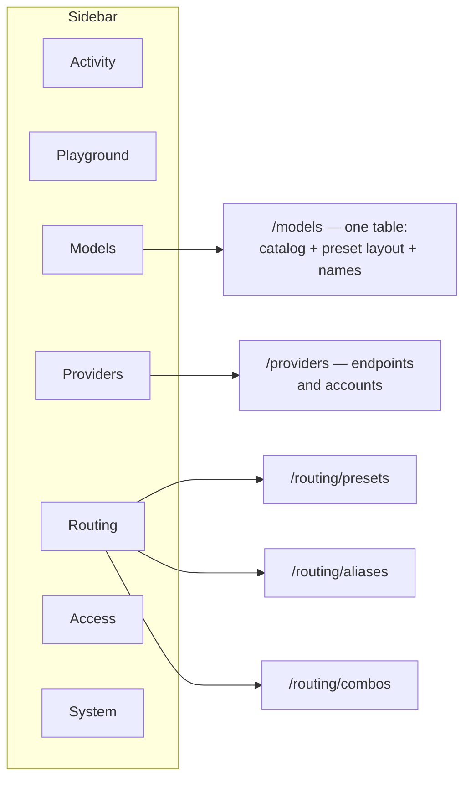

# RRouter · Models and routing redesign

Spec for consolidating the Models page and splitting the `/routing` section. Written for
engineers and coding agents. Read it once, then use the checklist at the end.

- Visual language: [`THEME.md`](../docs/redesign/THEME.md) and [`DESIGN.md`](../docs/redesign/DESIGN.md). Layout, spacing and
  type rules still apply; this file only changes information architecture and page anatomy.
- Evidence base: v0.15.1, commit `a889014`. Every current-behaviour claim below cites code;
  line numbers refer to that commit, before the UI implementation moved some files.
- Status: proposal, with the UI phases partly implemented on 2026-11-15. The sidebar/
  Models/Presets/provider-label work is live; the backend endpoint identity (Phase 1) is
  not. Until it lands, a custom endpoint's name is display-only and model refs stay
  protocol-based (`openai/...`). See "Implementation status" below.
- Supersedes: `DESIGN.md` §1 rule 4 and §12 where they exclude Models/Providers/Aliases/Combos,
  and `DESIGN.md`'s stale canvas note about `/routing/models`.


## Implementation status (2026-11-15)

Implemented in the dashboard:

- Models is one page with one toolbar/table; the Active/Registry/Names tabs are gone.
- Sidebar: Models and Providers are standalone; Routing is Presets/Aliases/Combos.
- `/routing/presets` manages preset lifecycle; `/models` keeps selection and save.
- Custom endpoint creation requires a provider name; Providers shows it with a `custom`
  badge and protocol subtitle, and legacy custom-URL rows say `(custom URL)`.

Still outstanding:

- Phase 1 backend identity (`provider_endpoints`, resolver, per-endpoint model buckets).
  Model rows and `/v1/models` still use `openai`/`anthropic` for custom endpoints.
- Therefore the model badge and ref prefix are not yet user-defined.
- The doc's full acceptance checklist is not met until Phase 1 ships.

## 0. Decisions

1. **A custom endpoint becomes a named provider entity** with an immutable slug, an editable
   display name and its own routing/model bucket. Protocol remains the compiled transport.
2. **Models becomes one page with one table.** Preset order, catalog browsing, aliases and
   combos are filters and row kinds, not tabs.
3. **Models and Providers become standalone sidebar surfaces.** Routing keeps only Presets,
   Aliases and Combos.

## 1. Rules for anyone implementing this

1. **One dataset per page.** A page may narrow one table with filters. It may not hide a
   second, differently-shaped table behind a tab. That is the failure this spec removes.
2. **No page-level tab strip inside a section tab strip.** The shell already renders section
   tabs (`ui/src/App.tsx:676-718`). Models and Providers become standalone pages; only
   Routing keeps tabs.
3. **Preserve every existing job.** Drag ordering, groups, visibility, global disable, test,
   edit/delete custom rows, custom-model creation, preset save/conflict, and `/v1/models`
   discovery all survive. Nothing is dropped because a tab disappears.
4. **Provider identity is data, not a label.** A user-defined endpoint gets its own routing
   identity. Re-labelling the string `openai` is explicitly rejected: it leaves the shared
   routing pool and model bucket in place (§2.1).
5. **Reuse the repo's components and tokens.** `Card`, `PageHeader`, `Badge`, `Dot`,
   `Button`, `Select`, `Input`, `EmptyState`, `ErrorNote`, `DataTable`, `FilterChip`,
   `SortableTable`, `Modal` already exist. Never add a raw hex.
6. **No invented data.** Where the API cannot supply a field, the state treatment in §4.7 or
   the edge-case table in §5.9 says what to show; do not fake it client-side.

## 2. Why the current design fails

### 2.1 "OpenAI" is a compiled provider, not a user label

The custom-endpoint flow never creates a provider. It creates a second `openai` connection
with a base URL override:

| Step | Code |
| --- | --- |
| Custom card sets `provider = protocol` (`"openai"` or `"anthropic"`) | `ui/src/pages/providers.tsx:1374`, `:1382`, `:191-198` |
| Form posts `{provider:"openai", …, credentials:{base_url_override}}` | `ui/src/pages/providers.tsx:1721-1731` |
| Server validates the id against the compiled registry | `crates/rrouter-gateway/src/routes/connections.rs:260-265` |
| Provider id is stored verbatim and cannot be changed (PATCH `apply_patch` omits it) | `crates/rrouter-gateway/src/routes/connections.rs:892-952`; `crates/rrouter-store/src/store.rs:1238-1254` |
| Model fetch keys every row by `conn.provider` | `crates/rrouter-gateway/src/routes/models.rs:710-723`, `:1249` |
| Model table PK is `(provider, model)` | `crates/rrouter-store/src/migrations.rs:750-760` |
| UI renders `ProviderSpec.display`, i.e. `"OpenAI"` | `ui/src/pages/providers.tsx:104-105`; `crates/rrouter-gateway/src/routes/models.rs:963-967` |

Consequences, in order of severity:

1. **Routing is not isolated.** The planner selects candidates by `c.provider == provider`
   (`crates/rrouter-router/src/planner.rs:456-460`). A request for `openai/gpt-4.1` can be
   dispatched to the custom endpoint's connection (`crates/rrouter-gateway/src/proxy.rs:681-696`),
   and the reverse is also true. This is a correctness bug, not a naming preference.
2. **Model rows collide.** Two OpenAI-compatible endpoints that both serve `gpt-4o` produce
   one `(openai, gpt-4o)` row. There is no connection attribution on `ModelItem`
   (`crates/rrouter-gateway/src/models_registry.rs:148-198`).
3. **Metadata is borrowed.** models.dev enrichment for `openai` is applied to the custom
   endpoint (`crates/rrouter-router/src/catalog.rs:316-322`), so price, context and
   capabilities can describe a different upstream.
4. **The operator's name is inert.** `Connection.name` is explicitly dashboard-only
   (`ui/src/pages/providers.tsx:929-931`, `:979`); the provider column ignores it
   (`:274-288`).

The current screenshot shows the symptom: two rows both labelled **OpenAI**, distinguished
only by the account cell (`docs/screenshots/providers.png`).

### 2.2 Three tabs hide one dataset and lose state

`ui/src/pages/models.tsx:19-32` documents the split by job:

| View | Job | Evidence |
| --- | --- | --- |
| Active | Edit this preset's order, groups, hide, enable | `ui/src/pages/models/active.tsx:33-36` |
| Registry | Every row, filters, prices, custom rows | `ui/src/pages/models/registry.tsx:29-41` |
| Names | Aliases/combos, group and `/v1/models` visibility | `ui/src/pages/models/names.tsx:24-36` |

Problems:

- The row is the same object in all three views, but the table is rebuilt twice
  (`active.tsx:263-280`; `registry.tsx:142-155`) and the provider display map is built twice
  (`active.tsx:100-103`; `registry.tsx:94-97`).
- Inactive Radix panels unmount (`ui/src/components/atoms/TabStrip.tsx:5-12,29-58`), so
  search text, open modals, the undo toast, and the make-default probe reset on every switch.
- `?view=` is a fourth piece of view state that must be reconciled with filters
  (`models.tsx:54-92`). A filter-only link silently changes the view.
- Active's disabled rows are rendered nowhere (`active.tsx:190`); the empty state tells the
  operator to go to Registry (`:282-295`). That is a tab making the user hunt.

The fix is not to stack the three tables in one scroll again. The code says the previous
single-scroll page failed because operators could not tell which table they were looking at
(`models.tsx:22-24`). The fix is **one table definition, one dataset, explicit filters and
status columns**.

### 2.3 `/routing` mixes supply, inventory and policy

Today `/routing` has four tabs:

```
/routing
├─ Models      inventory + active preset + names
├─ Providers   accounts, credentials, quotas, custom endpoints
├─ Aliases     name → target
└─ Combos      fallback / round-robin / smart chains
```

That is three different mental models in one section:

| Question | Job | Should live with |
| --- | --- | --- |
| Who can serve requests? | Supply | Providers |
| What can be served, at what price? | Inventory | Models |
| How does a name resolve to a candidate list? | Policy | Presets, Aliases, Combos |

The shell also stacks controls on phones: the section strip (`App.tsx:380-412`), the
section-tab strip (`:676-718`), then Models' own tab strip (`models.tsx:121-128`).

## 3. Target information architecture

### 3.1 Sidebar and section map

Models and Providers become **standalone surfaces**. Routing keeps only policy. This matches
the design canvas's existing instinct (`docs/redesign/reference/Main.dc.html:621-626`:
Providers and Models under Gateway; Aliases and Combos under Routing).



Sidebar order: **Activity, Playground, Models, Providers, Routing, Access, System**. Models
is first because it is the highest-frequency read/edit surface; Providers is one click away
for supply problems. Routing is occasional policy work.

Models and Providers are `standalone` sections: their `SECTIONS` entry points at one page
and `SectionLayout` renders **no** tab strip when the section has one destination. Routing
keeps the normal section tabs. Do not give a standalone page a one-item tab strip. The
command palette must include the standalone pages as entries (it currently flattens section
tabs, `ui/src/App.tsx:233-244`); model hits navigate to `/models?q=…` canonically.

```
┌ Sidebar ──────────────┐
│ Activity              │
│ Playground            │
│ Models                │  ← catalog + preset layout (one page)
│ Providers             │  ← endpoints + accounts
│ Routing               │
│   Presets  Aliases  Combos
│ Access                │
│ System                │
└───────────────────────┘
```

### 3.2 Route map and redirects

| New path | Component | Access | Old path |
| --- | --- | --- | --- |
| `/models` | `Models` (unified) | everyone; admin gets edit controls | `/routing/models`, `/models?view=*` |
| `/providers` | `Providers` (endpoint master-detail) | everyone; admin gets mutations | `/routing/providers`, `/connections` |
| `/routing` | `SectionIndex` → first visible tab | admin | unchanged root |
| `/routing/presets` | `Presets` (new) | admin | none; default for `/routing` |
| `/routing/aliases` | `Aliases` | admin | unchanged |
| `/routing/combos` | `Combos` | admin | unchanged |

Legacy redirects must preserve the query string. Today every legacy redirect uses a bare
`<Navigate to="…" replace />` (`ui/src/main.tsx:209-224`), so `/models?q=<ref>` loses `q`.
That is already a live bug: the command palette navigates to `/models?q=<ref>`
(`ui/src/App.tsx:780`), the redirect rewrites it to `/routing/models`, and Models defaults to
Active (`ui/src/pages/models.tsx:54-62`), so a palette hit lands on the wrong board.

Use one helper with an optional mapper; a blind copy cannot translate `view`, `ipage` or
`custom`:

```tsx
function Legacy({ to, map }: { to: string; map?: (p: URLSearchParams) => void }) {
  const { search } = useLocation();
  const next = new URLSearchParams(search);
  map?.(next);
  return <Navigate to={{ pathname: to, search: next.toString() }} replace />;
}
```

Redirect map:

| From | To | Query handling |
| --- | --- | --- |
| `/routing/models` | `/models` | copy, then `view` → filters |
| `/models?view=*` | `/models` (same path) | rewrite `view` → filters; keep `q/provider/shared` |
| `/routing/providers`, `/connections` | `/providers` | copy |
| `/routing/providers?custom=openai\|anthropic` | `/providers?add=custom&protocol=…` | map `custom` → `add/protocol` |
| `/aliases` | `/routing/aliases` | copy |
| `/combos` | `/routing/combos` | copy |
| `/routing` | `/routing/presets` for an admin; `/models` for a role with no visible tab | drop query |
| `/routing/models?view=active` | `/models?status=routed` | map |
| `/routing/models?view=registry` | `/models?status=routed,hidden,disabled,unrouted` | map |
| `/routing/models?view=names` | `/models?status=routed,hidden&names=1` | map |

`/models` and `/providers` are canonical. Remove their old redirect entries
(`ui/src/main.tsx:213-215`) instead of keeping both directions; only `/routing/*`,
`/connections` and the other legacy aliases redirect. The `view` mapper runs on both
`/routing/models` and `/models` (same path) so an old bookmark still lands on the right
filter state. `/providers` accepts `?add=custom&protocol=openai|anthropic` to open the
custom-endpoint form directly.

Also fix the emitters, not only the redirects:

- Command palette: `go("/models?q=…")` → `/models?q=…` canonical, no redirect.
- Empty registry: replace raw `<a href="/app/providers">` with router `<Link to="/providers">`
  (`ui/src/pages/models/rows.tsx:410,421`).
- Activity incident banner: `/routing/providers` → `/providers`
  (`ui/src/pages/activity/index.tsx:275`).
- Onboarding and wizard: `/providers`, `/aliases`, `/combos` → canonical paths
  (`ui/src/pages/activity/onboarding.tsx:13-14`; `ui/src/pages/setup/index.tsx:292-294`).
- Docs listed in §11.

### 3.3 URL state contract

| Parameter | Meaning | Default |
| --- | --- | --- |
| `preset` | Preset id being edited | server active/default preset |
| `q` | Search across model id, display, provider name, alias/combo name | empty |
| `provider` | Provider/endpoint id | all |
| `status` | Comma set of `routed,hidden,disabled,unrouted` | `routed` |
| `names` | Include alias/combo rows | `0` |
| `custom` | Only operator-created model rows | `0` |
| `page`, `size` | One cursor for the unified table | `1`, `50` |

Old state maps forward:

| Old | New |
| --- | --- |
| `view=active` | `status=routed` |
| `view=registry` | `status=routed,hidden,disabled,unrouted` |
| `view=names` | `status=routed,hidden&names=1` |
| `ipage` (hidden cursor) | deleted by the mapper; hidden rows share `page` |
| `dpage` (disabled cursor) | deleted by the mapper; disabled rows share `page` |
| `custom=openai\|anthropic` (Providers deep link) | `add=custom&protocol=…` |
| `shared=1` | kept as `shared=1` filter chip |

Defaults are stripped from the URL exactly as today (`models.tsx:65-83`).

## 4. The unified Models page

### 4.1 Anatomy

```
Models                                              Preset [Default ▾]  Saved 09:15  [+ Add ▾]
Every model this gateway can serve. 6 routed · 312 known · 4 named routes.

┌──────────────────────────────────────────────────────────────────────────────────────┐
│ [Search models, aliases, combos…]  [Provider ▾]  [Status ▾ Routed]  [Names]  [Clear] │
├──────────────────────────────────────────────────────────────────────────────────────┤
│ ⠿  PROVIDER / NAME       MODEL / TARGET          CTX    $/1M      GROUP    /v1   ON   │
│ ── Core ──────────────────────────────────────────────── visible in /v1/models ────── │
│ ⠿  [OpenAI]              gpt-5                    400K   1.25/10   Core     ◉     ◉   │
│ ⠿  [Acme Gateway] custom llama-3.3-70b            128K   —         Core     ◉     ◉   │
│ ⠿  [Claude]              sonnet-4-5               200K   3/15      Core     ◉     ◉   │
│ ── Anthropic ───────────────────────────────────────────────────────────────────────  │
│ ⠿  [Claude]              opus-4-1                 200K   15/75     Anthropic ◉     ◉   │
│ ── Hidden from this preset (2) ─────────────────────────────────────────────────────  │
│    [OpenAI]              o4-mini                  —      —         —        ○     ◉   │
│    [rrouter] alias       prod-default → openai/gpt-5  —  —        Names    ○     —   │
├──────────────────────────────────────────────────────────────────────────────────────┤
│ Showing 6 routed of 312 models · 4 named routes                        Rows 50 ▾     │
└──────────────────────────────────────────────────────────────────────────────────────┘
```

One `PageHeader`, one card, one table. The old preset bar becomes a compact header control;
the old three views become filter state.

**Roles:** an admin gets the preset header, `Add`, toggles and drag. A member gets the same
table without preset editing: default `Status = Not in preset`/all catalog rows, no preset
selector, no `Names`/`Custom` admin actions, and the existing read-only enabled badge
(`columns.tsx:162-179`). Members never see a preset they cannot edit.

### 4.2 One table, three row kinds

Define a discriminated union in the page:

```ts
type Row =
  | { kind: "model"; model: Model; entry: DraftEntry | undefined; inPreset: boolean }
  | { kind: "alias"; ref: string; alias: Alias; entry: DraftEntry | undefined }
  | { kind: "combo"; ref: string; combo: Combo; entry: DraftEntry | undefined };
```

| Column | Model | Alias | Combo |
| --- | --- | --- | --- |
| drag | routed rows only | routed rows | routed rows |
| identity | provider display + id + badges | `rrouter` + name | `rrouter` + name |
| detail | display name, custom/preferred/deprecated | `→ target` | `strategy · N models` |
| context / max output | yes | — | — |
| price | yes | — | — |
| capabilities | yes | — | — |
| group | inline select | inline select (custom groups only) | inline select (custom groups only) |
| `/v1` | toggle | toggle | toggle |
| enabled | global toggle | — | — |
| actions | test, edit/delete custom, overflow | edit on Aliases, overflow | edit on Combos, overflow |

The existing `useModelColumns` cell renderers should be reused for the model cells
(`ui/src/pages/models/columns.tsx:56-209`). Add a `NameColumns` renderer in the same table;
do not fork a second table component. Aliases and combos are rendered as rows only when the
`Names` filter is on, so the default Models view stays model-focused.

### 4.3 Filters are the only view switch

The toolbar is a filter bar, not a tab set:

```
[Search…]  [Provider ▾]  [Status ▾]  [Names]  [Custom]  [Shared]  [Clear]
```

- `Status` is a checkbox menu: `Routed` (default on), `Hidden`, `Disabled`, `Not in preset`.
  Counts are shown next to each label.
- `Names` adds alias/combo rows. It is a toggle (`aria-pressed`), not a panel. It is
  **admin-only**: `GET /api/aliases` and combo reads are not mounted on the member router
  (`crates/rrouter-gateway/src/lib.rs:160-166`, `:202-205`), and the current page encodes that
  (`models.tsx:109-113`). A member sees no Names toggle and no named-route count.
- `Custom` narrows to `source === "custom"` model rows.
- `Provider` lists **provider display names**, not raw ids (`registry.tsx:319-329` today).
- Search matches `ref`, `id`, `display`, provider display, alias target, combo member.
- If a search has matches only outside the current status filter, show one line under the
  toolbar: `3 matches outside Routed · Show all`. One click widens `status`.

Why this is not the old tab problem: the table, columns, row actions and preset context never
change. Only the row set narrows, and every narrowing is visible in the URL and in the count
line.

### 4.4 Preset header

Replace `PresetBar`'s full-width bar (`ui/src/components/model-presets.tsx`) with:

```
Preset [Default ▾]   ● unsaved changes   Saved 09:15   [Save]
```

The dropdown contains:

- switch preset (with the existing save-and-switch prompt)
- save as new…
- manage presets… → `/routing/presets`
- discard changes (only when dirty)

Library lifecycle (rename, duplicate, delete, make default, auto-include) lives on the
Presets page. The Models header keeps `save as new…` because it derives from the working
draft; that is the only creation shortcut, not a second management surface.

Conflict and save errors stay inline under the header, with the same actions as today
(`loadLatest`, `discard`). The debounced 250 ms save and revision guard in
`ui/src/lib/layout-draft.ts` are unchanged.

### 4.5 Order, groups and discovery

These are three different states. Label them explicitly; never use "active" for all three.

| State | Scope | Control | Effect |
| --- | --- | --- | --- |
| **In this preset** | one preset | add/remove/restore row | row participates in this preset's order; visibility is separate |
| **Hidden** | one preset | eye toggle | omitted from `/v1/models` for the default preset; still routable by name |
| **Group** | one preset | select / group manager | names a bucket and its access grants |
| **Enabled** | global, keyed by bare model id | power toggle | `disabled_models`; the gateway refuses it on every endpoint |

Ordering:

- `Routed` status defaults to **custom order**. The drag handle appears only here.
- Dragging stays within the current group (the current implementation cannot move across
  groups or pages; `sortable-list.tsx` and `active.tsx:206-226`). Cross-group moves use the
  Group select or the row menu, not drag.
- Sorting by a column switches to a read-only sort and shows `Sorted by price · Return to
  custom order`. Dragging is disabled while sorted.
- Group headers show name, count, discovery state and access badge. Group **access** editing
  is default-preset-only (`groups.tsx:136`). Group **visibility** is stored on any preset, but
  only the default preset's groups affect `/v1/models`
  (`crates/rrouter-gateway/src/routes/models.rs:214-229`); label the
  toggle with that scope so hiding a group in a non-default preset is not mistaken for a
  discovery change.

### 4.6 Names in the same table

Alias and combo rows are not models. They have no context, price, capabilities or global
enabled flag; their identity is `rrouter/<name>` (`names.tsx:45-58`). In the unified table:

- They appear when `Names` is on, in whichever status they match (`routed`, `hidden`, or
  `not in preset`). With `Names` off, the header still reports the named-route count and
  the toolbar keeps the toggle one click away.
- Group and `/v1` controls write the same `layoutDraft` as model rows.
- Editing a target or chain stays on the specialized pages; the row links there.
- `Add ▾` offers `Custom model`, `Alias`, `Combo`. Alias/Combo open their create drawer; if
  the drawer is extracted later, the temporary link is `/routing/aliases` with an `open=create`
  param that the page must implement. Do not duplicate the editors.

### 4.7 States

| State | Treatment |
| --- | --- |
| Loading | Table skeleton with the header/filters usable; no layout jump. |
| No provider connected | One `EmptyState`: "Add a provider" → `/providers`; secondary "Add a custom model". |
| Preset has no rows | "This preset has no models." + button `Show not-in-preset models` (sets `Status → Not in preset`). |
| Filter empty | "No rows match these filters" + `Clear filters`; keep the toolbar. |
| Save conflict | Inline banner: "Another tab saved a newer revision." `Load latest` / `Save as new`. |
| Stale model ref | Row stays in the preset, dimmed, badge `unavailable`; never silently drop. |
| Disabled | Dimmed row, badge `disabled`, enable toggle; excluded from routed count. |
| Legacy custom URL | Provider badge shows `custom`; header link to the conversion hint in §5.8. |

### 4.8 Mobile

- One horizontally scrollable filter row; no page-level tab strip.
- The table becomes cards (reuse `SortableCards`/`ModelCards`).
- Drag is replaced by `Move up` / `Move down` in the row menu; group select stays.
- The preset control and `Add` collapse into the page header; the save state remains visible.
- Never hide a column's data on a phone: fold it into the card body (the current model cell
  already does this at `columns.tsx:108-117`).

### 4.9 Accessibility

- Filter toggles are real buttons with `aria-pressed`; the status menu is a checkbox menu.
- Drag has keyboard sensors and announcements (reuse `sortable-list.tsx:50-53,107-122`).
- The table has a caption naming the preset and status: "Routed models in Default".
- Save-state changes announce through `role="status"`; errors through `role="alert"`.
- No reliance on colour alone: `disabled`, `hidden`, `custom` are text badges, not just dots.
- Focus returns to the row after a toggle or group change.

## 5. Provider identity and custom endpoints

### 5.1 Vocabulary

- **Provider (UI)** — a routable upstream identity. Built-in examples: OpenAI, Anthropic,
  Claude, Codex. A custom endpoint is also a provider.
- **Protocol** — the wire shape it speaks: OpenAI Chat or Anthropic Messages.
- **Endpoint** — the stored row that names a provider (display name, slug, protocol, base URL,
  optional metadata source).
- **Account / connection** — one credential under an endpoint.

Stop using "provider" to mean both the compiled transport id and the operator's endpoint.

### 5.2 Display rules

| Surface | Shows | Example |
| --- | --- | --- |
| Providers table, endpoint list | display name + protocol subtitle + `custom` badge | `Acme Gateway` · `OpenAI-compatible` |
| Account cell | account name (existing operator label) | `production-key` |
| Models provider chip | short display name, tooltip full name + slug + protocol | `Acme` |
| Model row secondary text | model display name, as today | `Llama 3.3 70B` |
| Ref / copy / API | immutable slug | `acme/llama-3.3-70b` |
| `/v1/models` `owned_by` | slug | `acme` |
| Logs / errors | `display_name (slug)` | `Acme Gateway (acme)` |
| Unknown/legacy custom URL | `OpenAI` + `custom URL` badge + account host | `OpenAI · api.acme.dev` |

Icon rule: a custom endpoint uses the protocol's icon plus a small `custom` marker, or a
neutral endpoint glyph. It must not present itself as the OpenAI brand alone.

Duplicate names are allowed; the slug disambiguates. If two endpoints have the same display
name, append the slug in lists: `Acme Gateway (acme)`.

### 5.3 Add custom endpoint flow

Replace the two static "Custom OpenAI / Custom Anthropic" cards with one first-class flow:

```
Add provider
┌──────────────────────────────────────────────────────────────────────┐
│ ( ) Subscription   (•) API key   ( ) Custom endpoint                 │
│                                                                      │
│ Name *            [Acme Gateway                                  ]    │
│ Protocol *        (•) OpenAI-compatible   ( ) Anthropic Messages     │
│ Base URL *        [https://api.acme.dev/v1                       ]    │
│ Model prefix      [acme]        used in refs: acme/<model>            │
│ API key *         [sk-…]                                             │
│ Advanced          metadata source [OpenAI ▾]                          │
│                                                                      │
│ [Test endpoint]   ● Reachable · 12 models found                      │
│                                        [Cancel]  [Add endpoint]      │
└──────────────────────────────────────────────────────────────────────┘
```

Rules:

- **Name is required.** No default of "OpenAI". It is the `display_name`.
- **Protocol is required.** It chooses the static transport spec; it is immutable after
  creation.
- **Base URL is required.** It is stored on the endpoint, not repeated on every connection.
- **Model prefix** defaults to a slug of the name; editable before save; immutable after.
  Validate `[a-z0-9][a-z0-9-]{1,30}`, reject compiled provider ids, `rrouter`, `combo`, `all`.
- **API key is required.** The protocol template's auth style is Bearer (OpenAI) or
  `x-api-key` (Anthropic), and an empty credential fails closed in
  `crates/rrouter-auth/src/headers.rs:26-60`. A keyless local endpoint stays on the built-in
  Ollama provider; an endpoint-level `auth_style` override is a separate transport change.
- **Test endpoint** performs a model-list fetch + 1-token probe and shows count/latency.
- Saving creates the endpoint and the first account in one transaction, then starts the
  existing initial model fetch (`crates/rrouter-gateway/src/routes/models.rs:710-723`).

### 5.4 Providers page anatomy

```
Providers                                                   [Search…]  [+ Add provider]
Endpoints this gateway can route through.

┌ Endpoints ─────────────────────┬ Acme Gateway ──────────────────────────────────────┐
│ ● OpenAI            2 accounts │ custom · OpenAI-compatible                          │
│ ● Acme Gateway  [custom] 1     │ https://api.acme.dev/v1                             │
│ ● Claude            1 account  │ ref prefix acme · 12 models · metadata: OpenAI      │
│ ● Codex             1 account  │ [Edit endpoint] [Test] [Delete]                     │
│                                │                                                     │
│                                │ Accounts                                            │
│                                │ account      owner   auth   priority weight state   │
│                                │ production   shared  key    0        100    ●       │
│                                │ …                                                   │
└────────────────────────────────┴─────────────────────────────────────────────────────┘
Subscription limits (OAuth endpoints only)
Operator limits (per account)
```

- The left list is the endpoint registry: built-ins with accounts, custom endpoints, and
  disconnected built-ins under "Not connected".
- Selecting an endpoint filters the account table. `?endpoint=` is the URL state.
- The page no longer mixes subscription limits and operator quotas for every provider in one
  scroll; those are sections below, scoped to the selected endpoint, with "All endpoints" as
  the default for the aggregate view.
- Mobile: the endpoint list becomes a select/card stack; accounts render below it.

### 5.5 Stored model

Add one table. `ProviderSpec` stays the compiled **protocol template**; the endpoint is the
identity and the base URL.

```sql
CREATE TABLE provider_endpoints (
  id                TEXT PRIMARY KEY,          -- immutable ref slug, e.g. "acme"
  display_name      TEXT NOT NULL,             -- user-defined, editable
  protocol          TEXT NOT NULL,             -- 'openai' | 'anthropic'
  base_url          TEXT NOT NULL,
  metadata_provider TEXT,                      -- optional pricing/caps donor
  created_at        INTEGER NOT NULL,
  updated_at        INTEGER NOT NULL
);
```

- `connections.provider` stores the endpoint id. It is already unconstrained `TEXT` with no
  FK (`crates/rrouter-store/src/migrations.rs:689-705`), so no connection-table shape change is needed.
- For a custom endpoint, the endpoint owns `base_url`; its accounts must not carry a
  competing `base_url_override`. The resolver injects the endpoint URL into the request path
  and model fetch. Static providers keep today's rule: the connection override wins
  (`crates/rrouter-gateway/src/proxy.rs:693-696`). Conversion clears the moved account's
  override after copying it to the endpoint row.
- `models.provider` stores the endpoint id; the PK `(provider, model)` now isolates two
  endpoints serving the same model id.
- Preset items and groups keep using `provider` / `provider:<id>`; refs become
  `acme/<model>` and the implicit group is named from the endpoint display name.
- `metadata_provider` defaults to the protocol's built-in id (`openai`/`anthropic`) so price
  and capability overlay still work. It affects metadata only, never routing.

Why not make `ProviderSpec` dynamic? Its fields are compile-time values (static strings,
static slices and `Copy` enums), and lookups return `&'static ProviderSpec`
(`crates/rrouter-auth/src/registry.rs:128-190`, `:865-881`). Making it owned would touch
transport, refresh, headers, query, OAuth and manifests for no routing benefit. Resolve a
custom endpoint to its protocol spec instead; the endpoint supplies identity, display, base
URL and metadata source.

### 5.6 Resolution

Add one resolver to `AppState`, backed by a read-through cache of `provider_endpoints`.
Invalidate it on endpoint create/update/delete; a stale cache must not keep routing to a
deleted base URL.

```rust
pub struct ResolvedProvider {
    pub id: String,                    // "acme"
    pub display: String,               // "Acme Gateway"
    pub spec: &'static ProviderSpec,   // protocol template
    pub base_url: Option<String>,      // endpoint base URL
    pub metadata_provider: String,     // "openai"
    pub custom: bool,
}
```

Replace direct `rrouter_auth::get(&id)` in request paths with the resolver. The complete gate
list from the current code:

| Gate | Current call |
| --- | --- |
| Connection create / patch / probe | `crates/rrouter-gateway/src/routes/connections.rs:263`, `:380`, `:491` |
| Initial model fetch and manual fetch | `crates/rrouter-gateway/src/routes/models.rs:714`, `:1031` |
| Provider catalog | `crates/rrouter-gateway/src/routes/models.rs:963` |
| `/v1/models/{id}` provider-prefix split | `crates/rrouter-gateway/src/routes/models.rs:585-586` |
| `/v1/models` implicit group display name | `crates/rrouter-gateway/src/routes/models.rs:338-344` |
| Group-alias admission must not shadow an endpoint | `crates/rrouter-gateway/src/state.rs:478-493` |
| Stream-only and route dialect | `crates/rrouter-gateway/src/proxy.rs:2367-2370`, `:2660-2672` |
| Quota ping and subscription usage | `crates/rrouter-gateway/src/quota_ping.rs:165-167`, `crates/rrouter-gateway/src/provider_usage.rs:236-242` |
| Model registry allow-list | `crates/rrouter-gateway/src/models_registry.rs:549-554` |
| models.dev metadata overlay | `crates/rrouter-gateway/src/models_registry.rs:215-240`, `:302`; `crates/rrouter-router/src/catalog.rs:304-322` |
| Dispatch and capability endpoints | `crates/rrouter-gateway/src/proxy.rs:681`, `:1015`, `:1301`, `:2654`, `:4359`, `:4483` |
| Provider-for-candidate | `crates/rrouter-gateway/src/proxy.rs:2653-2656` |
| Planner dialect and provider prefix | `crates/rrouter-router/src/planner.rs:60-74`, `:745` |
| Key model allow-list validation | `crates/rrouter-gateway/src/routes/keys.rs:495` |
| Usage model-prefix filter | `crates/rrouter-gateway/src/routes/usage.rs:149-159` |
| Config provider allow-lists | `crates/rrouter-gateway/src/config.rs:1190`, `:1483` |
| OAuth / native / search / rerank | `crates/rrouter-gateway/src/routes/oauth.rs:76-108`, `crates/rrouter-gateway/src/routes/native.rs:69,85`, `crates/rrouter-gateway/src/routes/search.rs:313`, `crates/rrouter-gateway/src/routes/rerank.rs:244` |

`is_registered_provider` in the planner must consult the endpoint set, not only the compiled
registry. Pass a resolved provider-set into the planner (or make the planner own a
`ProviderRegistry` handle); do not add a second hard-coded id list. The same precedence rule
applies to `AppState::admit`: an endpoint id is a provider first; only a prefix that is not a
compiled provider **and not an endpoint** may be interpreted as a preset group alias. Without
that order, an endpoint slug that matches a group name inherits an unrelated ACL.

Quota ping and subscription usage remain OAuth-only surfaces; routing a custom API-key
endpoint through the resolver must not make those paths attempt an OAuth refresh.

Config allow-lists are startup policy. Resolve them against the compiled registry plus the
endpoint rows present at boot; a runtime-added endpoint is addressable by keys and requests
but cannot retroactively rewrite config. Document that distinction rather than silently
dropping an endpoint named in config.

`provider_dialect` resolves an endpoint to its protocol spec's dialect. `models_dev_provider`
resolves an endpoint to `metadata_provider`. `fetch_upstream` and `proxy::endpoint` must take
the resolved endpoint base URL; for a custom endpoint they must not fall back to
`spec.base_url` or require `creds.base_url_override`.

### 5.7 API contract

```
POST   /api/endpoints
       { name, protocol, base_url, model_prefix?, api_key, metadata_provider? }
       → { id, display_name, protocol, base_url, connection_id }

GET    /api/endpoints
       → { data: [{ id, display_name, protocol, base_url, metadata_provider,
                    connection_count, model_count, has_connection }] }

PATCH  /api/endpoints/{id}
       { display_name?, base_url?, metadata_provider? }      // id/protocol immutable

DELETE /api/endpoints/{id}?cascade=false
       409 while accounts exist unless cascade=true

POST   /api/connections
       { provider: "<endpoint id>", auth_type: "api_key", … }
       // additional accounts under an existing endpoint
```

`GET /api/models/providers` merges compiled provider specs and endpoint rows:

```json
{
  "id": "acme",
  "display": "Acme Gateway",
  "kind": "api_key",
  "custom": true,
  "protocol": "openai",
  "metadata_provider": "openai",
  "has_connection": true,
  "scope": "global",
  "listed": true,
  "requires_base_url_override": false,
  "base_url_example": "https://api.acme.dev/v1"
}
```

`ConnectionView` does not need a new display field; the existing `displayOf` lookup works
once endpoint rows are in the provider list. Add `custom` and `protocol` to `ModelProvider`
(`ui/src/lib/api.ts:789-808`) and render the badge from it.

### 5.8 Migration of existing custom-URL connections

Existing rows are ambiguous: an `openai` connection with `base_url_override` could be a
proxy, a regional deployment, or a custom endpoint. Do **not** silently rewrite preset refs,
model rows, or preferences in a SQL migration.

Ship this instead:

1. V37 creates `provider_endpoints` only. No data rewrite.
2. New custom endpoints use the new identity immediately.
3. Legacy rows render as `OpenAI` with a `custom URL` badge and the host
   (`AccountCell` already shows the host, `providers.tsx:765-772`).
4. The endpoint detail offers **Convert this account to a named endpoint**. The dialog
   previews the consequences: model rows to copy, preset entries that reference
   `openai/<id>`, and aliases targeting those refs. Conversion is explicit and auditable.
5. Conversion transaction:
   - create the endpoint row;
   - create new model rows under the endpoint id (copy, do not delete the old bucket);
   - repoint the connection to the new id;
   - leave presets/aliases untouched, with a "Add to preset" hint, because a preset entry
     may intentionally point at the official OpenAI connection.
6. Never auto-delete the old `openai` model rows; an operator removes them when no official
   OpenAI connection needs them. The preview must state the routing consequence: after
   conversion, existing `openai/<id>` refs no longer reach this account. The dialog offers
   to copy those refs to `acme/<id>` in the active presets; it never rewrites them silently.

This keeps bookmarks and routing working through the upgrade. It is slower than a blind
rewrite, but it cannot silently move traffic between upstreams.

### 5.9 Edge cases

| Case | Behaviour |
| --- | --- |
| Duplicate display name | Allowed; list shows `Name (slug)`. |
| Slug collision with compiled provider | Refused at create with a suggestion. |
| Rename display | Updates every label; refs and `owned_by` unchanged. |
| Change protocol | Refused; create a new endpoint and delete the old one. |
| Delete with accounts | 409; cascade requires typing the slug and lists affected rows. |
| Delete with preset refs | Preset rows become `unavailable`, as with a removed provider today. |
| Two endpoints, same model id | Separate rows/buckets and refs; coverage chip shows both. Preferred provider pins one. Global enable/disable is still keyed by the bare model id, so disabling `gpt-4o` disables it on every endpoint. |
| Bare model request | A known bare id expands to catalog endpoints that serve it; an unknown id widens to every active endpoint (existing behaviour). Preferred provider wins first. |
| Custom endpoint with no key | Not supported by the current protocol templates; a keyless local endpoint uses the Ollama provider. Endpoint-level auth override is out of scope. |
| Base URL change | Allowed for custom only; re-probe and invalidate model sync. |
| Metadata donor wrong | `metadata_provider` is editable; set `none` to stop overlay. |
| Protocol quirk mismatch | An endpoint inherits the compiled protocol template, including `max_tokens_key` and headers. "OpenAI-compatible" is not one wire shape; a target that rejects `max_completion_tokens` needs a separate compatibility profile, not a display-name fix. |

### 5.10 Tests

New Rust tests must cover:

- `POST /api/endpoints` creates an endpoint and connection; `GET /api/models/providers`
  returns the display name and `custom: true`.
- `acme/gpt-4o` resolves only to the `acme` connection; `openai/gpt-4o` cannot select it.
- Two endpoints with the same model id keep separate `(provider, model)` rows.
- Rename changes `display` but not `id`, refs, or `owned_by`.
- Preset refs `acme/<id>` are visible in `/v1/models` and group as `provider:acme`.
- Slug collision/reserved id refused.
- Cascade delete and 409.
- Legacy `openai + base_url_override` still routes exactly as before until converted.

Existing tests that pin provider identity must stay green:
`crates/rrouter-auth/src/registry.rs:1014-1092`,
`crates/rrouter-gateway/tests/models.rs:1142-1189,1498-1563`,
`crates/rrouter-gateway/tests/connection_scope.rs:304-314,785-820`,
`crates/rrouter-router/src/planner.rs:1745-1802`.

## 6. Specialized pages

### 6.1 Presets (`/routing/presets`, new)

Preset lifecycle moves out of the Models page header, but inline order/group/visibility
stays on Models.

```
Presets                                                     [+ New preset]
┌──────────────────────────────────────────────────────────────────────────────┐
│ Name          Models  Default  Updated                          Open          │
│ Default       6       ●        Nov 12 09:15                     [Open]        │
│ Production    12               Nov 10 18:02                     [Open]        │
└──────────────────────────────────────────────────────────────────────────────┘
```

Row actions: open in Models (`/models?preset=<id>`), rename, duplicate, make default, delete.
The detail drawer loads the existing `GET /api/model-presets/{id}` and shows the full
layout: auto-include toggle, groups (including visibility and access), revision, updated
time. Do not put group/visibility counts in the list; the list metadata API intentionally
strips `layout` (`crates/rrouter-gateway/src/routes/model_presets.rs:53-68`), and the drawer
already needs the document.

Data: `GET/POST /api/model-presets`, `PATCH/DELETE /api/model-presets/{id}`,
`PUT /api/model-presets/{id}/layout`; capabilities already exist
(`crates/rrouter-gateway/src/routes/model_presets.rs`). Reuse the query hooks and mutations
from `active.tsx:66-72`; do not add API routes.

### 6.2 Aliases (`/routing/aliases`)

Keep the route and CRUD. Add:

- search and sort (name, target);
- a table row with target, group, `/v1` state, and a copy button;
- create/edit in a side drawer, not a permanent form above the table;
- a test action using the existing model-test endpoint with the alias name;
- a link to Models filtered to the alias row (`/models?names=1&q=<alias>`).

Do not duplicate the target editor on Models. The Models row links here.

### 6.3 Combos (`/routing/combos`)

Same treatment as Aliases: search, drawer, chain preview, strategy badge
(`fallback`/`round_robin`/`smart`), test action, link to Models. Show `router_model` for smart
combos. No new backend.

### 6.4 Providers (`/providers`)

Master-detail as in §5.4. Keep every current capability: add provider (subscription/API
key/custom endpoint), account rename, priority/weight, base URL, quotas, subscription limits,
auto-ping, test, remove. Move the long explanatory copy into inline hints or the empty state;
do not delete it.

## 7. Interaction, accessibility, responsive

- One primary action per page: `Add provider`, `Add` on Models, `New preset` on Presets.
- No nested tab strips. Section tabs are the only tab strip.
- All icon buttons have `aria-label`; all filters have visible labels or an accessible name.
- Focus visible: 2px accent outline, 2px offset. Never remove outlines.
- Touch targets ≥ 44px under 820px.
- `prefers-reduced-motion`: no drag animation, no pulse.
- Drag announcements name the row and new group/position.
- Tables use real `<table>` semantics; cards use lists with headings.
- Errors are inline `role="alert"` and never replace the table.
- Search is debounced 200 ms and writes the URL with `replace: true` while typing.
- The page survives a refetch without losing focus or the open row menu.

## 8. Implementation plan

### Phase 0 — IA scaffolding (no behaviour change)

- Add `Legacy` redirect helper; preserve search for every legacy route (`ui/src/main.tsx`).
- Update palette, onboarding, setup and raw anchors (§3.2).
- Add `/providers` and `/models` as canonical routes; keep `/routing/*` and `/connections`
  redirecting, and remove the current `/models`→`/routing/models` and
  `/providers`→`/routing/providers` redirects.
- Add `standalone` section handling so Models/Providers render without a one-item tab strip.
- Add `/routing/presets` route + placeholder page; move nothing yet.
- Change `SectionIndex`/`sectionDefault` so a role with no visible tab in a section is sent
  to `/models` (or `/activity`), never back to the same section root. This is required before
  Routing/Presets/Aliases/Combos all become admin-only. Add a redirect-loop regression test.

**Accept:** all old URLs land on the right page with filters intact; no dead links.

### Phase 1 — Endpoint identity (backend)

- V37 `provider_endpoints`; store CRUD; bump `SCHEMA_VERSION` 36 → 37
  (`crates/rrouter-store/src/migrations.rs:15`, `crates/rrouter-store/src/store.rs`).
- `AppState` resolver + cache; migrate every gate in §5.6.
- `POST/GET/PATCH/DELETE /api/endpoints`; merge into `/api/models/providers`.
- Model sync/fetch use the endpoint id; `metadata_provider` overlay.
- Planner accepts endpoint ids; key/config validation.
- Tests from §5.10.

**Accept:** a custom endpoint created via API routes and lists models under its slug; isolation
tests pass; existing provider-id tests pass.

### Phase 2 — Providers UI

- Split `ui/src/pages/providers.tsx` into `providers/index.tsx`, `endpoint-list.tsx`,
  `endpoint-form.tsx`, `account-table.tsx`, `limits.tsx` (or equivalent modules).
- Add the custom endpoint form, display rules, convert-account dialog.
- Keep account actions and limits; scope them to the selected endpoint.

**Accept:** create "Acme Gateway" → it appears as Acme everywhere; no "OpenAI" label; two
custom endpoints coexist; rename works; legacy rows show the custom-URL badge.

### Phase 3 — Unified Models page

- Replace `models.tsx` three-view shell with the unified table.
- Extract `useModelRows` (models + names union), `ModelFilters`, `PresetHeader`.
- Keep `useModelColumns` cell renderers; add name cells.
- Implement status filters, one pagination cursor, URL contract, legacy `?view=` mapping.
- Remove `active.tsx`/`registry.tsx`/`names.tsx` once their jobs are covered; delete
  `params.ts` view constants and dead `dpage`/`ipage`.

**Accept:** checklist §9.2–§9.4; no page-level TabStrip remains.

### Phase 4 — Specialized pages

- Build `/routing/presets`; move preset management actions.
- Add search/drawer/test to Aliases and Combos; add Models deep links.
- Remove the old preset-bar management from Models (keep selection/save).

**Accept:** preset CRUD works from Presets; Models header links there; alias/combo edit flows
unchanged.

### Phase 5 — Cleanup and verification

- Update docs (§11); remove dead links and unused params.
- `cd ui && npm run typecheck && npm run build`
- `cargo test -p rrouter-store`
- `cargo test -p rrouter-gateway --test models --test connection_scope`
- `cargo test -p rrouter-router`
- Keyboard-only pass on Models, Providers, Presets.
- Mobile pass at 390px and 820px.

## 9. Acceptance checklist

### 9.1 Provider naming

- [ ] Adding a custom OpenAI-compatible endpoint asks for a name and never defaults to
      "OpenAI".
- [ ] The Providers list, Models badges, logs and `/v1/models` show the user-defined name
      or slug; "OpenAI" appears only as the protocol subtitle.
- [ ] `acme/<model>` routes only to Acme accounts; `openai/<model>` never does.
- [ ] Two custom endpoints serving the same model id have separate rows and refs; disabling
      that bare id is documented as global, not per endpoint.
- [ ] Renaming the display name does not change refs or `owned_by`.
- [ ] Legacy custom-URL accounts are labelled `custom URL` and offer conversion.
- [ ] Slug collision, reserved ids, delete-with-accounts, and protocol changes are handled.

### 9.2 Models consolidation

- [ ] `/models` has no page-level tab strip; one table definition and one dataset.
- [ ] Status/Names/Custom/Provider/Search filters combine and persist in the URL.
- [ ] Routed, Hidden, Disabled, Not in preset, aliases and combos are all reachable.
- [ ] Drag order, group select, `/v1` toggle, global enable, test, edit/delete custom,
      custom-model create, and preset save/conflict all still work.
- [ ] `?view=active|registry|names` maps to the equivalent filter state on `/models`.
- [ ] Hidden and disabled rows use one pagination cursor; `ipage`/`dpage` are gone.
- [ ] Empty, loading, conflict and stale-row states are implemented.

### 9.3 Navigation

- [ ] Sidebar: Activity, Playground, Models, Providers, Routing, Access, System.
- [ ] Routing has exactly Presets, Aliases, Combos; no Models/Providers tabs.
- [ ] `/routing` lands on Presets for an admin; a role with no visible Routing tab is
      redirected to `/models`, never into a redirect loop.
- [ ] Models and Providers render no one-item section tab strip.
- [ ] All legacy routes preserve search where the destination has an equivalent filter;
      `/routing` root may drop it.
- [ ] Palette model hits land on the filtered table, not the default board.
- [ ] No raw `<a href="/app/...">` navigation remains in page content; plain anchors in
      `RouteError`/`NotFound` are allowed.
- [ ] Mobile shows one section tab row, not three stacked strips.

### 9.4 Quality gates

- [ ] `npm run typecheck` and `npm run build` pass in `ui/`.
- [ ] Rust tests listed in Phase 5 pass.
- [ ] Keyboard-only pass: filters, drag, group select, row menu, preset menu, modals.
- [ ] Contrast and focus spot-checked; no raw hex added.
- [ ] `prefers-reduced-motion` respected.
- [ ] No dead code: old views, params and links removed.

## 10. Risks and non-goals

### Risks

| Risk | Mitigation |
| --- | --- |
| Resolver refactor misses a gate | Centralize resolution; replace every `rrouter_auth::get` in request paths; add a custom-endpoint integration test that exercises chat, models, probe and fetch. |
| Preset refs change under an operator | No silent rewrite; conversion preview; copy rather than move; keep old rows. |
| Metadata regression for custom endpoints | `metadata_provider` defaults to the protocol; test price/context overlay. |
| Protocol template mismatch | The endpoint reuses the compiled protocol's token keys and headers; add a compatibility-profile override only when a real target needs it, and test it separately. |
| Unified table becomes another mega-page | One table definition, filters not panels, no stacked sections; enforce in review. |
| Route move breaks bookmarks | Query-preserving redirects + update every emitter. |
| Drag across groups still impossible | Do not claim it; use group select/menu. Fix separately if needed. |

### Non-goals

- Per-endpoint transport overrides beyond base URL and metadata source (auth style,
  max-token key, extra headers).
- Per-endpoint pricing overrides.
- A generic provider-manifest editor in the dashboard.
- Preset sharing scopes (`scope`/`owner`/`team` columns exist but are unused).
- Per-endpoint model disable. `disabled_models` is keyed by the bare id
  (`crates/rrouter-store/src/migrations.rs:720-722`); changing that is a separate store/API
  task, not part of this redesign.
- Per-connection model attribution on usage rows.
- Changing the routing planner's candidate order or retry semantics.
- Adding new OAuth providers.

## 11. Docs to update

- `docs/redesign/DESIGN.md:27-29,340-341` — remove Models/Providers from non-goals; point to
  this file.
- `docs/redesign/reference/Main.dc.html:621-626` — nav model.
- `docs/MODEL_PRESETS.md:166-190,219` — preset workflow and "Models → preset selector".
- `docs/MODELS.md:1-8,22-28` — Models page is now catalog + layout; aliases/combos are rows.
- `docs/ROUTING.md:33` — preferred provider wording and model refs.
- `docs/PROVIDERS.md:133,146` — Providers page, custom endpoint identity, account limits.
- `docs/KEYS.md:16`, `docs/README.md:23-24`, `README.md:107-108` — links/paths.
- `docs/redesign/AUTH.md:38-40` — permission matrix naming Models/Providers/Routing.
- `docs/redesign/ONBOARDING.md:104-113,138` — done-step links.
