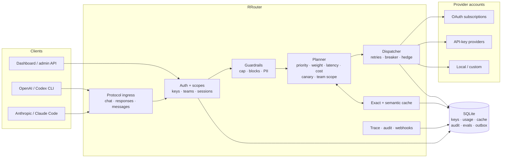

# Architecture

RRouter is one Rust binary with embedded SQLite and a compiled-in dashboard.

Request flow:

1. **Ingress** normalizes Chat, Responses and Messages into one canonical request.
2. **Auth + guardrails** resolve key/team, limits and PII/blocking policy.
3. **Planner** expands aliases/combos and selects eligible accounts; priority is authoritative.
4. **Dispatcher** retries, fails over, probes breakers and optionally hedges.
5. **Response** is translated back to the caller's dialect; usage, trace, audit and webhooks
   are recorded.
6. **Search** (`/v1/search`) skips dialect translation: it plans the same provider accounts,
   sends that provider's native search tool, and returns its cited answer in one canonical
   body. Retries, breakers, key limits and usage accounting are shared with chat.

| Crate | Responsibility |
| --- | --- |
| `rrouter-core` | shared request/response/stream types and errors |
| `rrouter-auth` | provider registry, credentials, OAuth refresh |
| `rrouter-store` | SQLite, encryption, connections/keys/teams/usage/evals/outbox |
| `rrouter-translate` | Chat ⇄ Responses ⇄ Anthropic, request and stream; native web-search adapters |
| `rrouter-router` | aliases, combos, planning, breaker, dispatch |
| `rrouter-rtk` | Token Saver: inbound tool-result compression |
| `rrouter-gateway` | HTTP surface, proxy, admin API, dashboard |
| `rrouter-ui` | embedded Vite dashboard |

The full diagram source is [`architecture.mmd`](architecture.mmd).
