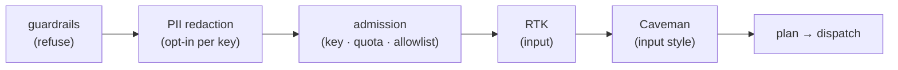

# Compression

Two methods trim a request, each with its own switch, both stored under one settings key
and edited on **ROUTING → Compression** (`/compression`, admin only). Every change saves
immediately; a failed save keeps the previous value.

| Method | Side | Effect |
| --- | --- | --- |
| `rtk` (Token Saver) | input · tool results | compresses noisy tool results before they reach the provider |
| `caveman` | output · model replies | appends a terse-output style instruction to the system prompt |

## Settings

```json
{ "compression": { "rtk": true, "caveman": false, "caveman_level": "full" } }
```

- `rtk` — boolean, default `true`. Compresses tool results on the inbound body: grouped
  greps, diffs and build logs collapse to their structure, long dumps keep head and tail
  with a marker. Error results are never touched.
- `caveman` — boolean, default `false`. Off because the instruction changes how *every*
  model reply reads.
- `caveman_level` — `lite`, `full` or `ultra`, default `full`. An unknown name is refused
  with `400`, never defaulted.

`PUT /api/settings` with `{"compression": {...}}` deep-merges: a patch naming one sub-key
keeps the other two, and an unknown sub-key is ignored. A non-boolean `rtk`/`caveman` or an
unknown level answers `400`. The write is audited as `settings_updated` with the top-level
key name only.

The flat pre-`compression` key `rtk` is still read — as the `rtk` default — only while no
`compression` object is stored. It is never written, and the stored copy is left untouched
so a rollback still honours it.

The stored block is mirrored into process atomics on startup and after every settings
write, so the proxy reads no database row per request.

## Per-request headers

| Header | Values | Absent |
| --- | --- | --- |
| `x-rrouter-rtk` | `off`, `0`, `false` disable (case-insensitive); any other value enables | stored `compression.rtk` |
| `x-rrouter-caveman` | same | stored `compression.caveman` |

The header is the whole decision: `x-rrouter-rtk: on` enables RTK even when the stored
switch is off.

## Pipeline order

On `/v1/chat/completions`, `/v1/responses` and `/v1/messages`:



Ordering is deliberate:

- Guardrails and admission run first, so a refused prompt costs no compression work.
- RTK runs on the wire body before planning, so same-dialect forwarding sends the
  compressed body unchanged.
- Caveman appends its instruction afterwards, to the prompt that will actually be sent, and
  the canonical parse is refreshed from the rewritten body. Routing reads the same body.

## Caveman

The instruction targets the response style only: code, paths, commands, error text, URLs
and identifiers stay verbatim, and security warnings, irreversible-action confirmations and
ordered multi-step sequences stay in normal prose. Each level is one fixed sentence, aimed
at the dialect's system slot:

| Dialect | Where the instruction goes |
| --- | --- |
| OpenAI Chat Completions | joined to the first system message, or a new system message opened at index 0; user and assistant turns untouched |
| OpenAI Responses | joined to `instructions`, created when absent or `null` |
| Anthropic Messages | joined to `system`, as a string or an appended text block |
| Embeddings, Code Assist, Qoder | never touched |

A string slot gets the instruction appended after a blank line; an existing instruction
in the body always stays first. Injection is idempotent: the shared marker line
(`Keep code, paths, commands, error text, URLs and identifiers verbatim.`) is searched for
anywhere in the body's system slot, so a second copy is never added — even after the level
changes. It is fail-open: a body whose system slot has an unexpected shape is forwarded
as written, never failed.

`rrouter_caveman_injected_total` counts requests whose body gained the instruction.
`rrouter_rtk_requests_total` and `rrouter_rtk_saved_bytes_total` count RTK the same way.
Those counters are process-lifetime totals; the stored effect readout below is what
survives a restart.

## RTK

RTK rewrites only tool results: OpenAI `role: "tool"` content, Responses
`function_call_output` items and Anthropic `tool_result` blocks. Error results and blobs
below 500 bytes are skipped, and a filter that would grow the text or return nothing falls
back to the original string. Filters are shape-based, not per-provider, so a provider whose
dialect is one of the three chat families is covered; embeddings, Google Code Assist and
Qoder frames are never rewritten. Model replies are not compressed: output trimming is
Caveman's job.

## Effectiveness

Every request whose body actually changed writes one row to `compression_events`, so a
row's presence is the signal — nothing is stored for a request compression left alone.
The write happens after RTK and Caveman and runs off the response path: a failed insert
logs a warning and never fails the request.

| Column | Meaning |
| --- | --- |
| `ts` | unix seconds |
| `request_id` | the request id, the same one `x-request-id` reports |
| `key_id` | the gateway key that spent the request |
| `team_id` | resolved from `key_id` at insert, exactly as on the usage row |
| `rtk_before`, `rtk_after` | tool-result text bytes the token saver saw and produced |
| `caveman` | `1` when the style instruction was appended |

The row is a counter, never a payload. A body that RTK or Caveman rewrote records only
the part that method touched: a Caveman-only request has `rtk_before` and `rtk_after` at
`0`, and an RTK-only request has `caveman` at `0`. Turning both methods off for a request
with `x-rrouter-rtk: off` and `x-rrouter-caveman: off` leaves nothing to report, so
nothing is recorded for it.

### Counter scope

`rtk_before` and `rtk_after` are the bytes of tool-result text only — the strings RTK was
handed and the strings it returned — never the whole request body. Error results, blobs
below 500 bytes and text no filter recognized are counted on both sides, so they add to
neither saving. A request whose filters were all skipped therefore records equal before
and after bytes.

### Reading it

```sh
curl -s "localhost:20128/api/compression/stats?hours=168" -H "x-api-key: <admin token>"
```

```json
{
  "hours": 168,
  "requests": 1204,
  "rtk_requests": 1103,
  "rtk_before": 18400000,
  "rtk_after": 5100000,
  "rtk_saved": 13300000,
  "rtk_saved_tokens_estimate": 3325000,
  "caveman_requests": 640
}
```

| Parameter | Default | Notes |
| --- | --- | --- |
| `hours` | `168` | clamped to `1`–`8760`; a non-numeric value answers `400` |
| `team_id` | none | a uuid; a reader may only name a team they belong to, otherwise `403` |

`requests` counts every row — RTK removed something, Caveman injected, or both.
`rtk_requests` counts only rows with `rtk_before > 0`, `caveman_requests` only rows where
the instruction went in, so the two do not sum to `requests`. `rtk_saved` is
`rtk_before - rtk_after`, saturating at zero.

`rtk_saved_tokens_estimate` is `rtk_saved / 4` and is an estimate, not a tokenizer run: no
provider's tokenizer is authoritative for bytes that were never sent, so the rule of thumb
stands in. Caveman's saving is on the reply side and is not measured — its number is a
count of injections.

Team scoping is the one `/api/usage/summary` uses: an admin sees every team and may narrow
to one, a reader sees their own teams.

### Retention

Nothing to configure: the rows follow the usage retention cutoff and are deleted with the
usage rows when `usage_retention_days` is above `0`. A prune failure is logged and reported
as zero without stopping the rest of the sweep. With retention off the rows are kept.

### Where it shows

**ROUTING → Compression** carries an Effect card over 24h, 7d or 30d: tool-result bytes
before and after, the percentage removed, the estimated tokens saved, changed requests and
Caveman injections. **Activity** adds one line — tokens saved across N requests — only when
the window holds at least one event, and links back to the Compression page.
