# Surface map

Generated by `scripts/surface-map.py` — do not edit. It reads the dashboard routes,
pages, imports, hooks, endpoints, settings keys, docs, tests and screenshots, and
`--check` fails when this file is stale or a route, page, endpoint or test is
missing from it.

```sh
scripts/surface-map.py --affected <files>   # every surface a change reaches
scripts/surface-map.py                      # regenerate this file and docs/surfaces.json
scripts/surface-map.py --check              # what CI and scripts/verify.sh run
```

## Graph

Route → page → endpoint → handler. Shared files and hooks are per page below; drawing
them here would cross every route into one knot.

```mermaid
graph LR
  e__api_aliases["/api/aliases"]
  e__api_capabilities["/api/capabilities"]
  e__api_combos["/api/combos"]
  e__api_connections["/api/connections"]
  e__api_evals_runs["/api/evals/runs"]
  e__api_evals_suites["/api/evals/suites"]
  e__api_free_mode["/api/free-mode"]
  e__api_keys["/api/keys"]
  e__api_keys__["/api/keys/*"]
  e__api_keys___models["/api/keys/*/models"]
  e__api_model_presets["/api/model-presets"]
  e__api_models_fetch["/api/models/fetch"]
  e__api_models_providers["/api/models/providers"]
  e__api_models_sync["/api/models/sync"]
  e__api_models_test["/api/models/test"]
  e__api_oauth___status__["/api/oauth/*/status/*"]
  e__api_oauth_providers["/api/oauth/providers"]
  e__api_settings["/api/settings"]
  e__api_settings_retention_sweep["/api/settings/retention/sweep"]
  e__api_system["/api/system"]
  e__api_system_logs["/api/system/logs"]
  e__api_system_logs__["/api/system/logs/*"]
  e__api_teams["/api/teams"]
  e__api_templates["/api/templates"]
  e__api_webhooks["/api/webhooks"]
  e__api_webhooks_status["/api/webhooks/status"]
  h_capabilities_rs["capabilities.rs"]
  h_combos_rs["combos.rs"]
  h_connections_rs["connections.rs"]
  h_evals_rs["evals.rs"]
  h_free_mode_rs["free_mode.rs"]
  h_keys_rs["keys.rs"]
  h_model_presets_rs["model_presets.rs"]
  h_models_rs["models.rs"]
  h_oauth_rs["oauth.rs"]
  h_providers_rs["providers.rs"]
  h_settings_rs["settings.rs"]
  h_system_logs_rs["system_logs.rs"]
  h_system_rs["system.rs"]
  h_teams_rs["teams.rs"]
  h_templates_rs["templates.rs"]
  h_webhooks_rs["webhooks.rs"]
  p_aliases["aliases"]
  p_appearance["appearance"]
  p_audit["audit"]
  p_combos["combos"]
  p_compression["compression"]
  p_embeddings["embeddings"]
  p_evals["evals"]
  p_forgot["forgot"]
  p_free_mode["free-mode"]
  p_general["general"]
  p_health["health"]
  p_index["index"]
  p_invite["invite"]
  p_keys["keys"]
  p_live_routing["live-routing"]
  p_models["models"]
  p_playground["playground"]
  p_presets["presets"]
  p_profile["profile"]
  p_providers["providers"]
  p_quickstart["quickstart"]
  p_register["register"]
  p_rerank["rerank"]
  p_runtime["runtime"]
  p_search["search"]
  p_security["security"]
  p_sessions["sessions"]
  p_setup_admin["setup-admin"]
  p_sign_in["sign-in"]
  p_system_logs["system-logs"]
  p_teams["teams"]
  p_templates["templates"]
  p_token_signin["token-signin"]
  p_usage["usage"]
  p_users["users"]
  p_webhooks["webhooks"]
  r_access_audit["access/audit"]
  r_access_keys["access/keys"]
  r_access_teams["access/teams"]
  r_access_users["access/users"]
  r_capability_embeddings["capability/embeddings"]
  r_capability_rerank["capability/rerank"]
  r_capability_search["capability/search"]
  r_compression["compression"]
  r_forgot["forgot"]
  r_free_mode["free-mode"]
  r_invite__token["invite/:token"]
  r_models["models"]
  r_playground_chat["playground/chat"]
  r_playground_evals["playground/evals"]
  r_playground_templates["playground/templates"]
  r_providers["providers"]
  r_quickstart["quickstart"]
  r_register["register"]
  r_routing_aliases["routing/aliases"]
  r_routing_combos["routing/combos"]
  r_routing_presets["routing/presets"]
  r_routing_topology["routing/topology"]
  r_settings_appearance["settings/appearance"]
  r_settings_general["settings/general"]
  r_settings_profile["settings/profile"]
  r_settings_runtime["settings/runtime"]
  r_settings_security["settings/security"]
  r_settings_sessions["settings/sessions"]
  r_setup["setup"]
  r_setup_admin["setup/admin"]
  r_sign_in["sign-in"]
  r_sign_in_token["sign-in/token"]
  r_system_health["system/health"]
  r_system_logs["system/logs"]
  r_system_webhooks["system/webhooks"]
  r_usage["usage"]
  e__api_aliases --> h_models_rs
  e__api_capabilities --> h_capabilities_rs
  e__api_combos --> h_combos_rs
  e__api_connections --> h_connections_rs
  e__api_evals_runs --> h_evals_rs
  e__api_evals_suites --> h_evals_rs
  e__api_free_mode --> h_free_mode_rs
  e__api_keys --> h_keys_rs
  e__api_keys__ --> h_keys_rs
  e__api_keys___models --> h_keys_rs
  e__api_model_presets --> h_model_presets_rs
  e__api_models_fetch --> h_models_rs
  e__api_models_providers --> h_providers_rs
  e__api_models_sync --> h_models_rs
  e__api_models_test --> h_models_rs
  e__api_oauth___status__ --> h_oauth_rs
  e__api_oauth_providers --> h_oauth_rs
  e__api_settings --> h_settings_rs
  e__api_settings_retention_sweep --> h_settings_rs
  e__api_system --> h_system_rs
  e__api_system_logs --> h_system_logs_rs
  e__api_system_logs__ --> h_system_logs_rs
  e__api_teams --> h_teams_rs
  e__api_templates --> h_templates_rs
  e__api_webhooks --> h_webhooks_rs
  e__api_webhooks_status --> h_webhooks_rs
  p_aliases --> e__api_aliases
  p_aliases --> e__api_models_providers
  p_combos --> e__api_combos
  p_combos --> e__api_models_providers
  p_compression --> e__api_settings
  p_embeddings --> e__api_capabilities
  p_embeddings --> e__api_connections
  p_evals --> e__api_evals_runs
  p_evals --> e__api_evals_suites
  p_general --> e__api_settings
  p_health --> e__api_connections
  p_health --> e__api_system
  p_health --> e__api_system_logs
  p_index --> e__api_connections
  p_index --> e__api_keys
  p_index --> e__api_models_providers
  p_index --> e__api_models_test
  p_index --> e__api_oauth___status__
  p_index --> e__api_oauth_providers
  p_keys --> e__api_keys
  p_keys --> e__api_keys__
  p_keys --> e__api_keys___models
  p_keys --> e__api_models_providers
  p_keys --> e__api_system
  p_keys --> e__api_teams
  p_live_routing --> e__api_connections
  p_models --> e__api_aliases
  p_models --> e__api_combos
  p_models --> e__api_free_mode
  p_models --> e__api_keys
  p_models --> e__api_model_presets
  p_models --> e__api_models_providers
  p_models --> e__api_teams
  p_playground --> e__api_models_providers
  p_playground --> e__api_system
  p_playground --> e__api_templates
  p_presets --> e__api_model_presets
  p_presets --> e__api_models_providers
  p_providers --> e__api_connections
  p_providers --> e__api_models_providers
  p_providers --> e__api_oauth___status__
  p_providers --> e__api_oauth_providers
  p_providers --> e__api_teams
  p_quickstart --> e__api_models_providers
  p_quickstart --> e__api_teams
  p_rerank --> e__api_capabilities
  p_rerank --> e__api_connections
  p_runtime --> e__api_connections
  p_runtime --> e__api_models_fetch
  p_runtime --> e__api_models_sync
  p_runtime --> e__api_settings
  p_runtime --> e__api_settings_retention_sweep
  p_runtime --> e__api_system
  p_search --> e__api_capabilities
  p_search --> e__api_connections
  p_system_logs --> e__api_system_logs
  p_system_logs --> e__api_system_logs__
  p_teams --> e__api_connections
  p_teams --> e__api_teams
  p_templates --> e__api_templates
  p_usage --> e__api_connections
  p_usage --> e__api_models_providers
  p_webhooks --> e__api_webhooks
  p_webhooks --> e__api_webhooks_status
  r_access_audit --> p_audit
  r_access_keys --> p_keys
  r_access_teams --> p_teams
  r_access_users --> p_users
  r_capability_embeddings --> p_embeddings
  r_capability_rerank --> p_rerank
  r_capability_search --> p_search
  r_compression --> p_compression
  r_forgot --> p_forgot
  r_free_mode --> p_free_mode
  r_invite__token --> p_invite
  r_models --> p_models
  r_playground_chat --> p_playground
  r_playground_evals --> p_evals
  r_playground_templates --> p_templates
  r_providers --> p_providers
  r_quickstart --> p_quickstart
  r_register --> p_register
  r_routing_aliases --> p_aliases
  r_routing_combos --> p_combos
  r_routing_presets --> p_presets
  r_routing_topology --> p_live_routing
  r_settings_appearance --> p_appearance
  r_settings_general --> p_general
  r_settings_profile --> p_profile
  r_settings_runtime --> p_runtime
  r_settings_security --> p_security
  r_settings_sessions --> p_sessions
  r_setup --> p_index
  r_setup_admin --> p_setup_admin
  r_sign_in --> p_sign_in
  r_sign_in_token --> p_token_signin
  r_system_health --> p_health
  r_system_logs --> p_system_logs
  r_system_webhooks --> p_webhooks
  r_usage --> p_usage
```



### `access/audit`

Page: `ui/src/pages/audit.tsx`

- Shared files (hops from the page): `ui/src/components/atoms/Badge.tsx` (2), `ui/src/components/atoms/Button.tsx` (2), `ui/src/components/atoms/Checkbox.tsx` (2), `ui/src/components/atoms/CopyButton.tsx` (2), `ui/src/components/atoms/CopyChip.tsx` (2), `ui/src/components/atoms/CopyIconButton.tsx` (2), `ui/src/components/atoms/Divider.tsx` (2), `ui/src/components/atoms/Dot.tsx` (2), `ui/src/components/atoms/FilterChip.tsx` (2), `ui/src/components/atoms/Grid.tsx` (2), `ui/src/components/atoms/Heading.tsx` (2), `ui/src/components/atoms/IconButton.tsx` (2), `ui/src/components/atoms/Inline.tsx` (2), `ui/src/components/atoms/Input.tsx` (2), `ui/src/components/atoms/Meter.tsx` (2), `ui/src/components/atoms/SectionLabel.tsx` (2), `ui/src/components/atoms/Segmented.tsx` (2), `ui/src/components/atoms/Select.tsx` (2), `ui/src/components/atoms/Stack.tsx` (2), `ui/src/components/atoms/StatusPill.tsx` (2), `ui/src/components/atoms/TabStrip.tsx` (2), `ui/src/components/atoms/Text.tsx` (2), `ui/src/components/atoms/Textarea.tsx` (2), `ui/src/components/atoms/Toggle.tsx` (2), `ui/src/components/atoms/layout.ts` (2), `ui/src/components/atoms/typography.ts` (2), `ui/src/components/atoms/useCopy.ts` (2), `ui/src/components/molecules/AlertBanner.tsx` (2), `ui/src/components/molecules/Card.tsx` (2), `ui/src/components/molecules/CardFooter.tsx` (2), `ui/src/components/molecules/CardHeader.tsx` (2), `ui/src/components/molecules/ConfirmDialog.tsx` (2), `ui/src/components/molecules/Disclosure.tsx` (2), `ui/src/components/molecules/EmptyState.tsx` (2), `ui/src/components/molecules/ErrorNote.tsx` (2), `ui/src/components/molecules/Field.tsx` (2), `ui/src/components/molecules/Modal.tsx` (2), `ui/src/components/molecules/PageHeader.tsx` (2), `ui/src/components/molecules/PageLayout.tsx` (2), `ui/src/components/molecules/Tabs.tsx` (2), `ui/src/components/table.tsx` (1), `ui/src/components/ui.tsx` (1), `ui/src/lib/api.ts` (2), `ui/src/lib/auth.ts` (1), `ui/src/lib/cx.ts` (3), `ui/src/lib/format.ts` (1), `ui/src/lib/free-mode-document.ts` (4), `ui/src/lib/free-mode.ts` (2), `ui/src/lib/queries.ts` (1), `ui/src/pages/free-mode/model.ts` (3)
- Query hooks: `useAudit` → `ui/src/pages/audit.tsx`
- Endpoints: —
- Docs: —
- Tests: `crates/rrouter-gateway/tests/auth.rs`, `crates/rrouter-gateway/tests/connection_scope.rs`, `crates/rrouter-gateway/tests/model_presets.rs`, `crates/rrouter-gateway/tests/proxy.rs`, `crates/rrouter-gateway/tests/teams.rs`, `crates/rrouter-gateway/tests/webhooks.rs`, `crates/rrouter-store/tests/store.rs`, `ui/src/pages/models/models.test.ts`
- Screenshots: —

### `access/keys`

Page: `ui/src/pages/keys.tsx`

- Shared files (hops from the page): `ui/src/components/atoms/Badge.tsx` (2), `ui/src/components/atoms/Button.tsx` (2), `ui/src/components/atoms/Checkbox.tsx` (2), `ui/src/components/atoms/CopyButton.tsx` (2), `ui/src/components/atoms/CopyChip.tsx` (2), `ui/src/components/atoms/CopyIconButton.tsx` (2), `ui/src/components/atoms/Divider.tsx` (2), `ui/src/components/atoms/Dot.tsx` (2), `ui/src/components/atoms/FilterChip.tsx` (2), `ui/src/components/atoms/Grid.tsx` (2), `ui/src/components/atoms/Heading.tsx` (2), `ui/src/components/atoms/IconButton.tsx` (2), `ui/src/components/atoms/Inline.tsx` (2), `ui/src/components/atoms/Input.tsx` (2), `ui/src/components/atoms/Meter.tsx` (2), `ui/src/components/atoms/SectionLabel.tsx` (2), `ui/src/components/atoms/Segmented.tsx` (2), `ui/src/components/atoms/Select.tsx` (2), `ui/src/components/atoms/Stack.tsx` (2), `ui/src/components/atoms/StatusPill.tsx` (2), `ui/src/components/atoms/TabStrip.tsx` (2), `ui/src/components/atoms/Text.tsx` (2), `ui/src/components/atoms/Textarea.tsx` (2), `ui/src/components/atoms/Toggle.tsx` (2), `ui/src/components/atoms/index.ts` (1), `ui/src/components/atoms/layout.ts` (2), `ui/src/components/atoms/typography.ts` (2), `ui/src/components/atoms/useCopy.ts` (2), `ui/src/components/connection-card.tsx` (1), `ui/src/components/create-key-modal.tsx` (1), `ui/src/components/model-picker.tsx` (2), `ui/src/components/molecules/AlertBanner.tsx` (2), `ui/src/components/molecules/Card.tsx` (2), `ui/src/components/molecules/CardFooter.tsx` (2), `ui/src/components/molecules/CardHeader.tsx` (2), `ui/src/components/molecules/ConfirmDialog.tsx` (2), `ui/src/components/molecules/Disclosure.tsx` (2), `ui/src/components/molecules/EmptyState.tsx` (2), `ui/src/components/molecules/ErrorNote.tsx` (2), `ui/src/components/molecules/Field.tsx` (2), `ui/src/components/molecules/Modal.tsx` (2), `ui/src/components/molecules/PageHeader.tsx` (2), `ui/src/components/molecules/PageLayout.tsx` (2), `ui/src/components/molecules/Tabs.tsx` (2), `ui/src/components/table.tsx` (1), `ui/src/components/ui.tsx` (1), `ui/src/lib/api.ts` (1), `ui/src/lib/auth.ts` (2), `ui/src/lib/cx.ts` (3), `ui/src/lib/format.ts` (1), `ui/src/lib/free-mode-document.ts` (4), `ui/src/lib/free-mode.ts` (2), `ui/src/lib/models.ts` (3), `ui/src/lib/queries.ts` (1), `ui/src/pages/free-mode/model.ts` (3), `ui/src/pages/keys/key-settings-drawer.tsx` (1), `ui/src/pages/keys/spend-cell.tsx` (1), `ui/src/pages/models/price.ts` (3)
- Query hooks: `useKeyModels` → `ui/src/pages/keys/key-settings-drawer.tsx`, `useKeys` → `ui/src/pages/keys.tsx`, `useModelProviders` → `ui/src/components/model-picker.tsx`, `useModels` → `ui/src/pages/keys/key-settings-drawer.tsx`, `usePlaygroundKey` → `ui/src/pages/keys/key-settings-drawer.tsx`, `useSystem` → `ui/src/pages/keys.tsx`, `useTeams` → `ui/src/pages/keys.tsx`, `useUpdateKey` → `ui/src/pages/keys/key-settings-drawer.tsx`, `useUpdateKeyModels` → `ui/src/pages/keys/key-settings-drawer.tsx`
- Endpoints: `/api/keys`, `/api/keys/*`, `/api/keys/*/models`, `/api/models/providers`, `/api/system`, `/api/teams`
- Docs: `docs/API.md`, `docs/FREE_MODE.md`, `docs/GUARDRAILS.md`, `docs/ROADMAP.md`
- Tests: `crates/rrouter-auth/tests/manifests.rs`, `crates/rrouter-gateway/tests/auth.rs`, `crates/rrouter-gateway/tests/connection_scope.rs`, `crates/rrouter-gateway/tests/free_mode.rs`, `crates/rrouter-gateway/tests/google_cca.rs`, `crates/rrouter-gateway/tests/keys.rs`, `crates/rrouter-gateway/tests/models.rs`, `crates/rrouter-gateway/tests/proxy.rs`, `crates/rrouter-gateway/tests/search.rs`, `crates/rrouter-gateway/tests/teams.rs`, `crates/rrouter-gateway/tests/webhooks.rs`, `crates/rrouter-router/tests/free_mode.rs`, `crates/rrouter-router/tests/routing.rs`, `crates/rrouter-store/tests/free_mode.rs`, `crates/rrouter-store/tests/store.rs`, `scripts/backup_restore_smoke.py`, `scripts/free_mode_smoke.py`, `scripts/test-surface-map.sh`, `ui/src/pages/models/models.test.ts`, `ui/tests/free-mode-document.test.ts`, `ui/tests/usage-board.test.ts`
- Screenshots: `docs/screenshots/keys.png`

### `access/teams`

Page: `ui/src/pages/teams.tsx`

- Shared files (hops from the page): `ui/src/components/atoms/Badge.tsx` (2), `ui/src/components/atoms/Button.tsx` (2), `ui/src/components/atoms/Checkbox.tsx` (2), `ui/src/components/atoms/CopyButton.tsx` (2), `ui/src/components/atoms/CopyChip.tsx` (2), `ui/src/components/atoms/CopyIconButton.tsx` (2), `ui/src/components/atoms/Divider.tsx` (2), `ui/src/components/atoms/Dot.tsx` (2), `ui/src/components/atoms/FilterChip.tsx` (2), `ui/src/components/atoms/Grid.tsx` (2), `ui/src/components/atoms/Heading.tsx` (2), `ui/src/components/atoms/IconButton.tsx` (2), `ui/src/components/atoms/Inline.tsx` (2), `ui/src/components/atoms/Input.tsx` (2), `ui/src/components/atoms/Meter.tsx` (2), `ui/src/components/atoms/SectionLabel.tsx` (2), `ui/src/components/atoms/Segmented.tsx` (2), `ui/src/components/atoms/Select.tsx` (2), `ui/src/components/atoms/Stack.tsx` (2), `ui/src/components/atoms/StatusPill.tsx` (2), `ui/src/components/atoms/TabStrip.tsx` (2), `ui/src/components/atoms/Text.tsx` (2), `ui/src/components/atoms/Textarea.tsx` (2), `ui/src/components/atoms/Toggle.tsx` (2), `ui/src/components/atoms/layout.ts` (2), `ui/src/components/atoms/typography.ts` (2), `ui/src/components/atoms/useCopy.ts` (2), `ui/src/components/molecules/AlertBanner.tsx` (2), `ui/src/components/molecules/Card.tsx` (2), `ui/src/components/molecules/CardFooter.tsx` (2), `ui/src/components/molecules/CardHeader.tsx` (2), `ui/src/components/molecules/ConfirmDialog.tsx` (2), `ui/src/components/molecules/Disclosure.tsx` (2), `ui/src/components/molecules/EmptyState.tsx` (2), `ui/src/components/molecules/ErrorNote.tsx` (2), `ui/src/components/molecules/Field.tsx` (2), `ui/src/components/molecules/Modal.tsx` (2), `ui/src/components/molecules/PageHeader.tsx` (2), `ui/src/components/molecules/PageLayout.tsx` (2), `ui/src/components/molecules/Tabs.tsx` (2), `ui/src/components/table.tsx` (1), `ui/src/components/ui.tsx` (1), `ui/src/lib/api.ts` (1), `ui/src/lib/auth.ts` (2), `ui/src/lib/cx.ts` (3), `ui/src/lib/format.ts` (1), `ui/src/lib/free-mode-document.ts` (4), `ui/src/lib/free-mode.ts` (2), `ui/src/lib/queries.ts` (1), `ui/src/pages/free-mode/model.ts` (3)
- Query hooks: `useAddTeamMember` → `ui/src/pages/teams.tsx`, `useAuthState` → `ui/src/pages/teams.tsx`, `useConnections` → `ui/src/pages/teams.tsx`, `useCreateTeam` → `ui/src/pages/teams.tsx`, `useDeleteTeam` → `ui/src/pages/teams.tsx`, `useIsAdmin` → `ui/src/pages/teams.tsx`, `useRemoveTeamMember` → `ui/src/pages/teams.tsx`, `useTeamKeys` → `ui/src/pages/teams.tsx`, `useTeamMembers` → `ui/src/pages/teams.tsx`, `useTeams` → `ui/src/pages/teams.tsx`, `useUpdateTeam` → `ui/src/pages/teams.tsx`
- Endpoints: `/api/connections`, `/api/teams`
- Docs: `docs/API.md`, `docs/DEPLOY.md`
- Tests: `crates/rrouter-gateway/tests/auth.rs`, `crates/rrouter-gateway/tests/connection_scope.rs`, `crates/rrouter-gateway/tests/egress_proxy.rs`, `crates/rrouter-gateway/tests/evals.rs`, `crates/rrouter-gateway/tests/model_presets.rs`, `crates/rrouter-gateway/tests/models.rs`, `crates/rrouter-gateway/tests/oauth_flow.rs`, `crates/rrouter-gateway/tests/proxy.rs`, `crates/rrouter-gateway/tests/teams.rs`, `crates/rrouter-store/tests/store.rs`, `scripts/backup_restore_smoke.py`, `scripts/e2e_smoke.py`, `scripts/test-surface-map.sh`
- Screenshots: `docs/screenshots/teams.png`

### `access/users`

Page: `ui/src/pages/users.tsx`

- Shared files (hops from the page): `ui/src/components/atoms/Badge.tsx` (2), `ui/src/components/atoms/Button.tsx` (2), `ui/src/components/atoms/Checkbox.tsx` (2), `ui/src/components/atoms/CopyButton.tsx` (2), `ui/src/components/atoms/CopyChip.tsx` (2), `ui/src/components/atoms/CopyIconButton.tsx` (2), `ui/src/components/atoms/Divider.tsx` (2), `ui/src/components/atoms/Dot.tsx` (2), `ui/src/components/atoms/FilterChip.tsx` (2), `ui/src/components/atoms/Grid.tsx` (2), `ui/src/components/atoms/Heading.tsx` (2), `ui/src/components/atoms/IconButton.tsx` (2), `ui/src/components/atoms/Inline.tsx` (2), `ui/src/components/atoms/Input.tsx` (2), `ui/src/components/atoms/Meter.tsx` (2), `ui/src/components/atoms/SectionLabel.tsx` (2), `ui/src/components/atoms/Segmented.tsx` (2), `ui/src/components/atoms/Select.tsx` (2), `ui/src/components/atoms/Stack.tsx` (2), `ui/src/components/atoms/StatusPill.tsx` (2), `ui/src/components/atoms/TabStrip.tsx` (2), `ui/src/components/atoms/Text.tsx` (2), `ui/src/components/atoms/Textarea.tsx` (2), `ui/src/components/atoms/Toggle.tsx` (2), `ui/src/components/atoms/layout.ts` (2), `ui/src/components/atoms/typography.ts` (2), `ui/src/components/atoms/useCopy.ts` (2), `ui/src/components/molecules/AlertBanner.tsx` (2), `ui/src/components/molecules/Card.tsx` (2), `ui/src/components/molecules/CardFooter.tsx` (2), `ui/src/components/molecules/CardHeader.tsx` (2), `ui/src/components/molecules/ConfirmDialog.tsx` (2), `ui/src/components/molecules/Disclosure.tsx` (2), `ui/src/components/molecules/EmptyState.tsx` (2), `ui/src/components/molecules/ErrorNote.tsx` (2), `ui/src/components/molecules/Field.tsx` (2), `ui/src/components/molecules/Modal.tsx` (2), `ui/src/components/molecules/PageHeader.tsx` (2), `ui/src/components/molecules/PageLayout.tsx` (2), `ui/src/components/molecules/Tabs.tsx` (2), `ui/src/components/table.tsx` (1), `ui/src/components/ui.tsx` (1), `ui/src/lib/api.ts` (2), `ui/src/lib/auth.ts` (1), `ui/src/lib/cx.ts` (3), `ui/src/lib/format.ts` (1), `ui/src/lib/free-mode-document.ts` (4), `ui/src/lib/free-mode.ts` (2), `ui/src/lib/queries.ts` (1), `ui/src/pages/free-mode/model.ts` (3)
- Query hooks: `useAuthState` → `ui/src/pages/users.tsx`, `useCreateInvite` → `ui/src/pages/users.tsx`, `useInvites` → `ui/src/pages/users.tsx`, `useRemoveUser` → `ui/src/pages/users.tsx`, `useRevokeInvite` → `ui/src/pages/users.tsx`, `useUpdateUser` → `ui/src/pages/users.tsx`, `useUsers` → `ui/src/pages/users.tsx`
- Endpoints: —
- Docs: —
- Tests: `crates/rrouter-gateway/tests/auth.rs`, `crates/rrouter-gateway/tests/connection_scope.rs`, `crates/rrouter-gateway/tests/evals.rs`, `crates/rrouter-gateway/tests/keys.rs`, `crates/rrouter-gateway/tests/model_presets.rs`, `crates/rrouter-gateway/tests/quota_history.rs`, `crates/rrouter-gateway/tests/teams.rs`, `crates/rrouter-store/tests/store.rs`, `scripts/backup_restore_smoke.py`
- Screenshots: —

### `capability/embeddings`

Page: `ui/src/pages/capability/embeddings.tsx`

- Shared files (hops from the page): `ui/src/components/atoms/Badge.tsx` (3), `ui/src/components/atoms/Button.tsx` (3), `ui/src/components/atoms/Checkbox.tsx` (3), `ui/src/components/atoms/CopyButton.tsx` (3), `ui/src/components/atoms/CopyChip.tsx` (3), `ui/src/components/atoms/CopyIconButton.tsx` (3), `ui/src/components/atoms/Divider.tsx` (3), `ui/src/components/atoms/Dot.tsx` (3), `ui/src/components/atoms/FilterChip.tsx` (3), `ui/src/components/atoms/Grid.tsx` (3), `ui/src/components/atoms/Heading.tsx` (3), `ui/src/components/atoms/IconButton.tsx` (3), `ui/src/components/atoms/Inline.tsx` (3), `ui/src/components/atoms/Input.tsx` (3), `ui/src/components/atoms/Meter.tsx` (3), `ui/src/components/atoms/SectionLabel.tsx` (3), `ui/src/components/atoms/Segmented.tsx` (3), `ui/src/components/atoms/Select.tsx` (3), `ui/src/components/atoms/Stack.tsx` (3), `ui/src/components/atoms/StatusPill.tsx` (3), `ui/src/components/atoms/TabStrip.tsx` (3), `ui/src/components/atoms/Text.tsx` (3), `ui/src/components/atoms/Textarea.tsx` (3), `ui/src/components/atoms/Toggle.tsx` (3), `ui/src/components/atoms/layout.ts` (3), `ui/src/components/atoms/typography.ts` (3), `ui/src/components/atoms/useCopy.ts` (3), `ui/src/components/molecules/AlertBanner.tsx` (3), `ui/src/components/molecules/Card.tsx` (3), `ui/src/components/molecules/CardFooter.tsx` (3), `ui/src/components/molecules/CardHeader.tsx` (3), `ui/src/components/molecules/ConfirmDialog.tsx` (3), `ui/src/components/molecules/Disclosure.tsx` (3), `ui/src/components/molecules/EmptyState.tsx` (3), `ui/src/components/molecules/ErrorNote.tsx` (3), `ui/src/components/molecules/Field.tsx` (3), `ui/src/components/molecules/Modal.tsx` (3), `ui/src/components/molecules/PageHeader.tsx` (3), `ui/src/components/molecules/PageLayout.tsx` (3), `ui/src/components/molecules/Tabs.tsx` (3), `ui/src/components/ui.tsx` (2), `ui/src/lib/api.ts` (2), `ui/src/lib/auth.ts` (3), `ui/src/lib/cx.ts` (3), `ui/src/lib/free-mode.ts` (3), `ui/src/lib/queries.ts` (2), `ui/src/pages/capability/shared.tsx` (1), `ui/src/pages/free-mode/model.ts` (4), `ui/src/pages/settings/gateway-settings.ts` (2)
- Query hooks: `useCapabilities` → `ui/src/pages/capability/shared.tsx`, `useConnections` → `ui/src/pages/capability/shared.tsx`, `useModels` → `ui/src/pages/capability/shared.tsx`
- Endpoints: `/api/capabilities`, `/api/connections`
- Docs: `docs/API.md`, `docs/DEPLOY.md`
- Tests: `crates/rrouter-gateway/tests/auth.rs`, `crates/rrouter-gateway/tests/capture.rs`, `crates/rrouter-gateway/tests/connection_scope.rs`, `crates/rrouter-gateway/tests/egress_proxy.rs`, `crates/rrouter-gateway/tests/free_mode.rs`, `crates/rrouter-gateway/tests/models.rs`, `crates/rrouter-gateway/tests/oauth_flow.rs`, `crates/rrouter-gateway/tests/proxy.rs`, `crates/rrouter-gateway/tests/search.rs`, `crates/rrouter-gateway/tests/teams.rs`, `crates/rrouter-router/tests/routing.rs`, `crates/rrouter-store/tests/store.rs`, `scripts/backup_restore_smoke.py`, `scripts/e2e_smoke.py`, `scripts/test-surface-map.sh`
- Screenshots: —

### `capability/rerank`

Page: `ui/src/pages/capability/rerank.tsx`

- Shared files (hops from the page): `ui/src/components/atoms/Badge.tsx` (3), `ui/src/components/atoms/Button.tsx` (3), `ui/src/components/atoms/Checkbox.tsx` (3), `ui/src/components/atoms/CopyButton.tsx` (3), `ui/src/components/atoms/CopyChip.tsx` (3), `ui/src/components/atoms/CopyIconButton.tsx` (3), `ui/src/components/atoms/Divider.tsx` (3), `ui/src/components/atoms/Dot.tsx` (3), `ui/src/components/atoms/FilterChip.tsx` (3), `ui/src/components/atoms/Grid.tsx` (3), `ui/src/components/atoms/Heading.tsx` (3), `ui/src/components/atoms/IconButton.tsx` (3), `ui/src/components/atoms/Inline.tsx` (3), `ui/src/components/atoms/Input.tsx` (3), `ui/src/components/atoms/Meter.tsx` (3), `ui/src/components/atoms/SectionLabel.tsx` (3), `ui/src/components/atoms/Segmented.tsx` (3), `ui/src/components/atoms/Select.tsx` (3), `ui/src/components/atoms/Stack.tsx` (3), `ui/src/components/atoms/StatusPill.tsx` (3), `ui/src/components/atoms/TabStrip.tsx` (3), `ui/src/components/atoms/Text.tsx` (3), `ui/src/components/atoms/Textarea.tsx` (3), `ui/src/components/atoms/Toggle.tsx` (3), `ui/src/components/atoms/layout.ts` (3), `ui/src/components/atoms/typography.ts` (3), `ui/src/components/atoms/useCopy.ts` (3), `ui/src/components/molecules/AlertBanner.tsx` (3), `ui/src/components/molecules/Card.tsx` (3), `ui/src/components/molecules/CardFooter.tsx` (3), `ui/src/components/molecules/CardHeader.tsx` (3), `ui/src/components/molecules/ConfirmDialog.tsx` (3), `ui/src/components/molecules/Disclosure.tsx` (3), `ui/src/components/molecules/EmptyState.tsx` (3), `ui/src/components/molecules/ErrorNote.tsx` (3), `ui/src/components/molecules/Field.tsx` (3), `ui/src/components/molecules/Modal.tsx` (3), `ui/src/components/molecules/PageHeader.tsx` (3), `ui/src/components/molecules/PageLayout.tsx` (3), `ui/src/components/molecules/Tabs.tsx` (3), `ui/src/components/ui.tsx` (2), `ui/src/lib/api.ts` (2), `ui/src/lib/auth.ts` (3), `ui/src/lib/cx.ts` (3), `ui/src/lib/free-mode.ts` (3), `ui/src/lib/queries.ts` (2), `ui/src/pages/capability/shared.tsx` (1), `ui/src/pages/free-mode/model.ts` (4), `ui/src/pages/settings/gateway-settings.ts` (2)
- Query hooks: `useCapabilities` → `ui/src/pages/capability/shared.tsx`, `useConnections` → `ui/src/pages/capability/shared.tsx`, `useModels` → `ui/src/pages/capability/shared.tsx`
- Endpoints: `/api/capabilities`, `/api/connections`
- Docs: `docs/API.md`, `docs/DEPLOY.md`
- Tests: `crates/rrouter-auth/tests/manifests.rs`, `crates/rrouter-gateway/tests/auth.rs`, `crates/rrouter-gateway/tests/capture.rs`, `crates/rrouter-gateway/tests/connection_scope.rs`, `crates/rrouter-gateway/tests/egress_proxy.rs`, `crates/rrouter-gateway/tests/models.rs`, `crates/rrouter-gateway/tests/oauth_flow.rs`, `crates/rrouter-gateway/tests/proxy.rs`, `crates/rrouter-gateway/tests/rerank.rs`, `crates/rrouter-gateway/tests/search.rs`, `crates/rrouter-gateway/tests/teams.rs`, `crates/rrouter-router/tests/routing.rs`, `crates/rrouter-store/tests/store.rs`, `scripts/backup_restore_smoke.py`, `scripts/e2e_smoke.py`, `scripts/test-surface-map.sh`
- Screenshots: —

### `capability/search`

Page: `ui/src/pages/capability/search.tsx`

- Shared files (hops from the page): `ui/src/components/atoms/Badge.tsx` (3), `ui/src/components/atoms/Button.tsx` (3), `ui/src/components/atoms/Checkbox.tsx` (3), `ui/src/components/atoms/CopyButton.tsx` (3), `ui/src/components/atoms/CopyChip.tsx` (3), `ui/src/components/atoms/CopyIconButton.tsx` (3), `ui/src/components/atoms/Divider.tsx` (3), `ui/src/components/atoms/Dot.tsx` (3), `ui/src/components/atoms/FilterChip.tsx` (3), `ui/src/components/atoms/Grid.tsx` (3), `ui/src/components/atoms/Heading.tsx` (3), `ui/src/components/atoms/IconButton.tsx` (3), `ui/src/components/atoms/Inline.tsx` (3), `ui/src/components/atoms/Input.tsx` (3), `ui/src/components/atoms/Meter.tsx` (3), `ui/src/components/atoms/SectionLabel.tsx` (3), `ui/src/components/atoms/Segmented.tsx` (3), `ui/src/components/atoms/Select.tsx` (3), `ui/src/components/atoms/Stack.tsx` (3), `ui/src/components/atoms/StatusPill.tsx` (3), `ui/src/components/atoms/TabStrip.tsx` (3), `ui/src/components/atoms/Text.tsx` (3), `ui/src/components/atoms/Textarea.tsx` (3), `ui/src/components/atoms/Toggle.tsx` (3), `ui/src/components/atoms/layout.ts` (3), `ui/src/components/atoms/typography.ts` (3), `ui/src/components/atoms/useCopy.ts` (3), `ui/src/components/molecules/AlertBanner.tsx` (3), `ui/src/components/molecules/Card.tsx` (3), `ui/src/components/molecules/CardFooter.tsx` (3), `ui/src/components/molecules/CardHeader.tsx` (3), `ui/src/components/molecules/ConfirmDialog.tsx` (3), `ui/src/components/molecules/Disclosure.tsx` (3), `ui/src/components/molecules/EmptyState.tsx` (3), `ui/src/components/molecules/ErrorNote.tsx` (3), `ui/src/components/molecules/Field.tsx` (3), `ui/src/components/molecules/Modal.tsx` (3), `ui/src/components/molecules/PageHeader.tsx` (3), `ui/src/components/molecules/PageLayout.tsx` (3), `ui/src/components/molecules/Tabs.tsx` (3), `ui/src/components/ui.tsx` (2), `ui/src/lib/api.ts` (2), `ui/src/lib/auth.ts` (3), `ui/src/lib/cx.ts` (3), `ui/src/lib/free-mode.ts` (3), `ui/src/lib/queries.ts` (2), `ui/src/pages/capability/shared.tsx` (1), `ui/src/pages/free-mode/model.ts` (4), `ui/src/pages/settings/gateway-settings.ts` (2)
- Query hooks: `useCapabilities` → `ui/src/pages/capability/shared.tsx`, `useConnections` → `ui/src/pages/capability/shared.tsx`, `useModels` → `ui/src/pages/capability/shared.tsx`
- Endpoints: `/api/capabilities`, `/api/connections`
- Docs: `docs/API.md`, `docs/DEPLOY.md`
- Tests: `crates/rrouter-gateway/tests/auth.rs`, `crates/rrouter-gateway/tests/capture.rs`, `crates/rrouter-gateway/tests/connection_scope.rs`, `crates/rrouter-gateway/tests/egress_proxy.rs`, `crates/rrouter-gateway/tests/models.rs`, `crates/rrouter-gateway/tests/oauth_flow.rs`, `crates/rrouter-gateway/tests/proxy.rs`, `crates/rrouter-gateway/tests/search.rs`, `crates/rrouter-gateway/tests/teams.rs`, `crates/rrouter-router/tests/routing.rs`, `crates/rrouter-store/tests/store.rs`, `scripts/backup_restore_smoke.py`, `scripts/e2e_smoke.py`, `scripts/test-surface-map.sh`, `ui/src/pages/models/models.test.ts`, `ui/tests/model-ref.test.ts`
- Screenshots: —

### `compression`

Page: `ui/src/pages/compression.tsx`

- Shared files (hops from the page): `ui/src/components/atoms/Badge.tsx` (2), `ui/src/components/atoms/Button.tsx` (2), `ui/src/components/atoms/Checkbox.tsx` (2), `ui/src/components/atoms/CopyButton.tsx` (2), `ui/src/components/atoms/CopyChip.tsx` (2), `ui/src/components/atoms/CopyIconButton.tsx` (2), `ui/src/components/atoms/Divider.tsx` (2), `ui/src/components/atoms/Dot.tsx` (2), `ui/src/components/atoms/FilterChip.tsx` (2), `ui/src/components/atoms/Grid.tsx` (2), `ui/src/components/atoms/Heading.tsx` (2), `ui/src/components/atoms/IconButton.tsx` (2), `ui/src/components/atoms/Inline.tsx` (2), `ui/src/components/atoms/Input.tsx` (2), `ui/src/components/atoms/Meter.tsx` (2), `ui/src/components/atoms/SectionLabel.tsx` (2), `ui/src/components/atoms/Segmented.tsx` (2), `ui/src/components/atoms/Select.tsx` (2), `ui/src/components/atoms/Stack.tsx` (2), `ui/src/components/atoms/StatusPill.tsx` (2), `ui/src/components/atoms/TabStrip.tsx` (2), `ui/src/components/atoms/Text.tsx` (2), `ui/src/components/atoms/Textarea.tsx` (2), `ui/src/components/atoms/Toggle.tsx` (2), `ui/src/components/atoms/layout.ts` (2), `ui/src/components/atoms/typography.ts` (2), `ui/src/components/atoms/useCopy.ts` (2), `ui/src/components/molecules/AlertBanner.tsx` (2), `ui/src/components/molecules/Card.tsx` (2), `ui/src/components/molecules/CardFooter.tsx` (2), `ui/src/components/molecules/CardHeader.tsx` (2), `ui/src/components/molecules/ConfirmDialog.tsx` (2), `ui/src/components/molecules/Disclosure.tsx` (2), `ui/src/components/molecules/EmptyState.tsx` (2), `ui/src/components/molecules/ErrorNote.tsx` (2), `ui/src/components/molecules/Field.tsx` (2), `ui/src/components/molecules/Modal.tsx` (2), `ui/src/components/molecules/PageHeader.tsx` (2), `ui/src/components/molecules/PageLayout.tsx` (2), `ui/src/components/molecules/Tabs.tsx` (2), `ui/src/components/ui.tsx` (1), `ui/src/lib/api.ts` (1), `ui/src/lib/auth.ts` (2), `ui/src/lib/cx.ts` (2), `ui/src/lib/format.ts` (1), `ui/src/lib/free-mode-document.ts` (4), `ui/src/lib/free-mode.ts` (2), `ui/src/lib/queries.ts` (1), `ui/src/pages/free-mode/model.ts` (3), `ui/src/pages/settings/gateway-settings.ts` (1)
- Query hooks: `useCompressionStats` → `ui/src/pages/compression.tsx`
- Endpoints: `/api/settings`
- Docs: `docs/API.md`, `docs/ARCHITECTURE.md`, `docs/COMPRESSION.md`
- Tests: `crates/rrouter-gateway/tests/auth.rs`, `crates/rrouter-gateway/tests/capture.rs`, `crates/rrouter-gateway/tests/compression.rs`, `crates/rrouter-gateway/tests/connection_scope.rs`, `crates/rrouter-gateway/tests/proxy.rs`, `crates/rrouter-gateway/tests/teams.rs`, `scripts/backup_restore_smoke.py`
- Screenshots: —

### `forgot`

Page: `ui/src/pages/auth/forgot.tsx`

- Shared files (hops from the page): `ui/src/components/atoms/Badge.tsx` (2), `ui/src/components/atoms/Button.tsx` (2), `ui/src/components/atoms/Checkbox.tsx` (2), `ui/src/components/atoms/CopyButton.tsx` (2), `ui/src/components/atoms/CopyChip.tsx` (2), `ui/src/components/atoms/CopyIconButton.tsx` (2), `ui/src/components/atoms/Divider.tsx` (2), `ui/src/components/atoms/Dot.tsx` (2), `ui/src/components/atoms/FilterChip.tsx` (2), `ui/src/components/atoms/Grid.tsx` (2), `ui/src/components/atoms/Heading.tsx` (2), `ui/src/components/atoms/IconButton.tsx` (2), `ui/src/components/atoms/Inline.tsx` (2), `ui/src/components/atoms/Input.tsx` (2), `ui/src/components/atoms/Meter.tsx` (2), `ui/src/components/atoms/SectionLabel.tsx` (2), `ui/src/components/atoms/Segmented.tsx` (2), `ui/src/components/atoms/Select.tsx` (2), `ui/src/components/atoms/Stack.tsx` (2), `ui/src/components/atoms/StatusPill.tsx` (2), `ui/src/components/atoms/TabStrip.tsx` (2), `ui/src/components/atoms/Text.tsx` (2), `ui/src/components/atoms/Textarea.tsx` (2), `ui/src/components/atoms/Toggle.tsx` (2), `ui/src/components/atoms/index.ts` (1), `ui/src/components/atoms/layout.ts` (2), `ui/src/components/atoms/typography.ts` (2), `ui/src/components/atoms/useCopy.ts` (2), `ui/src/components/auth-form.tsx` (1), `ui/src/components/brand-mark.tsx` (2), `ui/src/components/molecules/AlertBanner.tsx` (2), `ui/src/components/molecules/Card.tsx` (2), `ui/src/components/molecules/CardFooter.tsx` (2), `ui/src/components/molecules/CardHeader.tsx` (2), `ui/src/components/molecules/ConfirmDialog.tsx` (2), `ui/src/components/molecules/Disclosure.tsx` (2), `ui/src/components/molecules/EmptyState.tsx` (2), `ui/src/components/molecules/ErrorNote.tsx` (2), `ui/src/components/molecules/Field.tsx` (2), `ui/src/components/molecules/Modal.tsx` (2), `ui/src/components/molecules/PageHeader.tsx` (2), `ui/src/components/molecules/PageLayout.tsx` (2), `ui/src/components/molecules/Tabs.tsx` (2), `ui/src/components/ui.tsx` (1), `ui/src/lib/api.ts` (2), `ui/src/lib/auth.ts` (1), `ui/src/lib/cx.ts` (2), `ui/src/lib/media.ts` (3)
- Query hooks: `useReducedMotion` → `ui/src/components/brand-mark.tsx`
- Endpoints: —
- Docs: —
- Tests: —
- Screenshots: —

### `free-mode`

Page: `ui/src/pages/free-mode.tsx`

- Shared files (hops from the page): `ui/src/components/atoms/Badge.tsx` (2), `ui/src/components/atoms/Button.tsx` (2), `ui/src/components/atoms/Checkbox.tsx` (3), `ui/src/components/atoms/CopyButton.tsx` (2), `ui/src/components/atoms/CopyChip.tsx` (2), `ui/src/components/atoms/CopyIconButton.tsx` (2), `ui/src/components/atoms/Divider.tsx` (2), `ui/src/components/atoms/Dot.tsx` (2), `ui/src/components/atoms/FilterChip.tsx` (2), `ui/src/components/atoms/Grid.tsx` (2), `ui/src/components/atoms/Heading.tsx` (2), `ui/src/components/atoms/IconButton.tsx` (2), `ui/src/components/atoms/Inline.tsx` (2), `ui/src/components/atoms/Input.tsx` (2), `ui/src/components/atoms/Meter.tsx` (2), `ui/src/components/atoms/SectionLabel.tsx` (2), `ui/src/components/atoms/Segmented.tsx` (2), `ui/src/components/atoms/Select.tsx` (2), `ui/src/components/atoms/Stack.tsx` (2), `ui/src/components/atoms/StatusPill.tsx` (2), `ui/src/components/atoms/TabStrip.tsx` (2), `ui/src/components/atoms/Text.tsx` (2), `ui/src/components/atoms/Textarea.tsx` (2), `ui/src/components/atoms/Toggle.tsx` (2), `ui/src/components/atoms/layout.ts` (2), `ui/src/components/atoms/typography.ts` (2), `ui/src/components/atoms/useCopy.ts` (2), `ui/src/components/molecules/AlertBanner.tsx` (2), `ui/src/components/molecules/Card.tsx` (2), `ui/src/components/molecules/CardFooter.tsx` (2), `ui/src/components/molecules/CardHeader.tsx` (2), `ui/src/components/molecules/ConfirmDialog.tsx` (2), `ui/src/components/molecules/Disclosure.tsx` (2), `ui/src/components/molecules/EmptyState.tsx` (2), `ui/src/components/molecules/ErrorNote.tsx` (2), `ui/src/components/molecules/Field.tsx` (2), `ui/src/components/molecules/Modal.tsx` (2), `ui/src/components/molecules/PageHeader.tsx` (2), `ui/src/components/molecules/PageLayout.tsx` (2), `ui/src/components/molecules/Tabs.tsx` (2), `ui/src/components/provider-icon.tsx` (2), `ui/src/components/table.tsx` (2), `ui/src/components/ui.tsx` (1), `ui/src/lib/api.ts` (3), `ui/src/lib/auth.ts` (2), `ui/src/lib/cx.ts` (4), `ui/src/lib/format.ts` (2), `ui/src/lib/free-mode-document.ts` (2), `ui/src/lib/free-mode.ts` (2), `ui/src/lib/queries.ts` (1), `ui/src/pages/free-mode/advanced-section.tsx` (1), `ui/src/pages/free-mode/fallback-card.tsx` (1), `ui/src/pages/free-mode/hooks.ts` (1), `ui/src/pages/free-mode/model.ts` (1), `ui/src/pages/free-mode/models-section.tsx` (1), `ui/src/pages/free-mode/status-hero.tsx` (1)
- Query hooks: `useDiscoverFreeMode` → `ui/src/pages/free-mode/advanced-section.tsx`, `useFreeMode` → `ui/src/pages/free-mode.tsx`, `useImportFreeMode` → `ui/src/pages/free-mode/advanced-section.tsx`, `useTeardownFreeMode` → `ui/src/pages/free-mode/advanced-section.tsx`
- Endpoints: —
- Docs: `docs/FREE_MODE.md`, `docs/ROUTING.md`
- Tests: `crates/rrouter-gateway/tests/egress_proxy.rs`, `crates/rrouter-gateway/tests/free_mode.rs`, `crates/rrouter-gateway/tests/proxy.rs`, `crates/rrouter-router/tests/free_mode.rs`, `scripts/free_mode_smoke.py`, `ui/tests/free-mode-document.test.ts`
- Screenshots: —

### `invite/:token`

Page: `ui/src/pages/auth/invite.tsx`

- Shared files (hops from the page): `ui/src/components/atoms/Badge.tsx` (2), `ui/src/components/atoms/Button.tsx` (2), `ui/src/components/atoms/Checkbox.tsx` (2), `ui/src/components/atoms/CopyButton.tsx` (2), `ui/src/components/atoms/CopyChip.tsx` (2), `ui/src/components/atoms/CopyIconButton.tsx` (2), `ui/src/components/atoms/Divider.tsx` (2), `ui/src/components/atoms/Dot.tsx` (2), `ui/src/components/atoms/FilterChip.tsx` (2), `ui/src/components/atoms/Grid.tsx` (2), `ui/src/components/atoms/Heading.tsx` (2), `ui/src/components/atoms/IconButton.tsx` (2), `ui/src/components/atoms/Inline.tsx` (2), `ui/src/components/atoms/Input.tsx` (2), `ui/src/components/atoms/Meter.tsx` (2), `ui/src/components/atoms/SectionLabel.tsx` (2), `ui/src/components/atoms/Segmented.tsx` (2), `ui/src/components/atoms/Select.tsx` (2), `ui/src/components/atoms/Stack.tsx` (2), `ui/src/components/atoms/StatusPill.tsx` (2), `ui/src/components/atoms/TabStrip.tsx` (2), `ui/src/components/atoms/Text.tsx` (2), `ui/src/components/atoms/Textarea.tsx` (2), `ui/src/components/atoms/Toggle.tsx` (2), `ui/src/components/atoms/index.ts` (2), `ui/src/components/atoms/layout.ts` (2), `ui/src/components/atoms/typography.ts` (2), `ui/src/components/atoms/useCopy.ts` (2), `ui/src/components/auth-form.tsx` (1), `ui/src/components/brand-mark.tsx` (2), `ui/src/components/molecules/AlertBanner.tsx` (2), `ui/src/components/molecules/Card.tsx` (2), `ui/src/components/molecules/CardFooter.tsx` (2), `ui/src/components/molecules/CardHeader.tsx` (2), `ui/src/components/molecules/ConfirmDialog.tsx` (2), `ui/src/components/molecules/Disclosure.tsx` (2), `ui/src/components/molecules/EmptyState.tsx` (2), `ui/src/components/molecules/ErrorNote.tsx` (2), `ui/src/components/molecules/Field.tsx` (2), `ui/src/components/molecules/Modal.tsx` (2), `ui/src/components/molecules/PageHeader.tsx` (2), `ui/src/components/molecules/PageLayout.tsx` (2), `ui/src/components/molecules/Tabs.tsx` (2), `ui/src/components/ui.tsx` (1), `ui/src/lib/api.ts` (2), `ui/src/lib/auth.ts` (1), `ui/src/lib/cx.ts` (2), `ui/src/lib/free-mode-document.ts` (4), `ui/src/lib/free-mode.ts` (2), `ui/src/lib/media.ts` (3), `ui/src/lib/queries.ts` (1), `ui/src/pages/auth/sign-in.tsx` (1), `ui/src/pages/free-mode/model.ts` (3)
- Query hooks: `useReducedMotion` → `ui/src/components/brand-mark.tsx`
- Endpoints: —
- Docs: —
- Tests: `crates/rrouter-gateway/tests/auth.rs`, `crates/rrouter-gateway/tests/connection_scope.rs`, `crates/rrouter-gateway/tests/evals.rs`, `crates/rrouter-gateway/tests/keys.rs`, `crates/rrouter-gateway/tests/model_presets.rs`, `crates/rrouter-gateway/tests/oauth_flow.rs`, `crates/rrouter-gateway/tests/proxy.rs`, `crates/rrouter-gateway/tests/quota_history.rs`, `crates/rrouter-gateway/tests/teams.rs`, `scripts/antigravity_smoke.py`
- Screenshots: —

### `models`

Page: `ui/src/pages/models.tsx`

- Shared files (hops from the page): `ui/src/components/atoms/Badge.tsx` (3), `ui/src/components/atoms/Button.tsx` (3), `ui/src/components/atoms/Checkbox.tsx` (3), `ui/src/components/atoms/CopyButton.tsx` (3), `ui/src/components/atoms/CopyChip.tsx` (3), `ui/src/components/atoms/CopyIconButton.tsx` (3), `ui/src/components/atoms/Divider.tsx` (3), `ui/src/components/atoms/Dot.tsx` (3), `ui/src/components/atoms/FilterChip.tsx` (3), `ui/src/components/atoms/Grid.tsx` (3), `ui/src/components/atoms/Heading.tsx` (3), `ui/src/components/atoms/IconButton.tsx` (3), `ui/src/components/atoms/Inline.tsx` (3), `ui/src/components/atoms/Input.tsx` (3), `ui/src/components/atoms/Meter.tsx` (3), `ui/src/components/atoms/SectionLabel.tsx` (3), `ui/src/components/atoms/Segmented.tsx` (3), `ui/src/components/atoms/Select.tsx` (3), `ui/src/components/atoms/Stack.tsx` (3), `ui/src/components/atoms/StatusPill.tsx` (3), `ui/src/components/atoms/TabStrip.tsx` (3), `ui/src/components/atoms/Text.tsx` (3), `ui/src/components/atoms/Textarea.tsx` (3), `ui/src/components/atoms/Toggle.tsx` (3), `ui/src/components/atoms/index.ts` (2), `ui/src/components/atoms/layout.ts` (3), `ui/src/components/atoms/typography.ts` (3), `ui/src/components/atoms/useCopy.ts` (3), `ui/src/components/capability-chips.tsx` (2), `ui/src/components/model-select.tsx` (2), `ui/src/components/molecules/AlertBanner.tsx` (3), `ui/src/components/molecules/Card.tsx` (3), `ui/src/components/molecules/CardFooter.tsx` (3), `ui/src/components/molecules/CardHeader.tsx` (3), `ui/src/components/molecules/ConfirmDialog.tsx` (3), `ui/src/components/molecules/Disclosure.tsx` (3), `ui/src/components/molecules/EmptyState.tsx` (3), `ui/src/components/molecules/ErrorNote.tsx` (3), `ui/src/components/molecules/Field.tsx` (3), `ui/src/components/molecules/HealthBadge.tsx` (2), `ui/src/components/molecules/KpiTile.tsx` (1), `ui/src/components/molecules/Modal.tsx` (3), `ui/src/components/molecules/PageHeader.tsx` (3), `ui/src/components/molecules/PageLayout.tsx` (3), `ui/src/components/molecules/Tabs.tsx` (3), `ui/src/components/sortable-list.tsx` (2), `ui/src/components/table.tsx` (1), `ui/src/components/toast.tsx` (2), `ui/src/components/ui.tsx` (1), `ui/src/lib/api.ts` (1), `ui/src/lib/auth.ts` (2), `ui/src/lib/cx.ts` (3), `ui/src/lib/flags.ts` (1), `ui/src/lib/format.ts` (2), `ui/src/lib/free-mode-document.ts` (4), `ui/src/lib/free-mode.ts` (2), `ui/src/lib/layout-draft.ts` (1), `ui/src/lib/media.ts` (1), `ui/src/lib/model-name.ts` (2), `ui/src/lib/model-ref.ts` (2), `ui/src/lib/models.ts` (1), `ui/src/lib/queries.ts` (1), `ui/src/lib/url-state.ts` (1), `ui/src/pages/free-mode/model.ts` (3), `ui/src/pages/models/actions.ts` (1), `ui/src/pages/models/columns-unified.tsx` (1), `ui/src/pages/models/columns.tsx` (1), `ui/src/pages/models/custom-model.tsx` (1), `ui/src/pages/models/filters.tsx` (1), `ui/src/pages/models/groups.tsx` (1), `ui/src/pages/models/params.ts` (1), `ui/src/pages/models/preset-header.tsx` (1), `ui/src/pages/models/price.ts` (2), `ui/src/pages/models/rows.tsx` (1), `ui/src/pages/models/table-unified.tsx` (1), `ui/src/pages/models/unified-rows.ts` (1)
- Query hooks: `useActivatePreset` → `ui/src/pages/models.tsx`, `useAliases` → `ui/src/pages/models.tsx`, `useCombos` → `ui/src/pages/models.tsx`, `useCreatePreset` → `ui/src/pages/models.tsx`, `useDeletePreset` → `ui/src/pages/models/preset-header.tsx`, `useDuplicatePreset` → `ui/src/pages/models/preset-header.tsx`, `useFeatureFlag` → `ui/src/pages/models.tsx`, `useIsAdmin` → `ui/src/pages/models.tsx`, `useKeys` → `ui/src/pages/models/groups.tsx`, `useLayoutDraft` → `ui/src/pages/models.tsx`, `useMakeDefaultPreset` → `ui/src/pages/models/preset-header.tsx`, `useModelProviders` → `ui/src/pages/models.tsx`, `useModels` → `ui/src/pages/models.tsx`, `usePatchPreset` → `ui/src/pages/models/preset-header.tsx`, `usePhone` → `ui/src/pages/models.tsx`, `usePresetIndex` → `ui/src/pages/models.tsx`, `usePresetLayout` → `ui/src/pages/models.tsx`, `useReducedMotion` → `ui/src/pages/models.tsx`, `useTeams` → `ui/src/pages/models/groups.tsx`, `useUrlFilterState` → `ui/src/pages/models.tsx`, `useUsers` → `ui/src/pages/models/groups.tsx`
- Endpoints: `/api/aliases`, `/api/combos`, `/api/free-mode`, `/api/keys`, `/api/model-presets`, `/api/models/providers`, `/api/teams`
- Docs: `README.md`, `docs/API.md`, `docs/COMBOS.md`, `docs/DEPLOY.md`, `docs/FREE_MODE.md`, `docs/KEYS.md`, `docs/MODELS.md`, `docs/MODEL_PRESETS.md`, `docs/OBSERVABILITY.md`, `docs/PROVIDERS.md`, `docs/README.md`, `docs/REASONING.md`, `docs/ROADMAP.md`, `docs/ROUTING.md`, `docs/redesign/DESIGN.md`
- Tests: `crates/rrouter-gateway/tests/auth.rs`, `crates/rrouter-gateway/tests/compression.rs`, `crates/rrouter-gateway/tests/connection_scope.rs`, `crates/rrouter-gateway/tests/evals.rs`, `crates/rrouter-gateway/tests/free_mode.rs`, `crates/rrouter-gateway/tests/google_cca.rs`, `crates/rrouter-gateway/tests/keys.rs`, `crates/rrouter-gateway/tests/model_presets.rs`, `crates/rrouter-gateway/tests/models.rs`, `crates/rrouter-gateway/tests/oauth_flow.rs`, `crates/rrouter-gateway/tests/proxy.rs`, `crates/rrouter-gateway/tests/qoder.rs`, `crates/rrouter-gateway/tests/quota_history.rs`, `crates/rrouter-gateway/tests/rerank.rs`, `crates/rrouter-gateway/tests/search.rs`, `crates/rrouter-gateway/tests/teams.rs`, `crates/rrouter-gateway/tests/webhooks.rs`, `crates/rrouter-router/tests/free_mode.rs`, `crates/rrouter-router/tests/routing.rs`, `crates/rrouter-store/tests/free_mode.rs`, `crates/rrouter-store/tests/presets.rs`, `crates/rrouter-store/tests/store.rs`, `crates/rrouter-store/tests/webhooks.rs`, `crates/rrouter-translate/tests/conformance.rs`, `scripts/antigravity_smoke.py`, `scripts/combo_smoke.py`, `scripts/e2e_smoke.py`, `scripts/free_mode_smoke.py`, `scripts/model_presets_smoke.py`, `scripts/oauth_smoke.py`, `scripts/test-surface-map.sh`, `ui/src/pages/models/models.test.ts`, `ui/src/pages/providers/providers.test.ts`, `ui/tests/free-mode-document.test.ts`, `ui/tests/model-ref.test.ts`, `ui/tests/usage-board.test.ts`
- Screenshots: `docs/screenshots/models-mobile.png`, `docs/screenshots/models.png`

### `playground/chat`

Page: `ui/src/pages/playground.tsx`

- Shared files (hops from the page): `ui/src/components/atoms/Badge.tsx` (2), `ui/src/components/atoms/Button.tsx` (2), `ui/src/components/atoms/Checkbox.tsx` (2), `ui/src/components/atoms/CopyButton.tsx` (2), `ui/src/components/atoms/CopyChip.tsx` (2), `ui/src/components/atoms/CopyIconButton.tsx` (2), `ui/src/components/atoms/Divider.tsx` (2), `ui/src/components/atoms/Dot.tsx` (2), `ui/src/components/atoms/FilterChip.tsx` (2), `ui/src/components/atoms/Grid.tsx` (2), `ui/src/components/atoms/Heading.tsx` (2), `ui/src/components/atoms/IconButton.tsx` (2), `ui/src/components/atoms/Inline.tsx` (2), `ui/src/components/atoms/Input.tsx` (2), `ui/src/components/atoms/Meter.tsx` (2), `ui/src/components/atoms/SectionLabel.tsx` (2), `ui/src/components/atoms/Segmented.tsx` (2), `ui/src/components/atoms/Select.tsx` (2), `ui/src/components/atoms/Stack.tsx` (2), `ui/src/components/atoms/StatusPill.tsx` (2), `ui/src/components/atoms/TabStrip.tsx` (2), `ui/src/components/atoms/Text.tsx` (2), `ui/src/components/atoms/Textarea.tsx` (2), `ui/src/components/atoms/Toggle.tsx` (2), `ui/src/components/atoms/index.ts` (1), `ui/src/components/atoms/layout.ts` (2), `ui/src/components/atoms/typography.ts` (2), `ui/src/components/atoms/useCopy.ts` (2), `ui/src/components/effort-picker.tsx` (2), `ui/src/components/model-select.tsx` (2), `ui/src/components/molecules/AlertBanner.tsx` (2), `ui/src/components/molecules/Card.tsx` (2), `ui/src/components/molecules/CardFooter.tsx` (2), `ui/src/components/molecules/CardHeader.tsx` (2), `ui/src/components/molecules/ConfirmDialog.tsx` (2), `ui/src/components/molecules/Disclosure.tsx` (2), `ui/src/components/molecules/EmptyState.tsx` (2), `ui/src/components/molecules/ErrorNote.tsx` (2), `ui/src/components/molecules/Field.tsx` (2), `ui/src/components/molecules/Modal.tsx` (2), `ui/src/components/molecules/PageHeader.tsx` (2), `ui/src/components/molecules/PageLayout.tsx` (2), `ui/src/components/molecules/Tabs.tsx` (2), `ui/src/components/ui.tsx` (1), `ui/src/lib/api.ts` (2), `ui/src/lib/auth.ts` (2), `ui/src/lib/cx.ts` (3), `ui/src/lib/format.ts` (2), `ui/src/lib/free-mode-document.ts` (4), `ui/src/lib/free-mode.ts` (2), `ui/src/lib/media.ts` (3), `ui/src/lib/model-ref.ts` (1), `ui/src/lib/queries.ts` (1), `ui/src/pages/free-mode/model.ts` (3), `ui/src/pages/models/price.ts` (3), `ui/src/pages/playground/composer.tsx` (1), `ui/src/pages/playground/turn-card.tsx` (1)
- Query hooks: `useCreateTemplate` → `ui/src/pages/playground/composer.tsx`, `useModelProviders` → `ui/src/components/model-select.tsx`, `useModels` → `ui/src/pages/playground.tsx`, `usePlaygroundKey` → `ui/src/pages/playground.tsx`, `useReducedMotion` → `ui/src/components/model-select.tsx`, `useSystem` → `ui/src/pages/playground.tsx`, `useTemplateVersions` → `ui/src/pages/playground/composer.tsx`, `useTemplates` → `ui/src/pages/playground.tsx`, `useUsageDetail` → `ui/src/pages/playground/turn-card.tsx`
- Endpoints: `/api/models/providers`, `/api/system`, `/api/templates`
- Docs: `docs/API.md`, `docs/FREE_MODE.md`
- Tests: `crates/rrouter-gateway/tests/auth.rs`, `crates/rrouter-gateway/tests/connection_scope.rs`, `crates/rrouter-gateway/tests/free_mode.rs`, `crates/rrouter-gateway/tests/keys.rs`, `crates/rrouter-gateway/tests/models.rs`, `crates/rrouter-gateway/tests/proxy.rs`, `crates/rrouter-gateway/tests/search.rs`, `crates/rrouter-gateway/tests/teams.rs`, `crates/rrouter-router/tests/free_mode.rs`, `crates/rrouter-router/tests/routing.rs`, `crates/rrouter-store/tests/free_mode.rs`, `crates/rrouter-store/tests/store.rs`, `ui/src/pages/models/models.test.ts`, `ui/tests/free-mode-document.test.ts`, `ui/tests/usage-board.test.ts`
- Screenshots: —

### `playground/evals`

Page: `ui/src/pages/evals.tsx`

- Shared files (hops from the page): `ui/src/components/atoms/Badge.tsx` (2), `ui/src/components/atoms/Button.tsx` (2), `ui/src/components/atoms/Checkbox.tsx` (2), `ui/src/components/atoms/CopyButton.tsx` (2), `ui/src/components/atoms/CopyChip.tsx` (2), `ui/src/components/atoms/CopyIconButton.tsx` (2), `ui/src/components/atoms/Divider.tsx` (2), `ui/src/components/atoms/Dot.tsx` (2), `ui/src/components/atoms/FilterChip.tsx` (2), `ui/src/components/atoms/Grid.tsx` (2), `ui/src/components/atoms/Heading.tsx` (2), `ui/src/components/atoms/IconButton.tsx` (2), `ui/src/components/atoms/Inline.tsx` (2), `ui/src/components/atoms/Input.tsx` (2), `ui/src/components/atoms/Meter.tsx` (2), `ui/src/components/atoms/SectionLabel.tsx` (2), `ui/src/components/atoms/Segmented.tsx` (2), `ui/src/components/atoms/Select.tsx` (2), `ui/src/components/atoms/Stack.tsx` (2), `ui/src/components/atoms/StatusPill.tsx` (2), `ui/src/components/atoms/TabStrip.tsx` (2), `ui/src/components/atoms/Text.tsx` (2), `ui/src/components/atoms/Textarea.tsx` (2), `ui/src/components/atoms/Toggle.tsx` (2), `ui/src/components/atoms/layout.ts` (2), `ui/src/components/atoms/typography.ts` (2), `ui/src/components/atoms/useCopy.ts` (2), `ui/src/components/molecules/AlertBanner.tsx` (2), `ui/src/components/molecules/Card.tsx` (2), `ui/src/components/molecules/CardFooter.tsx` (2), `ui/src/components/molecules/CardHeader.tsx` (2), `ui/src/components/molecules/ConfirmDialog.tsx` (2), `ui/src/components/molecules/Disclosure.tsx` (2), `ui/src/components/molecules/EmptyState.tsx` (2), `ui/src/components/molecules/ErrorNote.tsx` (2), `ui/src/components/molecules/Field.tsx` (2), `ui/src/components/molecules/Modal.tsx` (2), `ui/src/components/molecules/PageHeader.tsx` (2), `ui/src/components/molecules/PageLayout.tsx` (2), `ui/src/components/molecules/Tabs.tsx` (2), `ui/src/components/table.tsx` (1), `ui/src/components/ui.tsx` (1), `ui/src/lib/api.ts` (1), `ui/src/lib/auth.ts` (2), `ui/src/lib/cx.ts` (3), `ui/src/lib/format.ts` (1), `ui/src/lib/free-mode-document.ts` (4), `ui/src/lib/free-mode.ts` (2), `ui/src/lib/queries.ts` (1), `ui/src/pages/free-mode/model.ts` (3)
- Query hooks: `useCreateEvalCase` → `ui/src/pages/evals.tsx`, `useCreateEvalSuite` → `ui/src/pages/evals.tsx`, `useDeleteEvalCase` → `ui/src/pages/evals.tsx`, `useDeleteEvalSuite` → `ui/src/pages/evals.tsx`, `useEvalRun` → `ui/src/pages/evals.tsx`, `useEvalSuite` → `ui/src/pages/evals.tsx`, `useEvalSuites` → `ui/src/pages/evals.tsx`, `useIsAdmin` → `ui/src/pages/evals.tsx`, `useModels` → `ui/src/pages/evals.tsx`, `useStartEvalRun` → `ui/src/pages/evals.tsx`, `useUpdateEvalSuite` → `ui/src/pages/evals.tsx`
- Endpoints: `/api/evals/runs`, `/api/evals/suites`
- Docs: —
- Tests: `crates/rrouter-gateway/tests/evals.rs`, `crates/rrouter-store/tests/evals.rs`, `scripts/test-surface-map.sh`
- Screenshots: `docs/screenshots/evals.png`

### `playground/templates`

Page: `ui/src/pages/templates.tsx`

- Shared files (hops from the page): `ui/src/components/atoms/Badge.tsx` (2), `ui/src/components/atoms/Button.tsx` (2), `ui/src/components/atoms/Checkbox.tsx` (2), `ui/src/components/atoms/CopyButton.tsx` (2), `ui/src/components/atoms/CopyChip.tsx` (2), `ui/src/components/atoms/CopyIconButton.tsx` (2), `ui/src/components/atoms/Divider.tsx` (2), `ui/src/components/atoms/Dot.tsx` (2), `ui/src/components/atoms/FilterChip.tsx` (2), `ui/src/components/atoms/Grid.tsx` (2), `ui/src/components/atoms/Heading.tsx` (2), `ui/src/components/atoms/IconButton.tsx` (2), `ui/src/components/atoms/Inline.tsx` (2), `ui/src/components/atoms/Input.tsx` (2), `ui/src/components/atoms/Meter.tsx` (2), `ui/src/components/atoms/SectionLabel.tsx` (2), `ui/src/components/atoms/Segmented.tsx` (2), `ui/src/components/atoms/Select.tsx` (2), `ui/src/components/atoms/Stack.tsx` (2), `ui/src/components/atoms/StatusPill.tsx` (2), `ui/src/components/atoms/TabStrip.tsx` (2), `ui/src/components/atoms/Text.tsx` (2), `ui/src/components/atoms/Textarea.tsx` (2), `ui/src/components/atoms/Toggle.tsx` (2), `ui/src/components/atoms/layout.ts` (2), `ui/src/components/atoms/typography.ts` (2), `ui/src/components/atoms/useCopy.ts` (2), `ui/src/components/molecules/AlertBanner.tsx` (2), `ui/src/components/molecules/Card.tsx` (2), `ui/src/components/molecules/CardFooter.tsx` (2), `ui/src/components/molecules/CardHeader.tsx` (2), `ui/src/components/molecules/ConfirmDialog.tsx` (2), `ui/src/components/molecules/Disclosure.tsx` (2), `ui/src/components/molecules/EmptyState.tsx` (2), `ui/src/components/molecules/ErrorNote.tsx` (2), `ui/src/components/molecules/Field.tsx` (2), `ui/src/components/molecules/Modal.tsx` (2), `ui/src/components/molecules/PageHeader.tsx` (2), `ui/src/components/molecules/PageLayout.tsx` (2), `ui/src/components/molecules/Tabs.tsx` (2), `ui/src/components/table.tsx` (1), `ui/src/components/ui.tsx` (1), `ui/src/lib/api.ts` (1), `ui/src/lib/auth.ts` (2), `ui/src/lib/cx.ts` (3), `ui/src/lib/format.ts` (1), `ui/src/lib/free-mode-document.ts` (4), `ui/src/lib/free-mode.ts` (2), `ui/src/lib/queries.ts` (1), `ui/src/pages/free-mode/model.ts` (3)
- Query hooks: `useCreateTemplate` → `ui/src/pages/templates.tsx`, `useDeleteTemplate` → `ui/src/pages/templates.tsx`, `useIsAdmin` → `ui/src/pages/templates.tsx`, `useTemplateVersions` → `ui/src/pages/templates.tsx`, `useTemplates` → `ui/src/pages/templates.tsx`, `useUpdateTemplate` → `ui/src/pages/templates.tsx`
- Endpoints: `/api/templates`
- Docs: —
- Tests: `crates/rrouter-gateway/tests/auth.rs`, `crates/rrouter-gateway/tests/proxy.rs`, `crates/rrouter-store/tests/store.rs`
- Screenshots: —

### `providers`

Page: `ui/src/pages/providers.tsx`

- Shared files (hops from the page): `ui/src/components/atoms/Badge.tsx` (3), `ui/src/components/atoms/Button.tsx` (3), `ui/src/components/atoms/Checkbox.tsx` (3), `ui/src/components/atoms/CopyButton.tsx` (3), `ui/src/components/atoms/CopyChip.tsx` (3), `ui/src/components/atoms/CopyIconButton.tsx` (3), `ui/src/components/atoms/Divider.tsx` (3), `ui/src/components/atoms/Dot.tsx` (3), `ui/src/components/atoms/FilterChip.tsx` (3), `ui/src/components/atoms/Grid.tsx` (3), `ui/src/components/atoms/Heading.tsx` (3), `ui/src/components/atoms/IconButton.tsx` (3), `ui/src/components/atoms/Inline.tsx` (3), `ui/src/components/atoms/Input.tsx` (3), `ui/src/components/atoms/Meter.tsx` (3), `ui/src/components/atoms/SectionLabel.tsx` (3), `ui/src/components/atoms/Segmented.tsx` (3), `ui/src/components/atoms/Select.tsx` (3), `ui/src/components/atoms/Stack.tsx` (3), `ui/src/components/atoms/StatusPill.tsx` (3), `ui/src/components/atoms/TabStrip.tsx` (3), `ui/src/components/atoms/Text.tsx` (3), `ui/src/components/atoms/Textarea.tsx` (3), `ui/src/components/atoms/Toggle.tsx` (3), `ui/src/components/atoms/index.ts` (2), `ui/src/components/atoms/layout.ts` (3), `ui/src/components/atoms/typography.ts` (3), `ui/src/components/atoms/useCopy.ts` (3), `ui/src/components/hover-preview.tsx` (3), `ui/src/components/molecules/AlertBanner.tsx` (3), `ui/src/components/molecules/Card.tsx` (3), `ui/src/components/molecules/CardFooter.tsx` (3), `ui/src/components/molecules/CardHeader.tsx` (3), `ui/src/components/molecules/ConfirmDialog.tsx` (3), `ui/src/components/molecules/Disclosure.tsx` (3), `ui/src/components/molecules/EmptyState.tsx` (3), `ui/src/components/molecules/ErrorNote.tsx` (3), `ui/src/components/molecules/Field.tsx` (3), `ui/src/components/molecules/HealthBadge.tsx` (2), `ui/src/components/molecules/KpiTile.tsx` (2), `ui/src/components/molecules/Modal.tsx` (3), `ui/src/components/molecules/PageHeader.tsx` (3), `ui/src/components/molecules/PageLayout.tsx` (3), `ui/src/components/molecules/Tabs.tsx` (3), `ui/src/components/oauth-dialog.tsx` (1), `ui/src/components/provider-icon.tsx` (2), `ui/src/components/table.tsx` (2), `ui/src/components/ui.tsx` (1), `ui/src/lib/api.ts` (1), `ui/src/lib/auth.ts` (1), `ui/src/lib/cx.ts` (3), `ui/src/lib/format.ts` (2), `ui/src/lib/free-mode-document.ts` (4), `ui/src/lib/free-mode.ts` (2), `ui/src/lib/oauth.ts` (2), `ui/src/lib/queries.ts` (1), `ui/src/lib/refusal.ts` (1), `ui/src/pages/free-mode/model.ts` (3), `ui/src/pages/providers/account-preview.tsx` (2), `ui/src/pages/providers/account-row.tsx` (1), `ui/src/pages/providers/add-provider-flow.tsx` (1), `ui/src/pages/providers/connection-drawer.tsx` (1), `ui/src/pages/providers/types.ts` (1), `ui/src/pages/usage/headline.tsx` (2), `ui/src/pages/usage/pace.ts` (2), `ui/src/pages/usage/quota.tsx` (2)
- Query hooks: `useAccountQuotas` → `ui/src/pages/providers.tsx`, `useAccountSubscriptions` → `ui/src/pages/providers.tsx`, `useConnections` → `ui/src/pages/providers.tsx`, `useIsAdmin` → `ui/src/pages/providers.tsx`, `useModelProviders` → `ui/src/pages/providers.tsx`, `useOAuthFlow` → `ui/src/components/oauth-dialog.tsx`, `useOAuthProviders` → `ui/src/pages/providers.tsx`, `useOAuthStatus` → `ui/src/lib/oauth.ts`, `useTeams` → `ui/src/pages/providers.tsx`, `useUsageSummaryByConnection` → `ui/src/pages/providers.tsx`
- Endpoints: `/api/connections`, `/api/models/providers`, `/api/oauth/*/status/*`, `/api/oauth/providers`, `/api/teams`
- Docs: `README.md`, `docs/API.md`, `docs/ARCHITECTURE.md`, `docs/DEPLOY.md`, `docs/FREE_MODE.md`, `docs/MODELS.md`, `docs/PROVIDERS.md`, `docs/REASONING.md`, `docs/ROADMAP.md`, `docs/ROUTING.md`, `docs/decisions/0001-no-prepaid-credits.md`, `docs/redesign/DESIGN.md`
- Tests: `crates/rrouter-auth/tests/manifests.rs`, `crates/rrouter-auth/tests/qoder_cosy.rs`, `crates/rrouter-gateway/tests/auth.rs`, `crates/rrouter-gateway/tests/capture.rs`, `crates/rrouter-gateway/tests/compression.rs`, `crates/rrouter-gateway/tests/connection_scope.rs`, `crates/rrouter-gateway/tests/egress_proxy.rs`, `crates/rrouter-gateway/tests/evals.rs`, `crates/rrouter-gateway/tests/files_batches.rs`, `crates/rrouter-gateway/tests/free_mode.rs`, `crates/rrouter-gateway/tests/google_cca.rs`, `crates/rrouter-gateway/tests/keys.rs`, `crates/rrouter-gateway/tests/model_presets.rs`, `crates/rrouter-gateway/tests/models.rs`, `crates/rrouter-gateway/tests/oauth_flow.rs`, `crates/rrouter-gateway/tests/oauth_providers.rs`, `crates/rrouter-gateway/tests/proxy.rs`, `crates/rrouter-gateway/tests/qoder.rs`, `crates/rrouter-gateway/tests/quota_history.rs`, `crates/rrouter-gateway/tests/reload.rs`, `crates/rrouter-gateway/tests/rerank.rs`, `crates/rrouter-gateway/tests/search.rs`, `crates/rrouter-gateway/tests/teams.rs`, `crates/rrouter-gateway/tests/updates.rs`, `crates/rrouter-gateway/tests/webhooks.rs`, `crates/rrouter-router/tests/free_mode.rs`, `crates/rrouter-router/tests/routing.rs`, `crates/rrouter-store/tests/free_mode.rs`, `crates/rrouter-store/tests/store.rs`, `crates/rrouter-store/tests/webhooks.rs`, `scripts/backup_restore_smoke.py`, `scripts/e2e_smoke.py`, `scripts/free_mode_smoke.py`, `scripts/model_presets_smoke.py`, `scripts/test-surface-map.sh`, `ui/src/pages/providers/providers.test.ts`, `ui/tests/free-mode-document.test.ts`, `ui/tests/pace.test.ts`, `ui/tests/usage-board.test.ts`
- Screenshots: `docs/screenshots/providers.png`

### `quickstart`

Page: `ui/src/pages/quickstart.tsx`

- Shared files (hops from the page): `ui/src/components/atoms/Badge.tsx` (3), `ui/src/components/atoms/Button.tsx` (3), `ui/src/components/atoms/Checkbox.tsx` (3), `ui/src/components/atoms/CopyButton.tsx` (3), `ui/src/components/atoms/CopyChip.tsx` (3), `ui/src/components/atoms/CopyIconButton.tsx` (3), `ui/src/components/atoms/Divider.tsx` (3), `ui/src/components/atoms/Dot.tsx` (3), `ui/src/components/atoms/FilterChip.tsx` (3), `ui/src/components/atoms/Grid.tsx` (3), `ui/src/components/atoms/Heading.tsx` (3), `ui/src/components/atoms/IconButton.tsx` (3), `ui/src/components/atoms/Inline.tsx` (3), `ui/src/components/atoms/Input.tsx` (3), `ui/src/components/atoms/Meter.tsx` (3), `ui/src/components/atoms/SectionLabel.tsx` (3), `ui/src/components/atoms/Segmented.tsx` (3), `ui/src/components/atoms/Select.tsx` (3), `ui/src/components/atoms/Stack.tsx` (3), `ui/src/components/atoms/StatusPill.tsx` (3), `ui/src/components/atoms/TabStrip.tsx` (3), `ui/src/components/atoms/Text.tsx` (3), `ui/src/components/atoms/Textarea.tsx` (3), `ui/src/components/atoms/Toggle.tsx` (3), `ui/src/components/atoms/index.ts` (2), `ui/src/components/atoms/layout.ts` (3), `ui/src/components/atoms/typography.ts` (3), `ui/src/components/atoms/useCopy.ts` (3), `ui/src/components/connection-card.tsx` (1), `ui/src/components/create-key-modal.tsx` (1), `ui/src/components/model-picker.tsx` (2), `ui/src/components/molecules/AlertBanner.tsx` (3), `ui/src/components/molecules/Card.tsx` (3), `ui/src/components/molecules/CardFooter.tsx` (3), `ui/src/components/molecules/CardHeader.tsx` (3), `ui/src/components/molecules/ConfirmDialog.tsx` (3), `ui/src/components/molecules/Disclosure.tsx` (3), `ui/src/components/molecules/EmptyState.tsx` (3), `ui/src/components/molecules/ErrorNote.tsx` (3), `ui/src/components/molecules/Field.tsx` (3), `ui/src/components/molecules/Modal.tsx` (3), `ui/src/components/molecules/PageHeader.tsx` (3), `ui/src/components/molecules/PageLayout.tsx` (3), `ui/src/components/molecules/Tabs.tsx` (3), `ui/src/components/ui.tsx` (1), `ui/src/lib/api.ts` (2), `ui/src/lib/auth.ts` (2), `ui/src/lib/cx.ts` (3), `ui/src/lib/format.ts` (2), `ui/src/lib/free-mode-document.ts` (4), `ui/src/lib/free-mode.ts` (2), `ui/src/lib/models.ts` (3), `ui/src/lib/queries.ts` (1), `ui/src/pages/free-mode/model.ts` (3), `ui/src/pages/models/price.ts` (3)
- Query hooks: `useIsAdmin` → `ui/src/pages/quickstart.tsx`, `useModelProviders` → `ui/src/components/model-picker.tsx`, `useModels` → `ui/src/pages/quickstart.tsx`, `useTeams` → `ui/src/components/create-key-modal.tsx`
- Endpoints: `/api/models/providers`, `/api/teams`
- Docs: `docs/API.md`, `docs/FREE_MODE.md`
- Tests: `crates/rrouter-gateway/tests/auth.rs`, `crates/rrouter-gateway/tests/connection_scope.rs`, `crates/rrouter-gateway/tests/free_mode.rs`, `crates/rrouter-gateway/tests/models.rs`, `crates/rrouter-gateway/tests/proxy.rs`, `crates/rrouter-gateway/tests/search.rs`, `crates/rrouter-gateway/tests/teams.rs`, `crates/rrouter-router/tests/free_mode.rs`, `crates/rrouter-router/tests/routing.rs`, `crates/rrouter-store/tests/free_mode.rs`, `crates/rrouter-store/tests/store.rs`, `ui/src/pages/models/models.test.ts`, `ui/tests/free-mode-document.test.ts`
- Screenshots: —

### `register`

Page: `ui/src/pages/auth/register.tsx`

- Shared files (hops from the page): `ui/src/components/atoms/Badge.tsx` (3), `ui/src/components/atoms/Button.tsx` (3), `ui/src/components/atoms/Checkbox.tsx` (3), `ui/src/components/atoms/CopyButton.tsx` (3), `ui/src/components/atoms/CopyChip.tsx` (3), `ui/src/components/atoms/CopyIconButton.tsx` (3), `ui/src/components/atoms/Divider.tsx` (3), `ui/src/components/atoms/Dot.tsx` (3), `ui/src/components/atoms/FilterChip.tsx` (3), `ui/src/components/atoms/Grid.tsx` (3), `ui/src/components/atoms/Heading.tsx` (3), `ui/src/components/atoms/IconButton.tsx` (3), `ui/src/components/atoms/Inline.tsx` (3), `ui/src/components/atoms/Input.tsx` (3), `ui/src/components/atoms/Meter.tsx` (3), `ui/src/components/atoms/SectionLabel.tsx` (3), `ui/src/components/atoms/Segmented.tsx` (3), `ui/src/components/atoms/Select.tsx` (3), `ui/src/components/atoms/Stack.tsx` (3), `ui/src/components/atoms/StatusPill.tsx` (3), `ui/src/components/atoms/TabStrip.tsx` (3), `ui/src/components/atoms/Text.tsx` (3), `ui/src/components/atoms/Textarea.tsx` (3), `ui/src/components/atoms/Toggle.tsx` (3), `ui/src/components/atoms/index.ts` (2), `ui/src/components/atoms/layout.ts` (3), `ui/src/components/atoms/typography.ts` (3), `ui/src/components/atoms/useCopy.ts` (3), `ui/src/components/auth-form.tsx` (1), `ui/src/components/brand-mark.tsx` (2), `ui/src/components/molecules/AlertBanner.tsx` (3), `ui/src/components/molecules/Card.tsx` (3), `ui/src/components/molecules/CardFooter.tsx` (3), `ui/src/components/molecules/CardHeader.tsx` (3), `ui/src/components/molecules/ConfirmDialog.tsx` (3), `ui/src/components/molecules/Disclosure.tsx` (3), `ui/src/components/molecules/EmptyState.tsx` (3), `ui/src/components/molecules/ErrorNote.tsx` (3), `ui/src/components/molecules/Field.tsx` (3), `ui/src/components/molecules/Modal.tsx` (3), `ui/src/components/molecules/PageHeader.tsx` (3), `ui/src/components/molecules/PageLayout.tsx` (3), `ui/src/components/molecules/Tabs.tsx` (3), `ui/src/components/ui.tsx` (1), `ui/src/lib/api.ts` (3), `ui/src/lib/auth.ts` (2), `ui/src/lib/cx.ts` (3), `ui/src/lib/free-mode.ts` (3), `ui/src/lib/media.ts` (3), `ui/src/lib/queries.ts` (2), `ui/src/pages/auth/sign-in.tsx` (1), `ui/src/pages/free-mode/model.ts` (4)
- Query hooks: `useReducedMotion` → `ui/src/components/brand-mark.tsx`
- Endpoints: —
- Docs: `docs/PROVIDERS.md`
- Tests: `crates/rrouter-gateway/tests/auth.rs`, `crates/rrouter-gateway/tests/oauth_flow.rs`, `crates/rrouter-gateway/tests/proxy.rs`, `scripts/antigravity_smoke.py`, `scripts/e2e_smoke.py`
- Screenshots: —

### `routing/aliases`

Page: `ui/src/pages/aliases.tsx`

- Shared files (hops from the page): `ui/src/components/atoms/Badge.tsx` (2), `ui/src/components/atoms/Button.tsx` (2), `ui/src/components/atoms/Checkbox.tsx` (2), `ui/src/components/atoms/CopyButton.tsx` (2), `ui/src/components/atoms/CopyChip.tsx` (2), `ui/src/components/atoms/CopyIconButton.tsx` (2), `ui/src/components/atoms/Divider.tsx` (2), `ui/src/components/atoms/Dot.tsx` (2), `ui/src/components/atoms/FilterChip.tsx` (2), `ui/src/components/atoms/Grid.tsx` (2), `ui/src/components/atoms/Heading.tsx` (2), `ui/src/components/atoms/IconButton.tsx` (2), `ui/src/components/atoms/Inline.tsx` (2), `ui/src/components/atoms/Input.tsx` (2), `ui/src/components/atoms/Meter.tsx` (2), `ui/src/components/atoms/SectionLabel.tsx` (2), `ui/src/components/atoms/Segmented.tsx` (2), `ui/src/components/atoms/Select.tsx` (2), `ui/src/components/atoms/Stack.tsx` (2), `ui/src/components/atoms/StatusPill.tsx` (2), `ui/src/components/atoms/TabStrip.tsx` (2), `ui/src/components/atoms/Text.tsx` (2), `ui/src/components/atoms/Textarea.tsx` (2), `ui/src/components/atoms/Toggle.tsx` (2), `ui/src/components/atoms/index.ts` (1), `ui/src/components/atoms/layout.ts` (2), `ui/src/components/atoms/typography.ts` (2), `ui/src/components/atoms/useCopy.ts` (2), `ui/src/components/model-select.tsx` (1), `ui/src/components/molecules/AlertBanner.tsx` (2), `ui/src/components/molecules/Card.tsx` (2), `ui/src/components/molecules/CardFooter.tsx` (2), `ui/src/components/molecules/CardHeader.tsx` (2), `ui/src/components/molecules/ConfirmDialog.tsx` (2), `ui/src/components/molecules/Disclosure.tsx` (2), `ui/src/components/molecules/EmptyState.tsx` (2), `ui/src/components/molecules/ErrorNote.tsx` (2), `ui/src/components/molecules/Field.tsx` (2), `ui/src/components/molecules/Modal.tsx` (2), `ui/src/components/molecules/PageHeader.tsx` (2), `ui/src/components/molecules/PageLayout.tsx` (2), `ui/src/components/molecules/Tabs.tsx` (2), `ui/src/components/table.tsx` (1), `ui/src/components/ui.tsx` (1), `ui/src/lib/api.ts` (1), `ui/src/lib/auth.ts` (2), `ui/src/lib/cx.ts` (3), `ui/src/lib/free-mode-document.ts` (4), `ui/src/lib/free-mode.ts` (2), `ui/src/lib/media.ts` (2), `ui/src/lib/model-name.ts` (1), `ui/src/lib/queries.ts` (1), `ui/src/pages/free-mode/model.ts` (3), `ui/src/pages/models/price.ts` (2)
- Query hooks: `useAliases` → `ui/src/pages/aliases.tsx`, `useModelProviders` → `ui/src/components/model-select.tsx`, `useModels` → `ui/src/components/model-select.tsx`, `useReducedMotion` → `ui/src/components/model-select.tsx`
- Endpoints: `/api/aliases`, `/api/models/providers`
- Docs: `docs/API.md`, `docs/FREE_MODE.md`
- Tests: `crates/rrouter-gateway/tests/auth.rs`, `crates/rrouter-gateway/tests/connection_scope.rs`, `crates/rrouter-gateway/tests/free_mode.rs`, `crates/rrouter-gateway/tests/models.rs`, `crates/rrouter-gateway/tests/proxy.rs`, `crates/rrouter-gateway/tests/search.rs`, `crates/rrouter-router/tests/free_mode.rs`, `crates/rrouter-router/tests/routing.rs`, `crates/rrouter-store/tests/free_mode.rs`, `crates/rrouter-store/tests/store.rs`, `ui/src/pages/models/models.test.ts`, `ui/tests/free-mode-document.test.ts`
- Screenshots: —

### `routing/combos`

Page: `ui/src/pages/combos.tsx`

- Shared files (hops from the page): `ui/src/components/atoms/Badge.tsx` (2), `ui/src/components/atoms/Button.tsx` (2), `ui/src/components/atoms/Checkbox.tsx` (2), `ui/src/components/atoms/CopyButton.tsx` (2), `ui/src/components/atoms/CopyChip.tsx` (2), `ui/src/components/atoms/CopyIconButton.tsx` (2), `ui/src/components/atoms/Divider.tsx` (2), `ui/src/components/atoms/Dot.tsx` (2), `ui/src/components/atoms/FilterChip.tsx` (2), `ui/src/components/atoms/Grid.tsx` (2), `ui/src/components/atoms/Heading.tsx` (2), `ui/src/components/atoms/IconButton.tsx` (2), `ui/src/components/atoms/Inline.tsx` (2), `ui/src/components/atoms/Input.tsx` (2), `ui/src/components/atoms/Meter.tsx` (2), `ui/src/components/atoms/SectionLabel.tsx` (2), `ui/src/components/atoms/Segmented.tsx` (2), `ui/src/components/atoms/Select.tsx` (2), `ui/src/components/atoms/Stack.tsx` (2), `ui/src/components/atoms/StatusPill.tsx` (2), `ui/src/components/atoms/TabStrip.tsx` (2), `ui/src/components/atoms/Text.tsx` (2), `ui/src/components/atoms/Textarea.tsx` (2), `ui/src/components/atoms/Toggle.tsx` (2), `ui/src/components/atoms/index.ts` (1), `ui/src/components/atoms/layout.ts` (2), `ui/src/components/atoms/typography.ts` (2), `ui/src/components/atoms/useCopy.ts` (2), `ui/src/components/model-select.tsx` (1), `ui/src/components/molecules/AlertBanner.tsx` (2), `ui/src/components/molecules/Card.tsx` (2), `ui/src/components/molecules/CardFooter.tsx` (2), `ui/src/components/molecules/CardHeader.tsx` (2), `ui/src/components/molecules/ConfirmDialog.tsx` (2), `ui/src/components/molecules/Disclosure.tsx` (2), `ui/src/components/molecules/EmptyState.tsx` (2), `ui/src/components/molecules/ErrorNote.tsx` (2), `ui/src/components/molecules/Field.tsx` (2), `ui/src/components/molecules/Modal.tsx` (2), `ui/src/components/molecules/PageHeader.tsx` (2), `ui/src/components/molecules/PageLayout.tsx` (2), `ui/src/components/molecules/Tabs.tsx` (2), `ui/src/components/table.tsx` (1), `ui/src/components/ui.tsx` (1), `ui/src/lib/api.ts` (1), `ui/src/lib/auth.ts` (2), `ui/src/lib/cx.ts` (2), `ui/src/lib/free-mode-document.ts` (4), `ui/src/lib/free-mode.ts` (2), `ui/src/lib/media.ts` (2), `ui/src/lib/model-name.ts` (1), `ui/src/lib/queries.ts` (1), `ui/src/pages/free-mode/model.ts` (3), `ui/src/pages/models/price.ts` (2)
- Query hooks: `useCombos` → `ui/src/pages/combos.tsx`, `useModelProviders` → `ui/src/components/model-select.tsx`, `useModels` → `ui/src/pages/combos.tsx`, `useReducedMotion` → `ui/src/components/model-select.tsx`
- Endpoints: `/api/combos`, `/api/models/providers`
- Docs: `docs/API.md`, `docs/COMBOS.md`, `docs/FREE_MODE.md`
- Tests: `crates/rrouter-gateway/tests/auth.rs`, `crates/rrouter-gateway/tests/connection_scope.rs`, `crates/rrouter-gateway/tests/free_mode.rs`, `crates/rrouter-gateway/tests/models.rs`, `crates/rrouter-gateway/tests/proxy.rs`, `crates/rrouter-gateway/tests/search.rs`, `crates/rrouter-router/tests/free_mode.rs`, `crates/rrouter-router/tests/routing.rs`, `crates/rrouter-store/tests/free_mode.rs`, `crates/rrouter-store/tests/presets.rs`, `crates/rrouter-store/tests/store.rs`, `scripts/combo_smoke.py`, `ui/src/pages/models/models.test.ts`, `ui/tests/free-mode-document.test.ts`
- Screenshots: —

### `routing/presets`

Page: `ui/src/pages/presets.tsx`

- Shared files (hops from the page): `ui/src/components/atoms/Badge.tsx` (2), `ui/src/components/atoms/Button.tsx` (2), `ui/src/components/atoms/Checkbox.tsx` (2), `ui/src/components/atoms/CopyButton.tsx` (2), `ui/src/components/atoms/CopyChip.tsx` (2), `ui/src/components/atoms/CopyIconButton.tsx` (2), `ui/src/components/atoms/Divider.tsx` (2), `ui/src/components/atoms/Dot.tsx` (2), `ui/src/components/atoms/FilterChip.tsx` (2), `ui/src/components/atoms/Grid.tsx` (2), `ui/src/components/atoms/Heading.tsx` (2), `ui/src/components/atoms/IconButton.tsx` (2), `ui/src/components/atoms/Inline.tsx` (2), `ui/src/components/atoms/Input.tsx` (2), `ui/src/components/atoms/Meter.tsx` (2), `ui/src/components/atoms/SectionLabel.tsx` (2), `ui/src/components/atoms/Segmented.tsx` (2), `ui/src/components/atoms/Select.tsx` (2), `ui/src/components/atoms/Stack.tsx` (2), `ui/src/components/atoms/StatusPill.tsx` (2), `ui/src/components/atoms/TabStrip.tsx` (2), `ui/src/components/atoms/Text.tsx` (2), `ui/src/components/atoms/Textarea.tsx` (2), `ui/src/components/atoms/Toggle.tsx` (2), `ui/src/components/atoms/index.ts` (1), `ui/src/components/atoms/layout.ts` (2), `ui/src/components/atoms/typography.ts` (2), `ui/src/components/atoms/useCopy.ts` (2), `ui/src/components/model-select.tsx` (2), `ui/src/components/molecules/AlertBanner.tsx` (2), `ui/src/components/molecules/Card.tsx` (2), `ui/src/components/molecules/CardFooter.tsx` (2), `ui/src/components/molecules/CardHeader.tsx` (2), `ui/src/components/molecules/ConfirmDialog.tsx` (2), `ui/src/components/molecules/Disclosure.tsx` (2), `ui/src/components/molecules/EmptyState.tsx` (2), `ui/src/components/molecules/ErrorNote.tsx` (2), `ui/src/components/molecules/Field.tsx` (2), `ui/src/components/molecules/Modal.tsx` (2), `ui/src/components/molecules/PageHeader.tsx` (2), `ui/src/components/molecules/PageLayout.tsx` (2), `ui/src/components/molecules/Tabs.tsx` (2), `ui/src/components/table.tsx` (1), `ui/src/components/toast.tsx` (2), `ui/src/components/ui.tsx` (1), `ui/src/lib/api.ts` (1), `ui/src/lib/auth.ts` (2), `ui/src/lib/cx.ts` (3), `ui/src/lib/format.ts` (1), `ui/src/lib/free-mode-document.ts` (4), `ui/src/lib/free-mode.ts` (2), `ui/src/lib/layout-draft.ts` (1), `ui/src/lib/media.ts` (3), `ui/src/lib/model-name.ts` (2), `ui/src/lib/queries.ts` (1), `ui/src/pages/free-mode/model.ts` (3), `ui/src/pages/models/params.ts` (2), `ui/src/pages/models/preset-header.tsx` (1), `ui/src/pages/models/price.ts` (4), `ui/src/pages/models/unified-rows.ts` (3)
- Query hooks: `useCreatePreset` → `ui/src/pages/models/preset-header.tsx`, `useDeletePreset` → `ui/src/pages/models/preset-header.tsx`, `useDuplicatePreset` → `ui/src/pages/models/preset-header.tsx`, `useMakeDefaultPreset` → `ui/src/pages/models/preset-header.tsx`, `useModelProviders` → `ui/src/pages/presets.tsx`, `useModels` → `ui/src/components/model-select.tsx`, `usePatchPreset` → `ui/src/pages/models/preset-header.tsx`, `usePresetIndex` → `ui/src/pages/presets.tsx`, `usePresetLayout` → `ui/src/pages/presets.tsx`, `useReducedMotion` → `ui/src/components/model-select.tsx`
- Endpoints: `/api/model-presets`, `/api/models/providers`
- Docs: `docs/API.md`, `docs/FREE_MODE.md`, `docs/MODEL_PRESETS.md`
- Tests: `crates/rrouter-gateway/tests/auth.rs`, `crates/rrouter-gateway/tests/connection_scope.rs`, `crates/rrouter-gateway/tests/free_mode.rs`, `crates/rrouter-gateway/tests/model_presets.rs`, `crates/rrouter-gateway/tests/models.rs`, `crates/rrouter-gateway/tests/proxy.rs`, `crates/rrouter-gateway/tests/search.rs`, `crates/rrouter-router/tests/free_mode.rs`, `crates/rrouter-router/tests/routing.rs`, `crates/rrouter-store/tests/free_mode.rs`, `crates/rrouter-store/tests/presets.rs`, `crates/rrouter-store/tests/store.rs`, `scripts/e2e_smoke.py`, `scripts/model_presets_smoke.py`, `ui/src/pages/models/models.test.ts`, `ui/tests/free-mode-document.test.ts`
- Screenshots: —

### `routing/topology`

Page: `ui/src/components/live-routing.tsx`

- Shared files (hops from the page): `ui/src/components/atoms/Badge.tsx` (2), `ui/src/components/atoms/Button.tsx` (2), `ui/src/components/atoms/Checkbox.tsx` (2), `ui/src/components/atoms/CopyButton.tsx` (2), `ui/src/components/atoms/CopyChip.tsx` (2), `ui/src/components/atoms/CopyIconButton.tsx` (2), `ui/src/components/atoms/Divider.tsx` (2), `ui/src/components/atoms/Dot.tsx` (2), `ui/src/components/atoms/FilterChip.tsx` (2), `ui/src/components/atoms/Grid.tsx` (2), `ui/src/components/atoms/Heading.tsx` (2), `ui/src/components/atoms/IconButton.tsx` (2), `ui/src/components/atoms/Inline.tsx` (2), `ui/src/components/atoms/Input.tsx` (2), `ui/src/components/atoms/Meter.tsx` (2), `ui/src/components/atoms/SectionLabel.tsx` (2), `ui/src/components/atoms/Segmented.tsx` (2), `ui/src/components/atoms/Select.tsx` (2), `ui/src/components/atoms/Stack.tsx` (2), `ui/src/components/atoms/StatusPill.tsx` (2), `ui/src/components/atoms/TabStrip.tsx` (2), `ui/src/components/atoms/Text.tsx` (2), `ui/src/components/atoms/Textarea.tsx` (2), `ui/src/components/atoms/Toggle.tsx` (2), `ui/src/components/atoms/layout.ts` (2), `ui/src/components/atoms/typography.ts` (2), `ui/src/components/atoms/useCopy.ts` (2), `ui/src/components/brand-mark.tsx` (1), `ui/src/components/molecules/AlertBanner.tsx` (2), `ui/src/components/molecules/Card.tsx` (2), `ui/src/components/molecules/CardFooter.tsx` (2), `ui/src/components/molecules/CardHeader.tsx` (2), `ui/src/components/molecules/ConfirmDialog.tsx` (2), `ui/src/components/molecules/Disclosure.tsx` (2), `ui/src/components/molecules/EmptyState.tsx` (2), `ui/src/components/molecules/ErrorNote.tsx` (2), `ui/src/components/molecules/Field.tsx` (2), `ui/src/components/molecules/Modal.tsx` (2), `ui/src/components/molecules/PageHeader.tsx` (2), `ui/src/components/molecules/PageLayout.tsx` (2), `ui/src/components/molecules/Tabs.tsx` (2), `ui/src/components/provider-icon.tsx` (1), `ui/src/components/ui.tsx` (1), `ui/src/lib/api.ts` (1), `ui/src/lib/auth.ts` (2), `ui/src/lib/cx.ts` (2), `ui/src/lib/format.ts` (1), `ui/src/lib/free-mode-document.ts` (4), `ui/src/lib/free-mode.ts` (2), `ui/src/lib/media.ts` (1), `ui/src/lib/queries.ts` (1), `ui/src/pages/free-mode/model.ts` (3)
- Query hooks: `useConnections` → `ui/src/components/live-routing.tsx`, `useIsAdmin` → `ui/src/components/live-routing.tsx`, `useLiveUsage` → `ui/src/components/live-routing.tsx`, `useReducedMotion` → `ui/src/components/live-routing.tsx`
- Endpoints: `/api/connections`
- Docs: `docs/API.md`, `docs/DEPLOY.md`
- Tests: `crates/rrouter-gateway/tests/auth.rs`, `crates/rrouter-gateway/tests/capture.rs`, `crates/rrouter-gateway/tests/compression.rs`, `crates/rrouter-gateway/tests/connection_scope.rs`, `crates/rrouter-gateway/tests/egress_proxy.rs`, `crates/rrouter-gateway/tests/evals.rs`, `crates/rrouter-gateway/tests/files_batches.rs`, `crates/rrouter-gateway/tests/free_mode.rs`, `crates/rrouter-gateway/tests/google_cca.rs`, `crates/rrouter-gateway/tests/keys.rs`, `crates/rrouter-gateway/tests/model_presets.rs`, `crates/rrouter-gateway/tests/models.rs`, `crates/rrouter-gateway/tests/oauth_flow.rs`, `crates/rrouter-gateway/tests/oauth_providers.rs`, `crates/rrouter-gateway/tests/proxy.rs`, `crates/rrouter-gateway/tests/qoder.rs`, `crates/rrouter-gateway/tests/quota_history.rs`, `crates/rrouter-gateway/tests/rerank.rs`, `crates/rrouter-gateway/tests/search.rs`, `crates/rrouter-gateway/tests/teams.rs`, `crates/rrouter-gateway/tests/updates.rs`, `crates/rrouter-gateway/tests/webhooks.rs`, `crates/rrouter-router/tests/routing.rs`, `crates/rrouter-store/tests/presets.rs`, `crates/rrouter-store/tests/store.rs`, `crates/rrouter-translate/tests/conformance.rs`, `scripts/backup_restore_smoke.py`, `scripts/e2e_smoke.py`, `scripts/model_presets_smoke.py`, `scripts/test-surface-map.sh`, `ui/src/components/provider-icon.test.ts`
- Screenshots: —

### `settings/appearance`

Page: `ui/src/pages/settings/appearance.tsx`

- Shared files (hops from the page): `ui/src/components/atoms/Badge.tsx` (2), `ui/src/components/atoms/Button.tsx` (2), `ui/src/components/atoms/Checkbox.tsx` (2), `ui/src/components/atoms/CopyButton.tsx` (2), `ui/src/components/atoms/CopyChip.tsx` (2), `ui/src/components/atoms/CopyIconButton.tsx` (2), `ui/src/components/atoms/Divider.tsx` (2), `ui/src/components/atoms/Dot.tsx` (2), `ui/src/components/atoms/FilterChip.tsx` (2), `ui/src/components/atoms/Grid.tsx` (2), `ui/src/components/atoms/Heading.tsx` (2), `ui/src/components/atoms/IconButton.tsx` (2), `ui/src/components/atoms/Inline.tsx` (2), `ui/src/components/atoms/Input.tsx` (2), `ui/src/components/atoms/Meter.tsx` (2), `ui/src/components/atoms/SectionLabel.tsx` (2), `ui/src/components/atoms/Segmented.tsx` (2), `ui/src/components/atoms/Select.tsx` (2), `ui/src/components/atoms/Stack.tsx` (2), `ui/src/components/atoms/StatusPill.tsx` (2), `ui/src/components/atoms/TabStrip.tsx` (2), `ui/src/components/atoms/Text.tsx` (2), `ui/src/components/atoms/Textarea.tsx` (2), `ui/src/components/atoms/Toggle.tsx` (2), `ui/src/components/atoms/layout.ts` (2), `ui/src/components/atoms/typography.ts` (2), `ui/src/components/atoms/useCopy.ts` (2), `ui/src/components/molecules/AlertBanner.tsx` (2), `ui/src/components/molecules/Card.tsx` (2), `ui/src/components/molecules/CardFooter.tsx` (2), `ui/src/components/molecules/CardHeader.tsx` (2), `ui/src/components/molecules/ConfirmDialog.tsx` (2), `ui/src/components/molecules/Disclosure.tsx` (2), `ui/src/components/molecules/EmptyState.tsx` (2), `ui/src/components/molecules/ErrorNote.tsx` (2), `ui/src/components/molecules/Field.tsx` (2), `ui/src/components/molecules/Modal.tsx` (2), `ui/src/components/molecules/PageHeader.tsx` (2), `ui/src/components/molecules/PageLayout.tsx` (2), `ui/src/components/molecules/Tabs.tsx` (2), `ui/src/components/ui.tsx` (1), `ui/src/lib/appearance.tsx` (1), `ui/src/lib/cx.ts` (2)
- Query hooks: —
- Endpoints: —
- Docs: —
- Tests: —
- Screenshots: —

### `settings/general`

Page: `ui/src/pages/settings/general.tsx`

- Shared files (hops from the page): `ui/src/components/atoms/Badge.tsx` (2), `ui/src/components/atoms/Button.tsx` (2), `ui/src/components/atoms/Checkbox.tsx` (2), `ui/src/components/atoms/CopyButton.tsx` (2), `ui/src/components/atoms/CopyChip.tsx` (2), `ui/src/components/atoms/CopyIconButton.tsx` (2), `ui/src/components/atoms/Divider.tsx` (2), `ui/src/components/atoms/Dot.tsx` (2), `ui/src/components/atoms/FilterChip.tsx` (2), `ui/src/components/atoms/Grid.tsx` (2), `ui/src/components/atoms/Heading.tsx` (2), `ui/src/components/atoms/IconButton.tsx` (2), `ui/src/components/atoms/Inline.tsx` (2), `ui/src/components/atoms/Input.tsx` (2), `ui/src/components/atoms/Meter.tsx` (2), `ui/src/components/atoms/SectionLabel.tsx` (2), `ui/src/components/atoms/Segmented.tsx` (2), `ui/src/components/atoms/Select.tsx` (2), `ui/src/components/atoms/Stack.tsx` (2), `ui/src/components/atoms/StatusPill.tsx` (2), `ui/src/components/atoms/TabStrip.tsx` (2), `ui/src/components/atoms/Text.tsx` (2), `ui/src/components/atoms/Textarea.tsx` (2), `ui/src/components/atoms/Toggle.tsx` (2), `ui/src/components/atoms/layout.ts` (2), `ui/src/components/atoms/typography.ts` (2), `ui/src/components/atoms/useCopy.ts` (2), `ui/src/components/molecules/AlertBanner.tsx` (2), `ui/src/components/molecules/Card.tsx` (2), `ui/src/components/molecules/CardFooter.tsx` (2), `ui/src/components/molecules/CardHeader.tsx` (2), `ui/src/components/molecules/ConfirmDialog.tsx` (2), `ui/src/components/molecules/Disclosure.tsx` (2), `ui/src/components/molecules/EmptyState.tsx` (2), `ui/src/components/molecules/ErrorNote.tsx` (2), `ui/src/components/molecules/Field.tsx` (2), `ui/src/components/molecules/Modal.tsx` (2), `ui/src/components/molecules/PageHeader.tsx` (2), `ui/src/components/molecules/PageLayout.tsx` (2), `ui/src/components/molecules/Tabs.tsx` (2), `ui/src/components/ui.tsx` (1), `ui/src/lib/api.ts` (1), `ui/src/lib/cx.ts` (2), `ui/src/pages/settings/gateway-settings.ts` (1)
- Query hooks: —
- Endpoints: `/api/settings`
- Docs: `docs/API.md`, `docs/COMPRESSION.md`
- Tests: `crates/rrouter-gateway/tests/auth.rs`, `crates/rrouter-gateway/tests/capture.rs`, `crates/rrouter-gateway/tests/connection_scope.rs`, `crates/rrouter-gateway/tests/proxy.rs`, `crates/rrouter-gateway/tests/teams.rs`, `scripts/backup_restore_smoke.py`
- Screenshots: —

### `settings/profile`

Page: `ui/src/pages/settings/profile.tsx`

- Shared files (hops from the page): `ui/src/components/atoms/Badge.tsx` (2), `ui/src/components/atoms/Button.tsx` (2), `ui/src/components/atoms/Checkbox.tsx` (2), `ui/src/components/atoms/CopyButton.tsx` (2), `ui/src/components/atoms/CopyChip.tsx` (2), `ui/src/components/atoms/CopyIconButton.tsx` (2), `ui/src/components/atoms/Divider.tsx` (2), `ui/src/components/atoms/Dot.tsx` (2), `ui/src/components/atoms/FilterChip.tsx` (2), `ui/src/components/atoms/Grid.tsx` (2), `ui/src/components/atoms/Heading.tsx` (2), `ui/src/components/atoms/IconButton.tsx` (2), `ui/src/components/atoms/Inline.tsx` (2), `ui/src/components/atoms/Input.tsx` (2), `ui/src/components/atoms/Meter.tsx` (2), `ui/src/components/atoms/SectionLabel.tsx` (2), `ui/src/components/atoms/Segmented.tsx` (2), `ui/src/components/atoms/Select.tsx` (2), `ui/src/components/atoms/Stack.tsx` (2), `ui/src/components/atoms/StatusPill.tsx` (2), `ui/src/components/atoms/TabStrip.tsx` (2), `ui/src/components/atoms/Text.tsx` (2), `ui/src/components/atoms/Textarea.tsx` (2), `ui/src/components/atoms/Toggle.tsx` (2), `ui/src/components/atoms/layout.ts` (2), `ui/src/components/atoms/typography.ts` (2), `ui/src/components/atoms/useCopy.ts` (2), `ui/src/components/molecules/AlertBanner.tsx` (2), `ui/src/components/molecules/Card.tsx` (2), `ui/src/components/molecules/CardFooter.tsx` (2), `ui/src/components/molecules/CardHeader.tsx` (2), `ui/src/components/molecules/ConfirmDialog.tsx` (2), `ui/src/components/molecules/Disclosure.tsx` (2), `ui/src/components/molecules/EmptyState.tsx` (2), `ui/src/components/molecules/ErrorNote.tsx` (2), `ui/src/components/molecules/Field.tsx` (2), `ui/src/components/molecules/Modal.tsx` (2), `ui/src/components/molecules/PageHeader.tsx` (2), `ui/src/components/molecules/PageLayout.tsx` (2), `ui/src/components/molecules/Tabs.tsx` (2), `ui/src/components/ui.tsx` (1), `ui/src/lib/api.ts` (2), `ui/src/lib/auth.ts` (2), `ui/src/lib/cx.ts` (2), `ui/src/lib/format.ts` (1), `ui/src/lib/free-mode-document.ts` (4), `ui/src/lib/free-mode.ts` (2), `ui/src/lib/queries.ts` (1), `ui/src/pages/free-mode/model.ts` (3)
- Query hooks: `useMe` → `ui/src/pages/settings/profile.tsx`, `useUpdateMe` → `ui/src/pages/settings/profile.tsx`
- Endpoints: —
- Docs: —
- Tests: `crates/rrouter-auth/tests/wire_profile.rs`, `crates/rrouter-gateway/tests/free_mode.rs`, `crates/rrouter-gateway/tests/proxy.rs`
- Screenshots: —

### `settings/runtime`

Page: `ui/src/pages/settings/runtime.tsx`

- Shared files (hops from the page): `ui/src/components/atoms/Badge.tsx` (3), `ui/src/components/atoms/Button.tsx` (3), `ui/src/components/atoms/Checkbox.tsx` (3), `ui/src/components/atoms/CopyButton.tsx` (3), `ui/src/components/atoms/CopyChip.tsx` (3), `ui/src/components/atoms/CopyIconButton.tsx` (3), `ui/src/components/atoms/Divider.tsx` (3), `ui/src/components/atoms/Dot.tsx` (3), `ui/src/components/atoms/FilterChip.tsx` (3), `ui/src/components/atoms/Grid.tsx` (3), `ui/src/components/atoms/Heading.tsx` (3), `ui/src/components/atoms/IconButton.tsx` (3), `ui/src/components/atoms/Inline.tsx` (3), `ui/src/components/atoms/Input.tsx` (3), `ui/src/components/atoms/Meter.tsx` (3), `ui/src/components/atoms/SectionLabel.tsx` (3), `ui/src/components/atoms/Segmented.tsx` (3), `ui/src/components/atoms/Select.tsx` (3), `ui/src/components/atoms/Stack.tsx` (3), `ui/src/components/atoms/StatusPill.tsx` (3), `ui/src/components/atoms/TabStrip.tsx` (3), `ui/src/components/atoms/Text.tsx` (3), `ui/src/components/atoms/Textarea.tsx` (3), `ui/src/components/atoms/Toggle.tsx` (3), `ui/src/components/atoms/index.ts` (2), `ui/src/components/atoms/layout.ts` (3), `ui/src/components/atoms/typography.ts` (3), `ui/src/components/atoms/useCopy.ts` (3), `ui/src/components/molecules/AlertBanner.tsx` (3), `ui/src/components/molecules/Card.tsx` (3), `ui/src/components/molecules/CardFooter.tsx` (3), `ui/src/components/molecules/CardHeader.tsx` (3), `ui/src/components/molecules/ConfirmDialog.tsx` (3), `ui/src/components/molecules/Disclosure.tsx` (3), `ui/src/components/molecules/EmptyState.tsx` (3), `ui/src/components/molecules/ErrorNote.tsx` (3), `ui/src/components/molecules/Field.tsx` (3), `ui/src/components/molecules/Modal.tsx` (3), `ui/src/components/molecules/PageHeader.tsx` (3), `ui/src/components/molecules/PageLayout.tsx` (3), `ui/src/components/molecules/Tabs.tsx` (3), `ui/src/components/toast.tsx` (2), `ui/src/components/ui.tsx` (1), `ui/src/components/update-card.tsx` (1), `ui/src/lib/api.ts` (1), `ui/src/lib/auth.ts` (2), `ui/src/lib/cx.ts` (3), `ui/src/lib/format.ts` (1), `ui/src/lib/free-mode-document.ts` (4), `ui/src/lib/free-mode.ts` (2), `ui/src/lib/queries.ts` (1), `ui/src/pages/free-mode/model.ts` (3), `ui/src/pages/settings/gateway-settings.ts` (1)
- Query hooks: `useConnections` → `ui/src/pages/settings/runtime.tsx`, `useSystem` → `ui/src/pages/settings/runtime.tsx`
- Endpoints: `/api/connections`, `/api/models/fetch`, `/api/models/sync`, `/api/settings`, `/api/settings/retention/sweep`, `/api/system`
- Docs: `docs/API.md`, `docs/COMPRESSION.md`, `docs/DEPLOY.md`, `docs/PROVIDERS.md`
- Tests: `crates/rrouter-auth/tests/manifests.rs`, `crates/rrouter-auth/tests/qoder_cosy.rs`, `crates/rrouter-gateway/tests/auth.rs`, `crates/rrouter-gateway/tests/capture.rs`, `crates/rrouter-gateway/tests/connection_scope.rs`, `crates/rrouter-gateway/tests/egress_proxy.rs`, `crates/rrouter-gateway/tests/keys.rs`, `crates/rrouter-gateway/tests/models.rs`, `crates/rrouter-gateway/tests/oauth_flow.rs`, `crates/rrouter-gateway/tests/proxy.rs`, `crates/rrouter-gateway/tests/qoder.rs`, `crates/rrouter-gateway/tests/teams.rs`, `crates/rrouter-store/tests/evals.rs`, `crates/rrouter-store/tests/free_mode.rs`, `crates/rrouter-store/tests/presets.rs`, `crates/rrouter-store/tests/store.rs`, `crates/rrouter-store/tests/webhooks.rs`, `scripts/backup_restore_smoke.py`, `scripts/e2e_smoke.py`, `scripts/test-surface-map.sh`, `ui/src/components/provider-icon.test.ts`
- Screenshots: —

### `settings/security`

Page: `ui/src/pages/settings/security.tsx`

- Shared files (hops from the page): `ui/src/components/atoms/Badge.tsx` (2), `ui/src/components/atoms/Button.tsx` (2), `ui/src/components/atoms/Checkbox.tsx` (2), `ui/src/components/atoms/CopyButton.tsx` (2), `ui/src/components/atoms/CopyChip.tsx` (2), `ui/src/components/atoms/CopyIconButton.tsx` (2), `ui/src/components/atoms/Divider.tsx` (2), `ui/src/components/atoms/Dot.tsx` (2), `ui/src/components/atoms/FilterChip.tsx` (2), `ui/src/components/atoms/Grid.tsx` (2), `ui/src/components/atoms/Heading.tsx` (2), `ui/src/components/atoms/IconButton.tsx` (2), `ui/src/components/atoms/Inline.tsx` (2), `ui/src/components/atoms/Input.tsx` (2), `ui/src/components/atoms/Meter.tsx` (2), `ui/src/components/atoms/SectionLabel.tsx` (2), `ui/src/components/atoms/Segmented.tsx` (2), `ui/src/components/atoms/Select.tsx` (2), `ui/src/components/atoms/Stack.tsx` (2), `ui/src/components/atoms/StatusPill.tsx` (2), `ui/src/components/atoms/TabStrip.tsx` (2), `ui/src/components/atoms/Text.tsx` (2), `ui/src/components/atoms/Textarea.tsx` (2), `ui/src/components/atoms/Toggle.tsx` (2), `ui/src/components/atoms/layout.ts` (2), `ui/src/components/atoms/typography.ts` (2), `ui/src/components/atoms/useCopy.ts` (2), `ui/src/components/molecules/AlertBanner.tsx` (2), `ui/src/components/molecules/Card.tsx` (2), `ui/src/components/molecules/CardFooter.tsx` (2), `ui/src/components/molecules/CardHeader.tsx` (2), `ui/src/components/molecules/ConfirmDialog.tsx` (2), `ui/src/components/molecules/Disclosure.tsx` (2), `ui/src/components/molecules/EmptyState.tsx` (2), `ui/src/components/molecules/ErrorNote.tsx` (2), `ui/src/components/molecules/Field.tsx` (2), `ui/src/components/molecules/Modal.tsx` (2), `ui/src/components/molecules/PageHeader.tsx` (2), `ui/src/components/molecules/PageLayout.tsx` (2), `ui/src/components/molecules/Tabs.tsx` (2), `ui/src/components/ui.tsx` (1), `ui/src/lib/api.ts` (1), `ui/src/lib/auth.ts` (2), `ui/src/lib/cx.ts` (2), `ui/src/lib/free-mode-document.ts` (4), `ui/src/lib/free-mode.ts` (2), `ui/src/lib/queries.ts` (1), `ui/src/pages/free-mode/model.ts` (3)
- Query hooks: `useUpdateMe` → `ui/src/pages/settings/security.tsx`
- Endpoints: —
- Docs: —
- Tests: `crates/rrouter-gateway/tests/proxy.rs`
- Screenshots: —

### `settings/sessions`

Page: `ui/src/pages/settings/sessions.tsx`

- Shared files (hops from the page): `ui/src/components/atoms/Badge.tsx` (2), `ui/src/components/atoms/Button.tsx` (2), `ui/src/components/atoms/Checkbox.tsx` (2), `ui/src/components/atoms/CopyButton.tsx` (2), `ui/src/components/atoms/CopyChip.tsx` (2), `ui/src/components/atoms/CopyIconButton.tsx` (2), `ui/src/components/atoms/Divider.tsx` (2), `ui/src/components/atoms/Dot.tsx` (2), `ui/src/components/atoms/FilterChip.tsx` (2), `ui/src/components/atoms/Grid.tsx` (2), `ui/src/components/atoms/Heading.tsx` (2), `ui/src/components/atoms/IconButton.tsx` (2), `ui/src/components/atoms/Inline.tsx` (2), `ui/src/components/atoms/Input.tsx` (2), `ui/src/components/atoms/Meter.tsx` (2), `ui/src/components/atoms/SectionLabel.tsx` (2), `ui/src/components/atoms/Segmented.tsx` (2), `ui/src/components/atoms/Select.tsx` (2), `ui/src/components/atoms/Stack.tsx` (2), `ui/src/components/atoms/StatusPill.tsx` (2), `ui/src/components/atoms/TabStrip.tsx` (2), `ui/src/components/atoms/Text.tsx` (2), `ui/src/components/atoms/Textarea.tsx` (2), `ui/src/components/atoms/Toggle.tsx` (2), `ui/src/components/atoms/layout.ts` (2), `ui/src/components/atoms/typography.ts` (2), `ui/src/components/atoms/useCopy.ts` (2), `ui/src/components/molecules/AlertBanner.tsx` (2), `ui/src/components/molecules/Card.tsx` (2), `ui/src/components/molecules/CardFooter.tsx` (2), `ui/src/components/molecules/CardHeader.tsx` (2), `ui/src/components/molecules/ConfirmDialog.tsx` (2), `ui/src/components/molecules/Disclosure.tsx` (2), `ui/src/components/molecules/EmptyState.tsx` (2), `ui/src/components/molecules/ErrorNote.tsx` (2), `ui/src/components/molecules/Field.tsx` (2), `ui/src/components/molecules/Modal.tsx` (2), `ui/src/components/molecules/PageHeader.tsx` (2), `ui/src/components/molecules/PageLayout.tsx` (2), `ui/src/components/molecules/Tabs.tsx` (2), `ui/src/components/table.tsx` (1), `ui/src/components/ui.tsx` (1), `ui/src/lib/api.ts` (2), `ui/src/lib/auth.ts` (1), `ui/src/lib/cx.ts` (3), `ui/src/lib/format.ts` (1), `ui/src/lib/free-mode-document.ts` (4), `ui/src/lib/free-mode.ts` (2), `ui/src/lib/media.ts` (1), `ui/src/lib/queries.ts` (1), `ui/src/pages/free-mode/model.ts` (3)
- Query hooks: `useMe` → `ui/src/pages/settings/sessions.tsx`, `usePhone` → `ui/src/pages/settings/sessions.tsx`, `useRevokeOtherSessions` → `ui/src/pages/settings/sessions.tsx`, `useRevokeSession` → `ui/src/pages/settings/sessions.tsx`
- Endpoints: —
- Docs: —
- Tests: `crates/rrouter-gateway/tests/auth.rs`, `crates/rrouter-gateway/tests/compression.rs`, `crates/rrouter-gateway/tests/evals.rs`, `crates/rrouter-store/tests/store.rs`
- Screenshots: —

### `setup`

Page: `ui/src/pages/setup/index.tsx`

- Shared files (hops from the page): `ui/src/components/atoms/Badge.tsx` (2), `ui/src/components/atoms/Button.tsx` (2), `ui/src/components/atoms/Checkbox.tsx` (2), `ui/src/components/atoms/CopyButton.tsx` (2), `ui/src/components/atoms/CopyChip.tsx` (2), `ui/src/components/atoms/CopyIconButton.tsx` (2), `ui/src/components/atoms/Divider.tsx` (2), `ui/src/components/atoms/Dot.tsx` (2), `ui/src/components/atoms/FilterChip.tsx` (2), `ui/src/components/atoms/Grid.tsx` (2), `ui/src/components/atoms/Heading.tsx` (2), `ui/src/components/atoms/IconButton.tsx` (2), `ui/src/components/atoms/Inline.tsx` (2), `ui/src/components/atoms/Input.tsx` (2), `ui/src/components/atoms/Meter.tsx` (2), `ui/src/components/atoms/SectionLabel.tsx` (2), `ui/src/components/atoms/Segmented.tsx` (2), `ui/src/components/atoms/Select.tsx` (2), `ui/src/components/atoms/Stack.tsx` (2), `ui/src/components/atoms/StatusPill.tsx` (2), `ui/src/components/atoms/TabStrip.tsx` (2), `ui/src/components/atoms/Text.tsx` (2), `ui/src/components/atoms/Textarea.tsx` (2), `ui/src/components/atoms/Toggle.tsx` (2), `ui/src/components/atoms/index.ts` (1), `ui/src/components/atoms/layout.ts` (2), `ui/src/components/atoms/typography.ts` (2), `ui/src/components/atoms/useCopy.ts` (2), `ui/src/components/brand-mark.tsx` (1), `ui/src/components/molecules/AlertBanner.tsx` (2), `ui/src/components/molecules/Card.tsx` (2), `ui/src/components/molecules/CardFooter.tsx` (2), `ui/src/components/molecules/CardHeader.tsx` (2), `ui/src/components/molecules/ConfirmDialog.tsx` (2), `ui/src/components/molecules/Disclosure.tsx` (2), `ui/src/components/molecules/EmptyState.tsx` (2), `ui/src/components/molecules/ErrorNote.tsx` (2), `ui/src/components/molecules/Field.tsx` (2), `ui/src/components/molecules/Modal.tsx` (2), `ui/src/components/molecules/PageHeader.tsx` (2), `ui/src/components/molecules/PageLayout.tsx` (2), `ui/src/components/molecules/Tabs.tsx` (2), `ui/src/components/ui.tsx` (1), `ui/src/lib/api.ts` (1), `ui/src/lib/auth.ts` (2), `ui/src/lib/cx.ts` (2), `ui/src/lib/format.ts` (1), `ui/src/lib/free-mode-document.ts` (4), `ui/src/lib/free-mode.ts` (2), `ui/src/lib/media.ts` (2), `ui/src/lib/oauth.ts` (2), `ui/src/lib/queries.ts` (1), `ui/src/pages/free-mode/model.ts` (3), `ui/src/pages/setup/signin.tsx` (1), `ui/src/pages/setup/snippets.ts` (1)
- Query hooks: `useConnections` → `ui/src/pages/setup/index.tsx`, `useModelProviders` → `ui/src/pages/setup/index.tsx`, `useModels` → `ui/src/pages/setup/index.tsx`, `useOAuthFlow` → `ui/src/pages/setup/signin.tsx`, `useOAuthProviders` → `ui/src/pages/setup/index.tsx`, `useOAuthStatus` → `ui/src/lib/oauth.ts`, `useReducedMotion` → `ui/src/components/brand-mark.tsx`
- Endpoints: `/api/connections`, `/api/keys`, `/api/models/providers`, `/api/models/test`, `/api/oauth/*/status/*`, `/api/oauth/providers`
- Docs: `README.md`, `docs/API.md`, `docs/DEPLOY.md`, `docs/FREE_MODE.md`, `docs/ROADMAP.md`, `docs/SECURITY.md`, `docs/deploy/docker.md`, `docs/deploy/helm.md`, `docs/deploy/systemd.md`, `docs/redesign/DESIGN.md`
- Tests: `crates/rrouter-gateway/tests/auth.rs`, `crates/rrouter-gateway/tests/capture.rs`, `crates/rrouter-gateway/tests/connection_scope.rs`, `crates/rrouter-gateway/tests/egress_proxy.rs`, `crates/rrouter-gateway/tests/evals.rs`, `crates/rrouter-gateway/tests/free_mode.rs`, `crates/rrouter-gateway/tests/keys.rs`, `crates/rrouter-gateway/tests/model_presets.rs`, `crates/rrouter-gateway/tests/models.rs`, `crates/rrouter-gateway/tests/oauth_flow.rs`, `crates/rrouter-gateway/tests/oauth_providers.rs`, `crates/rrouter-gateway/tests/proxy.rs`, `crates/rrouter-gateway/tests/quota_history.rs`, `crates/rrouter-gateway/tests/teams.rs`, `crates/rrouter-gateway/tests/webhooks.rs`, `scripts/antigravity_smoke.py`, `scripts/backup_restore_smoke.py`, `scripts/e2e_smoke.py`, `scripts/test-surface-map.sh`
- Screenshots: —

### `setup/admin`

Page: `ui/src/pages/auth/setup-admin.tsx`

- Shared files (hops from the page): `ui/src/components/atoms/Badge.tsx` (2), `ui/src/components/atoms/Button.tsx` (2), `ui/src/components/atoms/Checkbox.tsx` (2), `ui/src/components/atoms/CopyButton.tsx` (2), `ui/src/components/atoms/CopyChip.tsx` (2), `ui/src/components/atoms/CopyIconButton.tsx` (2), `ui/src/components/atoms/Divider.tsx` (2), `ui/src/components/atoms/Dot.tsx` (2), `ui/src/components/atoms/FilterChip.tsx` (2), `ui/src/components/atoms/Grid.tsx` (2), `ui/src/components/atoms/Heading.tsx` (2), `ui/src/components/atoms/IconButton.tsx` (2), `ui/src/components/atoms/Inline.tsx` (2), `ui/src/components/atoms/Input.tsx` (2), `ui/src/components/atoms/Meter.tsx` (2), `ui/src/components/atoms/SectionLabel.tsx` (2), `ui/src/components/atoms/Segmented.tsx` (2), `ui/src/components/atoms/Select.tsx` (2), `ui/src/components/atoms/Stack.tsx` (2), `ui/src/components/atoms/StatusPill.tsx` (2), `ui/src/components/atoms/TabStrip.tsx` (2), `ui/src/components/atoms/Text.tsx` (2), `ui/src/components/atoms/Textarea.tsx` (2), `ui/src/components/atoms/Toggle.tsx` (2), `ui/src/components/atoms/index.ts` (1), `ui/src/components/atoms/layout.ts` (2), `ui/src/components/atoms/typography.ts` (2), `ui/src/components/atoms/useCopy.ts` (2), `ui/src/components/auth-form.tsx` (1), `ui/src/components/brand-mark.tsx` (2), `ui/src/components/molecules/AlertBanner.tsx` (2), `ui/src/components/molecules/Card.tsx` (2), `ui/src/components/molecules/CardFooter.tsx` (2), `ui/src/components/molecules/CardHeader.tsx` (2), `ui/src/components/molecules/ConfirmDialog.tsx` (2), `ui/src/components/molecules/Disclosure.tsx` (2), `ui/src/components/molecules/EmptyState.tsx` (2), `ui/src/components/molecules/ErrorNote.tsx` (2), `ui/src/components/molecules/Field.tsx` (2), `ui/src/components/molecules/Modal.tsx` (2), `ui/src/components/molecules/PageHeader.tsx` (2), `ui/src/components/molecules/PageLayout.tsx` (2), `ui/src/components/molecules/Tabs.tsx` (2), `ui/src/components/ui.tsx` (1), `ui/src/lib/api.ts` (1), `ui/src/lib/auth.ts` (1), `ui/src/lib/cx.ts` (2), `ui/src/lib/free-mode-document.ts` (4), `ui/src/lib/free-mode.ts` (2), `ui/src/lib/media.ts` (3), `ui/src/lib/queries.ts` (1), `ui/src/pages/free-mode/model.ts` (3)
- Query hooks: `useAuthState` → `ui/src/pages/auth/setup-admin.tsx`, `useReducedMotion` → `ui/src/components/brand-mark.tsx`
- Endpoints: —
- Docs: —
- Tests: —
- Screenshots: —

### `sign-in`

Page: `ui/src/pages/auth/sign-in.tsx`

- Shared files (hops from the page): `ui/src/components/atoms/Badge.tsx` (2), `ui/src/components/atoms/Button.tsx` (2), `ui/src/components/atoms/Checkbox.tsx` (2), `ui/src/components/atoms/CopyButton.tsx` (2), `ui/src/components/atoms/CopyChip.tsx` (2), `ui/src/components/atoms/CopyIconButton.tsx` (2), `ui/src/components/atoms/Divider.tsx` (2), `ui/src/components/atoms/Dot.tsx` (2), `ui/src/components/atoms/FilterChip.tsx` (2), `ui/src/components/atoms/Grid.tsx` (2), `ui/src/components/atoms/Heading.tsx` (2), `ui/src/components/atoms/IconButton.tsx` (2), `ui/src/components/atoms/Inline.tsx` (2), `ui/src/components/atoms/Input.tsx` (2), `ui/src/components/atoms/Meter.tsx` (2), `ui/src/components/atoms/SectionLabel.tsx` (2), `ui/src/components/atoms/Segmented.tsx` (2), `ui/src/components/atoms/Select.tsx` (2), `ui/src/components/atoms/Stack.tsx` (2), `ui/src/components/atoms/StatusPill.tsx` (2), `ui/src/components/atoms/TabStrip.tsx` (2), `ui/src/components/atoms/Text.tsx` (2), `ui/src/components/atoms/Textarea.tsx` (2), `ui/src/components/atoms/Toggle.tsx` (2), `ui/src/components/atoms/index.ts` (1), `ui/src/components/atoms/layout.ts` (2), `ui/src/components/atoms/typography.ts` (2), `ui/src/components/atoms/useCopy.ts` (2), `ui/src/components/auth-form.tsx` (1), `ui/src/components/brand-mark.tsx` (2), `ui/src/components/molecules/AlertBanner.tsx` (2), `ui/src/components/molecules/Card.tsx` (2), `ui/src/components/molecules/CardFooter.tsx` (2), `ui/src/components/molecules/CardHeader.tsx` (2), `ui/src/components/molecules/ConfirmDialog.tsx` (2), `ui/src/components/molecules/Disclosure.tsx` (2), `ui/src/components/molecules/EmptyState.tsx` (2), `ui/src/components/molecules/ErrorNote.tsx` (2), `ui/src/components/molecules/Field.tsx` (2), `ui/src/components/molecules/Modal.tsx` (2), `ui/src/components/molecules/PageHeader.tsx` (2), `ui/src/components/molecules/PageLayout.tsx` (2), `ui/src/components/molecules/Tabs.tsx` (2), `ui/src/components/ui.tsx` (1), `ui/src/lib/api.ts` (2), `ui/src/lib/auth.ts` (1), `ui/src/lib/cx.ts` (2), `ui/src/lib/free-mode-document.ts` (4), `ui/src/lib/free-mode.ts` (2), `ui/src/lib/media.ts` (3), `ui/src/lib/queries.ts` (1), `ui/src/pages/free-mode/model.ts` (3)
- Query hooks: `useReducedMotion` → `ui/src/components/brand-mark.tsx`
- Endpoints: —
- Docs: `docs/DEPLOY.md`, `docs/EVENTS.md`, `docs/PROVIDERS.md`, `docs/SECURITY.md`, `docs/redesign/DESIGN.md`
- Tests: `crates/rrouter-gateway/tests/auth.rs`, `crates/rrouter-gateway/tests/oauth_flow.rs`, `crates/rrouter-gateway/tests/proxy.rs`, `scripts/antigravity_smoke.py`
- Screenshots: —

### `sign-in/token`

Page: `ui/src/pages/auth/token-signin.tsx`

- Shared files (hops from the page): `ui/src/components/atoms/Badge.tsx` (3), `ui/src/components/atoms/Button.tsx` (3), `ui/src/components/atoms/Checkbox.tsx` (3), `ui/src/components/atoms/CopyButton.tsx` (3), `ui/src/components/atoms/CopyChip.tsx` (3), `ui/src/components/atoms/CopyIconButton.tsx` (3), `ui/src/components/atoms/Divider.tsx` (3), `ui/src/components/atoms/Dot.tsx` (3), `ui/src/components/atoms/FilterChip.tsx` (3), `ui/src/components/atoms/Grid.tsx` (3), `ui/src/components/atoms/Heading.tsx` (3), `ui/src/components/atoms/IconButton.tsx` (3), `ui/src/components/atoms/Inline.tsx` (3), `ui/src/components/atoms/Input.tsx` (3), `ui/src/components/atoms/Meter.tsx` (3), `ui/src/components/atoms/SectionLabel.tsx` (3), `ui/src/components/atoms/Segmented.tsx` (3), `ui/src/components/atoms/Select.tsx` (3), `ui/src/components/atoms/Stack.tsx` (3), `ui/src/components/atoms/StatusPill.tsx` (3), `ui/src/components/atoms/TabStrip.tsx` (3), `ui/src/components/atoms/Text.tsx` (3), `ui/src/components/atoms/Textarea.tsx` (3), `ui/src/components/atoms/Toggle.tsx` (3), `ui/src/components/atoms/index.ts` (2), `ui/src/components/atoms/layout.ts` (3), `ui/src/components/atoms/typography.ts` (3), `ui/src/components/atoms/useCopy.ts` (3), `ui/src/components/auth-form.tsx` (1), `ui/src/components/brand-mark.tsx` (2), `ui/src/components/molecules/AlertBanner.tsx` (3), `ui/src/components/molecules/Card.tsx` (3), `ui/src/components/molecules/CardFooter.tsx` (3), `ui/src/components/molecules/CardHeader.tsx` (3), `ui/src/components/molecules/ConfirmDialog.tsx` (3), `ui/src/components/molecules/Disclosure.tsx` (3), `ui/src/components/molecules/EmptyState.tsx` (3), `ui/src/components/molecules/ErrorNote.tsx` (3), `ui/src/components/molecules/Field.tsx` (3), `ui/src/components/molecules/Modal.tsx` (3), `ui/src/components/molecules/PageHeader.tsx` (3), `ui/src/components/molecules/PageLayout.tsx` (3), `ui/src/components/molecules/Tabs.tsx` (3), `ui/src/components/ui.tsx` (1), `ui/src/lib/api.ts` (1), `ui/src/lib/auth.ts` (2), `ui/src/lib/cx.ts` (3), `ui/src/lib/free-mode.ts` (3), `ui/src/lib/media.ts` (3), `ui/src/lib/queries.ts` (2), `ui/src/pages/auth/sign-in.tsx` (1), `ui/src/pages/free-mode/model.ts` (4)
- Query hooks: `useReducedMotion` → `ui/src/components/brand-mark.tsx`
- Endpoints: —
- Docs: —
- Tests: `crates/rrouter-gateway/tests/auth.rs`, `crates/rrouter-gateway/tests/oauth_flow.rs`, `crates/rrouter-gateway/tests/proxy.rs`, `scripts/antigravity_smoke.py`
- Screenshots: —

### `system/health`

Page: `ui/src/pages/health.tsx`

- Shared files (hops from the page): `ui/src/components/atoms/Badge.tsx` (2), `ui/src/components/atoms/Button.tsx` (2), `ui/src/components/atoms/Checkbox.tsx` (2), `ui/src/components/atoms/CopyButton.tsx` (2), `ui/src/components/atoms/CopyChip.tsx` (2), `ui/src/components/atoms/CopyIconButton.tsx` (2), `ui/src/components/atoms/Divider.tsx` (2), `ui/src/components/atoms/Dot.tsx` (2), `ui/src/components/atoms/FilterChip.tsx` (2), `ui/src/components/atoms/Grid.tsx` (2), `ui/src/components/atoms/Heading.tsx` (2), `ui/src/components/atoms/IconButton.tsx` (2), `ui/src/components/atoms/Inline.tsx` (2), `ui/src/components/atoms/Input.tsx` (2), `ui/src/components/atoms/Meter.tsx` (2), `ui/src/components/atoms/SectionLabel.tsx` (2), `ui/src/components/atoms/Segmented.tsx` (2), `ui/src/components/atoms/Select.tsx` (2), `ui/src/components/atoms/Stack.tsx` (2), `ui/src/components/atoms/StatusPill.tsx` (2), `ui/src/components/atoms/TabStrip.tsx` (2), `ui/src/components/atoms/Text.tsx` (2), `ui/src/components/atoms/Textarea.tsx` (2), `ui/src/components/atoms/Toggle.tsx` (2), `ui/src/components/atoms/layout.ts` (2), `ui/src/components/atoms/typography.ts` (2), `ui/src/components/atoms/useCopy.ts` (2), `ui/src/components/molecules/AlertBanner.tsx` (2), `ui/src/components/molecules/Card.tsx` (2), `ui/src/components/molecules/CardFooter.tsx` (2), `ui/src/components/molecules/CardHeader.tsx` (2), `ui/src/components/molecules/ConfirmDialog.tsx` (2), `ui/src/components/molecules/Disclosure.tsx` (2), `ui/src/components/molecules/EmptyState.tsx` (2), `ui/src/components/molecules/ErrorNote.tsx` (2), `ui/src/components/molecules/Field.tsx` (2), `ui/src/components/molecules/Modal.tsx` (2), `ui/src/components/molecules/PageHeader.tsx` (2), `ui/src/components/molecules/PageLayout.tsx` (2), `ui/src/components/molecules/Tabs.tsx` (2), `ui/src/components/table.tsx` (1), `ui/src/components/ui.tsx` (1), `ui/src/lib/api.ts` (1), `ui/src/lib/auth.ts` (2), `ui/src/lib/cx.ts` (2), `ui/src/lib/format.ts` (1), `ui/src/lib/free-mode-document.ts` (4), `ui/src/lib/free-mode.ts` (2), `ui/src/lib/queries.ts` (1), `ui/src/pages/free-mode/model.ts` (3)
- Query hooks: `useConnections` → `ui/src/pages/health.tsx`, `useHealth` → `ui/src/pages/health.tsx`, `useSystem` → `ui/src/pages/health.tsx`
- Endpoints: `/api/connections`, `/api/system`, `/api/system/logs`
- Docs: `docs/API.md`, `docs/DEPLOY.md`
- Tests: `crates/rrouter-gateway/tests/auth.rs`, `crates/rrouter-gateway/tests/capture.rs`, `crates/rrouter-gateway/tests/connection_scope.rs`, `crates/rrouter-gateway/tests/egress_proxy.rs`, `crates/rrouter-gateway/tests/keys.rs`, `crates/rrouter-gateway/tests/models.rs`, `crates/rrouter-gateway/tests/oauth_flow.rs`, `crates/rrouter-gateway/tests/proxy.rs`, `crates/rrouter-gateway/tests/teams.rs`, `scripts/antigravity_smoke.py`, `scripts/backup_restore_smoke.py`, `scripts/combo_smoke.py`, `scripts/e2e_smoke.py`, `scripts/free_mode_smoke.py`, `scripts/oauth_smoke.py`, `scripts/test-surface-map.sh`, `ui/src/pages/providers/providers.test.ts`
- Screenshots: —

### `system/logs`

Page: `ui/src/pages/system-logs.tsx`

- Shared files (hops from the page): `ui/src/components/atoms/Badge.tsx` (2), `ui/src/components/atoms/Button.tsx` (2), `ui/src/components/atoms/Checkbox.tsx` (2), `ui/src/components/atoms/CopyButton.tsx` (2), `ui/src/components/atoms/CopyChip.tsx` (2), `ui/src/components/atoms/CopyIconButton.tsx` (2), `ui/src/components/atoms/Divider.tsx` (2), `ui/src/components/atoms/Dot.tsx` (2), `ui/src/components/atoms/FilterChip.tsx` (2), `ui/src/components/atoms/Grid.tsx` (2), `ui/src/components/atoms/Heading.tsx` (2), `ui/src/components/atoms/IconButton.tsx` (2), `ui/src/components/atoms/Inline.tsx` (2), `ui/src/components/atoms/Input.tsx` (2), `ui/src/components/atoms/Meter.tsx` (2), `ui/src/components/atoms/SectionLabel.tsx` (2), `ui/src/components/atoms/Segmented.tsx` (2), `ui/src/components/atoms/Select.tsx` (2), `ui/src/components/atoms/Stack.tsx` (2), `ui/src/components/atoms/StatusPill.tsx` (2), `ui/src/components/atoms/TabStrip.tsx` (2), `ui/src/components/atoms/Text.tsx` (2), `ui/src/components/atoms/Textarea.tsx` (2), `ui/src/components/atoms/Toggle.tsx` (2), `ui/src/components/atoms/layout.ts` (2), `ui/src/components/atoms/typography.ts` (2), `ui/src/components/atoms/useCopy.ts` (2), `ui/src/components/molecules/AlertBanner.tsx` (2), `ui/src/components/molecules/Card.tsx` (2), `ui/src/components/molecules/CardFooter.tsx` (2), `ui/src/components/molecules/CardHeader.tsx` (2), `ui/src/components/molecules/ConfirmDialog.tsx` (2), `ui/src/components/molecules/Disclosure.tsx` (2), `ui/src/components/molecules/EmptyState.tsx` (2), `ui/src/components/molecules/ErrorNote.tsx` (2), `ui/src/components/molecules/Field.tsx` (2), `ui/src/components/molecules/Modal.tsx` (2), `ui/src/components/molecules/PageHeader.tsx` (2), `ui/src/components/molecules/PageLayout.tsx` (2), `ui/src/components/molecules/Tabs.tsx` (2), `ui/src/components/table.tsx` (1), `ui/src/components/toast.tsx` (1), `ui/src/components/ui.tsx` (1), `ui/src/lib/api.ts` (1), `ui/src/lib/cx.ts` (2)
- Query hooks: —
- Endpoints: `/api/system/logs`, `/api/system/logs/*`
- Docs: —
- Tests: `crates/rrouter-gateway/tests/capture.rs`
- Screenshots: —

### `system/webhooks`

Page: `ui/src/pages/webhooks.tsx`

- Shared files (hops from the page): `ui/src/components/atoms/Badge.tsx` (2), `ui/src/components/atoms/Button.tsx` (2), `ui/src/components/atoms/Checkbox.tsx` (2), `ui/src/components/atoms/CopyButton.tsx` (2), `ui/src/components/atoms/CopyChip.tsx` (2), `ui/src/components/atoms/CopyIconButton.tsx` (2), `ui/src/components/atoms/Divider.tsx` (2), `ui/src/components/atoms/Dot.tsx` (2), `ui/src/components/atoms/FilterChip.tsx` (2), `ui/src/components/atoms/Grid.tsx` (2), `ui/src/components/atoms/Heading.tsx` (2), `ui/src/components/atoms/IconButton.tsx` (2), `ui/src/components/atoms/Inline.tsx` (2), `ui/src/components/atoms/Input.tsx` (2), `ui/src/components/atoms/Meter.tsx` (2), `ui/src/components/atoms/SectionLabel.tsx` (2), `ui/src/components/atoms/Segmented.tsx` (2), `ui/src/components/atoms/Select.tsx` (2), `ui/src/components/atoms/Stack.tsx` (2), `ui/src/components/atoms/StatusPill.tsx` (2), `ui/src/components/atoms/TabStrip.tsx` (2), `ui/src/components/atoms/Text.tsx` (2), `ui/src/components/atoms/Textarea.tsx` (2), `ui/src/components/atoms/Toggle.tsx` (2), `ui/src/components/atoms/index.ts` (1), `ui/src/components/atoms/layout.ts` (2), `ui/src/components/atoms/typography.ts` (2), `ui/src/components/atoms/useCopy.ts` (2), `ui/src/components/molecules/AlertBanner.tsx` (2), `ui/src/components/molecules/Card.tsx` (2), `ui/src/components/molecules/CardFooter.tsx` (2), `ui/src/components/molecules/CardHeader.tsx` (2), `ui/src/components/molecules/ConfirmDialog.tsx` (2), `ui/src/components/molecules/Disclosure.tsx` (2), `ui/src/components/molecules/EmptyState.tsx` (2), `ui/src/components/molecules/ErrorNote.tsx` (2), `ui/src/components/molecules/Field.tsx` (2), `ui/src/components/molecules/Modal.tsx` (2), `ui/src/components/molecules/PageHeader.tsx` (2), `ui/src/components/molecules/PageLayout.tsx` (2), `ui/src/components/molecules/Tabs.tsx` (2), `ui/src/components/table.tsx` (1), `ui/src/components/ui.tsx` (1), `ui/src/lib/api.ts` (1), `ui/src/lib/auth.ts` (2), `ui/src/lib/cx.ts` (2), `ui/src/lib/format.ts` (1), `ui/src/lib/free-mode-document.ts` (4), `ui/src/lib/free-mode.ts` (2), `ui/src/lib/queries.ts` (1), `ui/src/pages/free-mode/model.ts` (3)
- Query hooks: `useCreateWebhook` → `ui/src/pages/webhooks.tsx`, `useDeleteWebhook` → `ui/src/pages/webhooks.tsx`, `useIsAdmin` → `ui/src/pages/webhooks.tsx`, `useUpdateWebhook` → `ui/src/pages/webhooks.tsx`, `useWebhookStatus` → `ui/src/pages/webhooks.tsx`, `useWebhooks` → `ui/src/pages/webhooks.tsx`
- Endpoints: `/api/webhooks`, `/api/webhooks/status`
- Docs: `docs/EVENTS.md`, `docs/ROADMAP.md`
- Tests: `crates/rrouter-gateway/tests/webhooks.rs`, `crates/rrouter-store/tests/webhooks.rs`
- Screenshots: `docs/screenshots/webhooks-mobile.png`, `docs/screenshots/webhooks.png`

### `usage`

Page: `ui/src/pages/usage.tsx`

- Shared files (hops from the page): `ui/src/components/atoms/Badge.tsx` (4), `ui/src/components/atoms/Button.tsx` (2), `ui/src/components/atoms/Checkbox.tsx` (2), `ui/src/components/atoms/CopyButton.tsx` (2), `ui/src/components/atoms/CopyChip.tsx` (2), `ui/src/components/atoms/CopyIconButton.tsx` (2), `ui/src/components/atoms/Divider.tsx` (2), `ui/src/components/atoms/Dot.tsx` (4), `ui/src/components/atoms/FilterChip.tsx` (2), `ui/src/components/atoms/Grid.tsx` (2), `ui/src/components/atoms/Heading.tsx` (2), `ui/src/components/atoms/IconButton.tsx` (2), `ui/src/components/atoms/Inline.tsx` (2), `ui/src/components/atoms/Input.tsx` (2), `ui/src/components/atoms/Meter.tsx` (2), `ui/src/components/atoms/SectionLabel.tsx` (2), `ui/src/components/atoms/Segmented.tsx` (2), `ui/src/components/atoms/Select.tsx` (2), `ui/src/components/atoms/Stack.tsx` (2), `ui/src/components/atoms/StatusPill.tsx` (2), `ui/src/components/atoms/TabStrip.tsx` (2), `ui/src/components/atoms/Text.tsx` (2), `ui/src/components/atoms/Textarea.tsx` (2), `ui/src/components/atoms/Toggle.tsx` (2), `ui/src/components/atoms/layout.ts` (2), `ui/src/components/atoms/typography.ts` (2), `ui/src/components/atoms/useCopy.ts` (2), `ui/src/components/hover-preview.tsx` (3), `ui/src/components/molecules/AlertBanner.tsx` (2), `ui/src/components/molecules/Card.tsx` (3), `ui/src/components/molecules/CardFooter.tsx` (2), `ui/src/components/molecules/CardHeader.tsx` (2), `ui/src/components/molecules/ConfirmDialog.tsx` (2), `ui/src/components/molecules/Disclosure.tsx` (2), `ui/src/components/molecules/EmptyState.tsx` (2), `ui/src/components/molecules/ErrorNote.tsx` (2), `ui/src/components/molecules/Field.tsx` (2), `ui/src/components/molecules/HealthBadge.tsx` (3), `ui/src/components/molecules/KpiTile.tsx` (2), `ui/src/components/molecules/Modal.tsx` (2), `ui/src/components/molecules/PageHeader.tsx` (2), `ui/src/components/molecules/PageLayout.tsx` (2), `ui/src/components/molecules/Tabs.tsx` (2), `ui/src/components/provider-icon.tsx` (3), `ui/src/components/ui.tsx` (1), `ui/src/lib/activity.ts` (1), `ui/src/lib/api.ts` (2), `ui/src/lib/auth.ts` (2), `ui/src/lib/cx.ts` (4), `ui/src/lib/format.ts` (2), `ui/src/lib/free-mode-document.ts` (4), `ui/src/lib/free-mode.ts` (2), `ui/src/lib/queries.ts` (1), `ui/src/lib/refusal.ts` (3), `ui/src/lib/url-state.ts` (1), `ui/src/pages/free-mode/model.ts` (3), `ui/src/pages/providers/types.ts` (2), `ui/src/pages/usage/aggregate.ts` (1), `ui/src/pages/usage/board-model.ts` (1), `ui/src/pages/usage/chart-geometry.ts` (4), `ui/src/pages/usage/limit-chart.tsx` (3), `ui/src/pages/usage/limits.tsx` (2), `ui/src/pages/usage/overview-charts.tsx` (1), `ui/src/pages/usage/overview-model.ts` (1), `ui/src/pages/usage/overview-panels.tsx` (1), `ui/src/pages/usage/pace.ts` (3), `ui/src/pages/usage/provider-badge.tsx` (2), `ui/src/pages/usage/quota.tsx` (1), `ui/src/pages/usage/summary-query.ts` (1), `ui/src/pages/usage/table.tsx` (1), `ui/src/pages/usage/unrouted-model.ts` (1), `ui/src/pages/usage/unrouted.tsx` (1)
- Query hooks: `useAccountQuotas` → `ui/src/pages/usage.tsx`, `useAccountSubscriptions` → `ui/src/pages/usage.tsx`, `useAccountUsageHistory` → `ui/src/pages/usage/limits.tsx`, `useConnections` → `ui/src/pages/usage.tsx`, `useIsAdmin` → `ui/src/pages/usage.tsx`, `useModelProviders` → `ui/src/pages/usage.tsx`, `useUrlFilterState` → `ui/src/pages/usage.tsx`, `useUsage` → `ui/src/pages/usage.tsx`, `useUsageByModel` → `ui/src/pages/usage.tsx`
- Endpoints: `/api/connections`, `/api/models/providers`
- Docs: `README.md`, `docs/API.md`, `docs/ARCHITECTURE.md`, `docs/CACHING.md`, `docs/COMBOS.md`, `docs/COMPRESSION.md`, `docs/CONFIG.md`, `docs/DEPLOY.md`, `docs/EVENTS.md`, `docs/FREE_MODE.md`, `docs/GUARDRAILS.md`, `docs/KEYS.md`, `docs/OBSERVABILITY.md`, `docs/PROVIDERS.md`, `docs/README.md`, `docs/ROADMAP.md`, `docs/ROUTING.md`, `docs/TELEMETRY.md`, `docs/decisions/0001-no-prepaid-credits.md`, `docs/redesign/DESIGN.md`
- Tests: `crates/rrouter-auth/tests/manifests.rs`, `crates/rrouter-auth/tests/qoder_cosy.rs`, `crates/rrouter-gateway/tests/auth.rs`, `crates/rrouter-gateway/tests/capture.rs`, `crates/rrouter-gateway/tests/compression.rs`, `crates/rrouter-gateway/tests/connection_scope.rs`, `crates/rrouter-gateway/tests/egress_proxy.rs`, `crates/rrouter-gateway/tests/evals.rs`, `crates/rrouter-gateway/tests/free_mode.rs`, `crates/rrouter-gateway/tests/google_cca.rs`, `crates/rrouter-gateway/tests/models.rs`, `crates/rrouter-gateway/tests/oauth_flow.rs`, `crates/rrouter-gateway/tests/proxy.rs`, `crates/rrouter-gateway/tests/qoder.rs`, `crates/rrouter-gateway/tests/quota_history.rs`, `crates/rrouter-gateway/tests/rerank.rs`, `crates/rrouter-gateway/tests/search.rs`, `crates/rrouter-gateway/tests/teams.rs`, `crates/rrouter-gateway/tests/webhooks.rs`, `crates/rrouter-router/tests/routing.rs`, `crates/rrouter-store/tests/presets.rs`, `crates/rrouter-store/tests/store.rs`, `crates/rrouter-store/tests/webhooks.rs`, `crates/rrouter-translate/tests/conformance.rs`, `scripts/antigravity_smoke.py`, `scripts/backup_restore_smoke.py`, `scripts/combo_smoke.py`, `scripts/e2e_smoke.py`, `scripts/free_mode_smoke.py`, `scripts/test-surface-map.sh`, `ui/src/pages/models/models.test.ts`, `ui/src/pages/providers/providers.test.ts`, `ui/tests/chart-geometry.test.ts`, `ui/tests/free-mode-document.test.ts`, `ui/tests/pace.test.ts`, `ui/tests/usage-board.test.ts`
- Screenshots: —

## Backend endpoints

| endpoint | verbs | handler | dashboard pages |
| --- | --- | --- | --- |
| `/api/accounts/quotas` | GET | `crates/rrouter-gateway/src/routes/quotas.rs` | — |
| `/api/accounts/quotas/*` | DELETE PUT | `crates/rrouter-gateway/src/routes/quotas.rs` | — |
| `/api/accounts/usage` | GET | `crates/rrouter-gateway/src/routes/quotas.rs` | — |
| `/api/accounts/usage/*/history` | GET | `crates/rrouter-gateway/src/routes/quotas.rs` | — |
| `/api/aliases` | DELETE GET POST PUT | `crates/rrouter-gateway/src/routes/models.rs` | `models`, `routing/aliases` |
| `/api/audit` | GET | `crates/rrouter-gateway/src/routes/audit.rs` | — |
| `/api/capabilities` | GET | `crates/rrouter-gateway/src/routes/capabilities.rs` | `capability/embeddings`, `capability/rerank`, `capability/search` |
| `/api/combos` | DELETE GET POST | `crates/rrouter-gateway/src/routes/combos.rs` | `models`, `routing/combos` |
| `/api/connections` | POST | `crates/rrouter-gateway/src/routes/connections.rs` | `access/teams`, `capability/embeddings`, `capability/rerank`, `capability/search`, `providers`, `routing/topology`, `settings/runtime`, `setup`, `system/health`, `usage` |
| `/api/connections/*` | DELETE PATCH | `crates/rrouter-gateway/src/routes/connections.rs` | — |
| `/api/connections/*/test` | POST | `crates/rrouter-gateway/src/routes/connections.rs` | — |
| `/api/disabled/*` | PUT | `crates/rrouter-gateway/src/routes/models.rs` | — |
| `/api/disabled/*/enable` | PUT | `crates/rrouter-gateway/src/routes/models.rs` | — |
| `/api/evals/runs` | POST | `crates/rrouter-gateway/src/routes/evals.rs` | `playground/evals` |
| `/api/evals/suites` | POST | `crates/rrouter-gateway/src/routes/evals.rs` | `playground/evals` |
| `/api/evals/suites/*` | DELETE PATCH | `crates/rrouter-gateway/src/routes/evals.rs` | — |
| `/api/evals/suites/*/cases` | POST | `crates/rrouter-gateway/src/routes/evals.rs` | — |
| `/api/evals/suites/*/cases/*` | DELETE | `crates/rrouter-gateway/src/routes/evals.rs` | — |
| `/api/free-mode` | DELETE GET PATCH | `crates/rrouter-gateway/src/routes/free_mode.rs` | `models` |
| `/api/free-mode/discover` | POST | `crates/rrouter-gateway/src/routes/free_mode.rs` | — |
| `/api/free-mode/import` | POST | `crates/rrouter-gateway/src/routes/free_mode.rs` | — |
| `/api/free-mode/models` | PATCH | `crates/rrouter-gateway/src/routes/free_mode.rs` | — |
| `/api/free-mode/probe` | POST | `crates/rrouter-gateway/src/routes/free_mode.rs` | — |
| `/api/keys` | GET POST | `crates/rrouter-gateway/src/routes/keys.rs` | `access/keys`, `models`, `setup` |
| `/api/keys/*` | DELETE PATCH | `crates/rrouter-gateway/src/routes/keys.rs` | `access/keys` |
| `/api/keys/*/models` | GET PUT | `crates/rrouter-gateway/src/routes/keys.rs` | `access/keys` |
| `/api/model-groups/*/access` | PUT | `crates/rrouter-gateway/src/routes/model_presets.rs` | — |
| `/api/model-presets` | POST | `crates/rrouter-gateway/src/routes/model_presets.rs` | `models`, `routing/presets` |
| `/api/model-presets/*` | DELETE PATCH | `crates/rrouter-gateway/src/routes/model_presets.rs` | — |
| `/api/model-presets/*/default` | POST | `crates/rrouter-gateway/src/routes/model_presets.rs` | — |
| `/api/model-presets/*/duplicate` | POST | `crates/rrouter-gateway/src/routes/model_presets.rs` | — |
| `/api/model-presets/*/layout` | PUT | `crates/rrouter-gateway/src/routes/model_presets.rs` | — |
| `/api/models/custom` | DELETE POST | `crates/rrouter-gateway/src/routes/models.rs` | — |
| `/api/models/fetch` | POST | `crates/rrouter-gateway/src/routes/models.rs` | `settings/runtime` |
| `/api/models/providers` | POST | `crates/rrouter-gateway/src/routes/providers.rs` | `access/keys`, `models`, `playground/chat`, `providers`, `quickstart`, `routing/aliases`, `routing/combos`, `routing/presets`, `setup`, `usage` |
| `/api/models/providers/*` | DELETE PATCH | `crates/rrouter-gateway/src/routes/providers.rs` | — |
| `/api/models/sync` | POST | `crates/rrouter-gateway/src/routes/models.rs` | `settings/runtime` |
| `/api/models/test` | POST | `crates/rrouter-gateway/src/routes/models.rs` | `setup` |
| `/api/oauth/*/*` | DELETE | `crates/rrouter-gateway/src/routes/oauth.rs` | — |
| `/api/oauth/*/complete` | POST | `crates/rrouter-gateway/src/routes/oauth.rs` | — |
| `/api/oauth/*/start` | POST | `crates/rrouter-gateway/src/routes/oauth.rs` | — |
| `/api/oauth/*/status/*` | GET | `crates/rrouter-gateway/src/routes/oauth.rs` | `providers`, `setup` |
| `/api/oauth/providers` | GET | `crates/rrouter-gateway/src/routes/oauth.rs` | `providers`, `setup` |
| `/api/playground/key` | POST | `crates/rrouter-gateway/src/routes/keys.rs` | — |
| `/api/quota-pings` | GET | `crates/rrouter-gateway/src/routes/quota_pings.rs` | — |
| `/api/quota-pings/*` | PUT | `crates/rrouter-gateway/src/routes/quota_pings.rs` | — |
| `/api/route/explain` | POST | `crates/rrouter-gateway/src/routes/explain.rs` | — |
| `/api/settings` | GET PUT | `crates/rrouter-gateway/src/routes/settings.rs` | `compression`, `settings/general`, `settings/runtime` |
| `/api/settings/retention/sweep` | POST | `crates/rrouter-gateway/src/routes/settings.rs` | `settings/runtime` |
| `/api/system` | GET | `crates/rrouter-gateway/src/routes/system.rs` | `access/keys`, `playground/chat`, `settings/runtime`, `system/health` |
| `/api/system/logs` | DELETE GET PUT | `crates/rrouter-gateway/src/routes/system_logs.rs` | `system/health`, `system/logs` |
| `/api/system/logs/*` | DELETE | `crates/rrouter-gateway/src/routes/system_logs.rs` | `system/logs` |
| `/api/teams` | POST | `crates/rrouter-gateway/src/routes/teams.rs` | `access/keys`, `access/teams`, `models`, `providers`, `quickstart` |
| `/api/teams/*` | DELETE PATCH | `crates/rrouter-gateway/src/routes/teams.rs` | — |
| `/api/templates` | POST | `crates/rrouter-gateway/src/routes/templates.rs` | `playground/chat`, `playground/templates` |
| `/api/templates/*` | DELETE PUT | `crates/rrouter-gateway/src/routes/templates.rs` | — |
| `/api/ui/panels` | GET | `crates/rrouter-gateway/src/ui.rs` | — |
| `/api/update` | GET | `crates/rrouter-gateway/src/routes/updates.rs` | — |
| `/api/update/apply` | POST | `crates/rrouter-gateway/src/routes/updates.rs` | — |
| `/api/update/check` | POST | `crates/rrouter-gateway/src/routes/updates.rs` | — |
| `/api/update/download` | POST | `crates/rrouter-gateway/src/routes/updates.rs` | — |
| `/api/update/settings` | PUT | `crates/rrouter-gateway/src/routes/updates.rs` | — |
| `/api/usage/*` | DELETE | `crates/rrouter-gateway/src/routes/usage.rs` | — |
| `/api/usage/*/capture` | GET | `crates/rrouter-gateway/src/routes/usage.rs` | — |
| `/api/users` | GET | `crates/rrouter-gateway/src/routes/users.rs` | — |
| `/api/users/*` | DELETE PUT | `crates/rrouter-gateway/src/routes/users.rs` | — |
| `/api/users/invites` | GET POST | `crates/rrouter-gateway/src/routes/auth.rs` | — |
| `/api/users/invites/*` | DELETE | `crates/rrouter-gateway/src/routes/auth.rs` | — |
| `/api/webhooks` | GET POST | `crates/rrouter-gateway/src/routes/webhooks.rs` | `system/webhooks` |
| `/api/webhooks/*` | DELETE PATCH | `crates/rrouter-gateway/src/routes/webhooks.rs` | — |
| `/api/webhooks/status` | GET | `crates/rrouter-gateway/src/routes/webhooks.rs` | `system/webhooks` |

Registered with no dashboard caller: `/api/accounts/quotas`, `/api/accounts/quotas/*`, `/api/accounts/usage`, `/api/accounts/usage/*/history`, `/api/audit`, `/api/connections/*`, `/api/connections/*/test`, `/api/disabled/*`, `/api/disabled/*/enable`, `/api/evals/suites/*`, `/api/evals/suites/*/cases`, `/api/evals/suites/*/cases/*`, `/api/free-mode/discover`, `/api/free-mode/import`, `/api/free-mode/models`, `/api/free-mode/probe`, `/api/model-groups/*/access`, `/api/model-presets/*`, `/api/model-presets/*/default`, `/api/model-presets/*/duplicate`, `/api/model-presets/*/layout`, `/api/models/custom`, `/api/models/providers/*`, `/api/oauth/*/*`, `/api/oauth/*/complete`, `/api/oauth/*/start`, `/api/playground/key`, `/api/quota-pings`, `/api/quota-pings/*`, `/api/route/explain`, `/api/teams/*`, `/api/templates/*`, `/api/ui/panels`, `/api/update`, `/api/update/apply`, `/api/update/check`, `/api/update/download`, `/api/update/settings`, `/api/usage/*`, `/api/usage/*/capture`, `/api/users`, `/api/users/*`, `/api/users/invites`, `/api/users/invites/*`, `/api/webhooks/*`

## Settings keys

| key | handler | dashboard | docs |
| --- | --- | --- | --- |
| `attempts_retention_days` | — | `ui/src/pages/settings/runtime.tsx` | — |
| `audit_retention_days` | — | `ui/src/pages/settings/runtime.tsx` | — |
| `brand_color` | — | `ui/src/app.tsx` `ui/src/pages/settings/gateway-settings.ts` `ui/src/pages/settings/general.tsx` | — |
| `brand_name` | — | `ui/src/app.tsx` `ui/src/pages/settings/gateway-settings.ts` `ui/src/pages/settings/general.tsx` | — |
| `capture_bodies` | — | `ui/src/pages/settings/runtime.tsx` | `docs/API.md` |
| `capture_retention_days` | — | `ui/src/pages/settings/runtime.tsx` | — |
| `caveman` | — | `ui/src/pages/compression.tsx` `ui/src/pages/settings/gateway-settings.ts` | `docs/ARCHITECTURE.md` `docs/COMPRESSION.md` |
| `footer_text` | — | `ui/src/app.tsx` `ui/src/pages/settings/gateway-settings.ts` `ui/src/pages/settings/general.tsx` | — |
| `logo_url` | — | `ui/src/app.tsx` `ui/src/pages/settings/gateway-settings.ts` `ui/src/pages/settings/general.tsx` | — |
| `record_attempts` | — | `ui/src/pages/settings/runtime.tsx` | — |
| `record_audit` | — | `ui/src/pages/settings/runtime.tsx` | — |
| `rtk` | — | `ui/src/pages/compression.tsx` `ui/src/pages/settings/gateway-settings.ts` | `docs/ARCHITECTURE.md` `docs/COMPRESSION.md` `docs/ROADMAP.md` |
| `system_log_retention_days` | — | `ui/src/pages/settings/runtime.tsx` | — |
| `system_logs` | `crates/rrouter-gateway/src/routes/settings.rs` | — | `docs/DEPLOY.md` |
| `usage_retention_days` | — | `ui/src/pages/settings/runtime.tsx` | `docs/COMPRESSION.md` `docs/CONFIG.md` |

## Tests

Reachable from a page: `crates/rrouter-auth/tests/manifests.rs`, `crates/rrouter-auth/tests/qoder_cosy.rs`, `crates/rrouter-auth/tests/wire_profile.rs`, `crates/rrouter-gateway/tests/auth.rs`, `crates/rrouter-gateway/tests/capture.rs`, `crates/rrouter-gateway/tests/compression.rs`, `crates/rrouter-gateway/tests/connection_scope.rs`, `crates/rrouter-gateway/tests/egress_proxy.rs`, `crates/rrouter-gateway/tests/evals.rs`, `crates/rrouter-gateway/tests/files_batches.rs`, `crates/rrouter-gateway/tests/free_mode.rs`, `crates/rrouter-gateway/tests/google_cca.rs`, `crates/rrouter-gateway/tests/keys.rs`, `crates/rrouter-gateway/tests/model_presets.rs`, `crates/rrouter-gateway/tests/models.rs`, `crates/rrouter-gateway/tests/oauth_flow.rs`, `crates/rrouter-gateway/tests/oauth_providers.rs`, `crates/rrouter-gateway/tests/proxy.rs`, `crates/rrouter-gateway/tests/qoder.rs`, `crates/rrouter-gateway/tests/quota_history.rs`, `crates/rrouter-gateway/tests/reload.rs`, `crates/rrouter-gateway/tests/rerank.rs`, `crates/rrouter-gateway/tests/search.rs`, `crates/rrouter-gateway/tests/teams.rs`, `crates/rrouter-gateway/tests/updates.rs`, `crates/rrouter-gateway/tests/webhooks.rs`, `crates/rrouter-router/tests/free_mode.rs`, `crates/rrouter-router/tests/routing.rs`, `crates/rrouter-store/tests/evals.rs`, `crates/rrouter-store/tests/free_mode.rs`, `crates/rrouter-store/tests/presets.rs`, `crates/rrouter-store/tests/store.rs`, `crates/rrouter-store/tests/webhooks.rs`, `crates/rrouter-translate/tests/conformance.rs`, `scripts/antigravity_smoke.py`, `scripts/backup_restore_smoke.py`, `scripts/combo_smoke.py`, `scripts/e2e_smoke.py`, `scripts/free_mode_smoke.py`, `scripts/model_presets_smoke.py`, `scripts/oauth_smoke.py`, `scripts/test-surface-map.sh`, `ui/src/components/provider-icon.test.ts`, `ui/src/pages/models/models.test.ts`, `ui/src/pages/providers/providers.test.ts`, `ui/tests/chart-geometry.test.ts`, `ui/tests/free-mode-document.test.ts`, `ui/tests/model-ref.test.ts`, `ui/tests/pace.test.ts`, `ui/tests/usage-board.test.ts`

Map-wide, no page: `crates/rrouter-auth/tests/qoder_pat.rs`, `crates/rrouter-gateway/tests/config_file.rs`, `crates/rrouter-gateway/tests/otel.rs`, `scripts/test-release-tools.sh`, `ui/tests/model-name.test.ts`, `ui/tests/refusal.test.ts`


## Warnings

- access/audit reaches no /api hook (read fine, or the page is static)
- access/users reaches no /api hook (read fine, or the page is static)
- forgot reaches no /api hook (read fine, or the page is static)
- free-mode reaches no /api hook (read fine, or the page is static)
- invite/:token reaches no /api hook (read fine, or the page is static)
- register reaches no /api hook (read fine, or the page is static)
- settings/appearance reaches no /api hook (read fine, or the page is static)
- settings/profile reaches no /api hook (read fine, or the page is static)
- settings/security reaches no /api hook (read fine, or the page is static)
- settings/sessions reaches no /api hook (read fine, or the page is static)
- setup/admin reaches no /api hook (read fine, or the page is static)
- sign-in reaches no /api hook (read fine, or the page is static)
- sign-in/token reaches no /api hook (read fine, or the page is static)